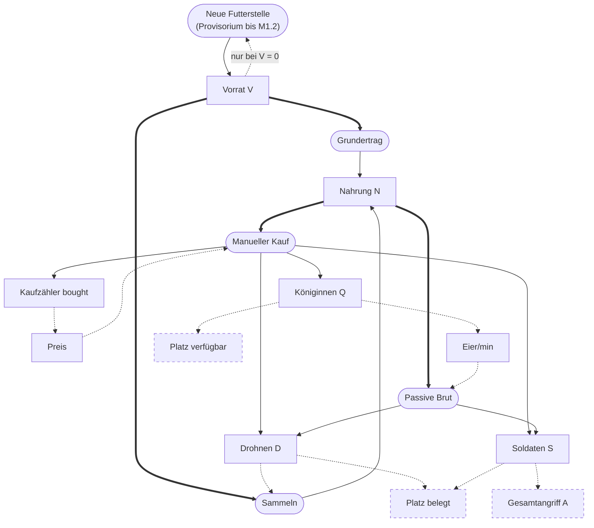

# IdleSwarm · Game-Design-Spezifikation v1

> Stand: 18.11.2026 · Gehört zu: [Projektplan](projektplan.md), [Produktplanung](produktplanung.md), [Technisches Konzept](technisches-konzept.md)

## 1. Geltung

Diese Spezifikation legt Formeln, Startwerte und Kostenkurven für Meilenstein **M1.1 · Kernschleife & Modell** fest. Sie ist die fachliche Vorlage für die Umsetzung in `core/balance`. Für M1.1 hat sie Vorrang vor dem Entwurf im [Technischen Konzept §5.2](technisches-konzept.md#52-modellgrößen-entwurf-für-spätere-größen).

- **Zahlenwerte sind „v1“:** Sie dürfen während M1.1 nachjustiert werden, bis die Bots die [Pacing-Ziele](projektplan.md#35-pacing-ziele-vorläufig) treffen. Formeln und Zielbänder bleiben dabei unverändert.
- **Alle Konstanten sind über Parameter überschreibbar** ([ADR-007](adr/007-modell-seite-echarts-balancing.md)). So testet die Modell-Seite Varianten ohne Codeänderung.
- **Nicht enthalten:** Mechaniken ab M1.2 (siehe [Abschnitt 7](#7-ausblick)).
- **Kein Klick:** Seit [AP 1.1.9](projektplan.md#m11--kernschleife--modell) kennt das Spiel keinen Klick mehr, an seine Stelle tritt der [Grundertrag](#41-grundertrag).

| Thema | Abschnitt | Stories |
|---|---|---|
| Grundertrag und Vorrat | [4.1](#41-grundertrag), [4.5](#45-abgeleitete-werte) | US-01.01–01.03 |
| Sammeln | [4.3](#43-simulationsschritt) | US-01.04 |
| Kauf von Einheiten | [3](#3-kostenkurven), [4.2](#42-manueller-kauf) | US-02.01–02.03 |
| Platz | [4.5](#45-abgeleitete-werte) | US-02.04 |
| Passive Brut | [4.3](#43-simulationsschritt) | US-02.05 |

## 2. Startwerte und Konstanten

### 2.1 Startzustand

| Größe | Startwert |
|---|---|
| Königinnen | 1 |
| Drohnen | 0 |
| Soldaten | 0 |
| Nahrung | 15 |
| DNA | 0 |
| Futterstelle | `vent` (Schlot), Größe 20.000, Vorrat voll (20.000) |
| Kaufzähler `bought` | 0 je Einheitentyp |

### 2.2 Einheiten

| Einheit | Basiskosten `c` | Preisfaktor `w` | Wirkung | Platz |
|---|---|---|---|---|
| Drohne | 10 | 1,07 | sammelt 0,2 Nahrung/s | belegt 1 |
| Soldat | 25 | 1,08 | Angriff 1 | belegt 2 |
| Königin | 60 | 1,20 | 6 Eier/min | bietet 10 |

Jeder Einheitentyp hat eigene Nahrungskosten. Eier/min ist nur eine Rate, keine Ressource.

### 2.3 Konstanten

| Symbol | Konstante | Wert v1 | Bedeutung |
|---|---|---|---|
| `g_0` | `baseFoodRate` | 1,5 | Grundertrag in Nahrung/s; gemessen in AP 1.1.9 ([Abschnitt 6](#6-messwerte-v1)) |
| `c_d` | `droneCost` | 10 | Basiskosten Drohne |
| `w_d` | `droneCostGrowth` | 1,07 | Preisfaktor Drohne |
| `r_d` | `droneCollectRate` | 0,2 | Nahrung/s je Drohne |
| `p_d` | `droneSpace` | 1 | Platzbedarf Drohne |
| `c_s` | `soldierCost` | 25 | Basiskosten Soldat |
| `w_s` | `soldierCostGrowth` | 1,08 | Preisfaktor Soldat |
| `a_s` | `soldierAttack` | 1 | Angriff je Soldat |
| `p_s` | `soldierSpace` | 2 | Platzbedarf Soldat |
| `c_q` | `queenCost` | 60 | Basiskosten Königin |
| `w_q` | `queenCostGrowth` | 1,20 | Preisfaktor Königin |
| `e_q` | `queenEggsPerMin` | 6 | Eier/min je Königin |
| `p_q` | `queenSpace` | 10 | Platzangebot je Königin |
| `a` | `broodDroneShare` | 3/4 | Drohnenanteil der Brut (Drohnen : Soldaten = 3 : 1) |
| – | `startFood` | 15 | Nahrung beim Start |
| – | `startQueens` | 1 | Königinnen beim Start |
| – | `siteSize` | 20.000 | Größe der ersten Futterstelle |

Weitere Symbole: `Q`, `D`, `S` sind die Anzahl Königinnen, Drohnen und Soldaten, `N` die Nahrung, `V` der Vorrat der Futterstelle und `dt` die Schrittdauer in Sekunden. Die Modifikatoren `M_sammeln` und `M_brut` sind bis M1.3 gleich 1.

## 3. Kostenkurven

```
Preis = c · w^n
```

`n` ist die Anzahl bisher **manuell gekaufter** Einheiten dieses Typs (Kaufzähler `bought`). Passive Brut erhöht `n` nicht. Ob der Zähler beim Weiterziehen zurückgesetzt wird, entscheidet M1.2.

| n | Drohne | Soldat | Königin |
|---|---|---|---|
| 0 | 10,00 | 25,00 | 60,00 |
| 1 | 10,70 | 27,00 | 72,00 |
| 5 | 14,03 | 36,73 | 149,30 |
| 10 | 19,67 | 53,97 | 371,50 |
| 20 | 38,70 | 116,52 | 2.300,26 |

Die Tabelle ist auf zwei Stellen gerundet. Gerechnet wird mit dem ungerundeten Preis.

## 4. Formeln

Einheitenzahlen sind intern kontinuierlich (`Num`, Bruchteile erlaubt). Die Anzeige rundet ab.

### Wirkungszusammenhänge

Das Diagramm zeigt, wie die Größen in M1.1 zusammenwirken. Abgerundete Knoten sind Vorgänge, eckige Knoten sind Größen. Konstanten und die Modifikatoren `M_sammeln` und `M_brut` sind nicht eingezeichnet.

| Darstellung | Bedeutung |
|---|---|
| durchgezogener Pfeil | Der Vorgang erhöht die Größe. |
| dicker Pfeil | Der Vorgang verbraucht die Größe. |
| gestrichelter Pfeil | Die Größe bestimmt den Wert oder die Stärke des Ziels oder ist seine Bedingung. |
| gestrichelter Rahmen | Die Größe wirkt in M1.1 auf nichts anderes. |



- **Wachstum:** Der Grundertrag trägt den Start. Danach sammeln Drohnen Nahrung, und Nahrung wird über Kauf und Brut zu neuen Drohnen. Königinnen verstärken diese Schleife über die Eier/min.
- **Konkurrenz:** Kauf und Brut verbrauchen dieselbe Nahrung.
- **Grenze:** Grundertrag und Drohnen leeren denselben Vorrat.
- **Noch ohne Wirkung:** Platz und Angriff werden erst mit dem Weiterziehen und dem Kampf in M1.2 wirksam.

### 4.1 Grundertrag

Die Futterstelle liefert je Sekunde den festen Ertrag `g_0`, unabhängig von der Zahl der Einheiten. Er wird im [Simulationsschritt](#43-simulationsschritt) zusammen mit dem Sammeln der Drohnen verrechnet und vom selben Vorrat abgezogen. Bei leerem Vorrat ist er 0.

Der Grundertrag hat zwei Aufgaben: Er trägt den Spielstart, in dem die Brut der ersten Königin mehr Nahrung braucht als wenige Drohnen liefern. Außerdem bleibt der Schwarm handlungsfähig, wenn er weder Drohnen noch Nahrung hat. Ein Klick oder Tap erzeugt keine Nahrung.

### 4.2 Manueller Kauf

Ein Kauf ist nur möglich, wenn `N ≥ Preis`. Er wird sofort angewendet, nicht erst im nächsten Tick:

```
N -= Preis
Einheit += 1
bought(Einheitentyp) += 1
```

Ein Kauf ergibt genau +1 Einheit. **Platz begrenzt weder Kauf noch Brut**, er wird erst beim Weiterziehen (M1.2) wirksam.

### 4.3 Simulationsschritt

Je Schritt der Dauer `dt` laufen nacheinander (1) Grundertrag und Sammeln und (2) Brut. Der Logik-Takt beträgt 10 Hz, also `dt = 0,1` ([Technisches Konzept §4](technisches-konzept.md#4-simulation)).

**(1) Grundertrag und Sammeln**

```
F = min((g_0 + D · r_d · M_sammeln) · dt, V)
N += F
V -= F
```

**(2) Brut**

```
E   = Q · e_q · M_brut              // Eier/min
e   = E / 60 · dt                   // Eier im Schritt
c̄   = a · c_d + (1 − a) · c_s       // mittlere Kosten, v1: 13,75
h   = min(e, N / c̄)                 // geschlüpft
D  += a · h
S  += (1 − a) · h
N  -= h · c̄
```

- Passive Brut kostet die Basiskosten **ohne Preisfaktor**.
- Das Verhältnis Drohnen : Soldaten ist bis M1.3 fest 3 : 1.
- Königinnen schlüpfen nicht passiv, sie werden nur gekauft.
- Fehlt Nahrung, pausiert die Brut anteilig. Nahrung wird nie negativ.

**Beispiel 1** mit `Q = 1`, `D = 10`, `S = 0`, `N = 5`, `V = 1.000`, `dt = 0,1`:

| Schritt | Rechnung | Ergebnis |
|---|---|---|
| Grundertrag und Sammeln | `F = min((1,5 + 10 · 0,2) · 0,1; 1.000) = 0,35` | `N = 5,35`, `V = 999,65` |
| Eier | `e = 6 / 60 · 0,1 = 0,01` | |
| Geschlüpft | `h = min(0,01; 5,35 / 13,75 ≈ 0,389) = 0,01` | `D = 10,0075`, `S = 0,0025` |
| Kosten | `0,01 · 13,75 = 0,1375` | `N = 5,2125` |

**Beispiel 2** (Nahrung reicht nicht) mit `Q = 1`, `D = 0`, `S = 0`, `N = 0,05`, `V = 0`, `dt = 0,1`: Ohne Vorrat gibt es keinen Grundertrag, also ist `h = min(0,01; 0,05 / 13,75 ≈ 0,00364) ≈ 0,00364`. Es schlüpfen rund 0,00273 Drohnen und 0,00091 Soldaten, danach ist `N = 0`.

### 4.4 Leere Futterstelle (Provisorium bis M1.2)

> **Provisorium:** Diese Regel überbrückt die Zeit, bis es das Weiterziehen gibt. Sie entfällt mit M1.2.

- Bei `V = 0` bringen Grundertrag und Drohnen nichts mehr. Die Brut läuft weiter, solange Nahrung da ist.
- Nur bei leerem Vorrat steht die Aktion **„Neue Futterstelle“** bereit. Sie setzt `V` wieder auf die Größe derselben Futterstelle.
- Einheiten, Nahrung und Kaufzähler bleiben erhalten.
- Auch die Bots nutzen diese Aktion.

### 4.5 Abgeleitete Werte

Diese Werte werden nicht gespeichert, sondern aus dem Zustand berechnet.

| Wert | Formel | Hinweis |
|---|---|---|
| Nahrung/s gesamt | `g_0 + D · r_d · M_sammeln` | 0 bei leerem Vorrat |
| davon Drohnen | `D · r_d · M_sammeln` | 0 bei leerem Vorrat |
| Eier/min | `Q · e_q · M_brut` | |
| Gesamtangriff | `A = S · a_s` | v1: `A = S · 1` |
| Platz verfügbar | `Q · p_q` | v1: `Q · 10` |
| Platz belegt | `D · p_d + S · p_s` | v1: `D · 1 + S · 2`; darf den verfügbaren Platz übersteigen |
| Warnfarbe Platz | `belegt ≥ 0,9 · verfügbar` | US-02.04 |
| Restzeit Futterstelle | `V / (g_0 + D · r_d · M_sammeln)` | auch ohne Drohnen bestimmbar |
| Effekt einer weiteren Königin | `+e_q · M_brut` Eier/min, `+p_q` Platz | Anzeige vor dem Kauf (US-02.03) |

Beispiele: Mit 50 Drohnen und vollem Vorrat beträgt die Restzeit `20.000 / (1,5 + 50 · 0,2) ≈ 1.739 s`, also rund 29 min. Mit `Q = 2`, `D = 15`, `S = 3` sind 21 von 20 Plätzen belegt (105 %).

## 5. Spielstand Version 2

Version 2 ergänzt den Spielstand um zwei Felder:

| Feld | Inhalt |
|---|---|
| `site` | stabile Typ-ID (`type`), `size`, `stock` |
| `bought` | Kaufzähler je Einheitentyp (`queens`, `drones`, `soldiers`) |

Die stabile ID der ersten Futterstelle ist `vent` (Schlot). Wie überall speichert der Spielstand nur die ID, keine Texte ([Technisches Konzept §3.4](technisches-konzept.md#34-zustandsmodell-entwurf)).

**Migration von Version 1:** Seed, RNG-Zustand und Zeiten bleiben erhalten. Futterstelle, Kaufzähler, Ressourcen und Einheiten werden auf die Startwerte aus [Abschnitt 2.1](#21-startzustand) gesetzt.

## 6. Messwerte v1

> **Gemessen** mit dem Headless-Runner (Stand AP 1.1.9, ohne Klick, mit Grundertrag `g_0 = 1,5`). Die Werte v1 bleiben unverändert, das Balancing folgt in AP 1.5.5. Die Zielbänder im [Projektplan §3.5](projektplan.md#35-pacing-ziele-vorläufig) gelten unverändert. **Die Mess-Definitionen unten sind vorläufig, die Entscheidung des Product Owners ist offen.**

**Messaufbau**

- Seed `modell`, `stepMs` 1000, Formeln und Werte wie oben. Die Spiellogik zieht noch keinen Zufall, das Ergebnis hängt also nicht vom Seed ab.
- **Aktiv:** entscheidet jede Sekunde und kauft die Einheit mit der kürzesten Amortisation. Ist diese noch zu teuer, spart er auf sie. Soldaten kauft er nicht.
- **Idle:** schaut alle 5 min vorbei und kauft dann alles Bezahlbare, Königin vor Drohne. Soldaten kauft er nicht.
- Beide lösen bei leerem Vorrat „Neue Futterstelle“ aus: Aktiv bei der nächsten Entscheidung, Idle beim nächsten Besuch.

**Mess-Definitionen (vorläufig, Entscheidung des Product Owners offen)**

- Kauflücken und längste Wartezeit der ersten 30 min werden mit `siteSize: 1e12` gemessen, damit das [Provisorium](#44-leere-futterstelle-provisorium-bis-m12) sie nicht verfälscht. Die Futterstellen werden mit der echten Größe 20.000 gemessen.
- **Längste Wartezeit** (`longestWaitMs`): längste zusammenhängende Strecke der ersten 30 min, in der nach den Entscheidungen des Bots weder Königin noch Drohne bezahlbar ist.
- Das Idle-Ziel „< 5 min“ und die Obergrenze 60 s für Aktiv werden über die längste Wartezeit bewertet, weil sonst Besuchsabstand und bewusstes Sparen die Kauflücke bestimmen.
- **Kauflücke:** Abstand zweier Kaufzeitpunkte; Käufe im selben Moment zählen als einer.
- **Dauer einer Futterstelle:** von ihrem Beginn bis zum leeren Vorrat, ohne die Zeit bis zur Erneuerung.
- Die „Durststrecke ohne neue Option“ wird als längste Strecke ohne Kauf gemessen.

| Kennzahl | Futterstelle | Ziel aktiv | Aktiv | Ziel idle | Idle |
|---|---|---|---|---|---|
| Erster Kauf | 20.000 | < 10 s | 0 s | – | 0 s |
| Längste Wartezeit, erste 30 min | `1e12` | ≤ 60 s | **1 min 49 s** | < 5 min | 1 min 07 s |
| Kauflücken, erste 30 min: Anzahl | `1e12` | – | 91 | – | 6 |
| Kauflücken, erste 30 min: Median | `1e12` | 5–60 s | 7 s | – | 5 min |
| Kauflücken, erste 30 min: Maximum | `1e12` | – | 99 s | – | 5 min |
| Erste Futterstelle | 20.000 | 3–15 min | 10,57 min | 10–60 min | 13,11 min |
| 2. / 3. / 4. Futterstelle | 20.000 | 3–15 min | **2,72 / 1,91 / 1,53 min** | 10–60 min | **2,41 / 1,47 / 1,01 min** |
| Längste Strecke ohne Kauf, 1 h | 20.000 | < 10 min | 3,97 min | < 60 min | 5,00 min |
| Längste Strecke ohne Kauf, 24 h | 20.000 | < 10 min | **187,73 min** | < 60 min | **95,00 min** |
| Längste Strecke ohne Kauf, 24 h | `1e12` | < 10 min | **114,62 min** | < 60 min | 35,00 min |

Fett: außerhalb des Zielbands.

Ergänzend, ohne Zielband: Der Anteil Wartezeit beträgt in den ersten 30 min 15,9 % (Aktiv) und 4,9 % (Idle), jeweils mit `siteSize: 1e12`. Über 24 h mit echter Futterstelle sind es 0,42 % und 59,14 %. Die Nahrungsrate verdoppelt sich im Median alle 448 s (Aktiv) und 460 s (Idle), abgetastet je Minute über 24 h mit echter Futterstelle.

**Vergleich mit dem Stand vor dem Klick-Ausbau (AP 1.1.8):** Die erste Futterstelle dauert bei Aktiv 10,57 statt 9,60 min, bei Idle 13,11 statt 15,50 min. Die längste Wartezeit steigt bei Aktiv von 14,7 s auf 1 min 49 s und sinkt bei Idle von 3 min 15 s auf 1 min 07 s. Die längsten Strecken ohne Kauf über 24 h ändern sich kaum. Die Nahrungsrate verdoppelt sich langsamer (448 statt 225 s bzw. 460 statt 354 s), weil sie nach dem ersten Drohnenkauf mit Grundertrag bei 1,7 statt 0,2 Nahrung/s beginnt.

**Außerhalb der Zielbänder oder nur mit der vorläufigen Definition passend**

- **Längste Wartezeit Aktiv:** Die 1 min 49 s liegen ganz am Spielbeginn (0 bis 109 s). Aktiv kauft dort bei jeder Entscheidung sofort die nächste Drohne, 14 Käufe im Abstand von 14 s bis 5 s. Danach ist jeweils nichts mehr bezahlbar, und nach der vorläufigen Definition zählt die ganze Strecke als eine Wartezeit. Erst als Aktiv auf die erste Königin spart (Kauf bei 116 s), bleibt eine Drohne bezahlbar. Als Kauflücke gemessen ist die längste Pause in dieser Phase 14 s. Die Definition misst hier also eher die Kaufkraft als das Warten.
- **Kauflücken Aktiv:** 35 von 91 Lücken liegen unter 5 s (kürzeste 1 s), 7 über 60 s (63 bis 99 s). In den langen Lücken spart Aktiv auf eine Königin, obwohl eine Drohne bezahlbar ist.
- **Kauflücken Idle:** Alle 6 Lücken betragen genau 5 min, also den Besuchsabstand. Als Kauflücke wäre „< 5 min“ damit nicht erfüllt; die längste Wartezeit liegt im Zielband.
- **Wiederaufgefüllte Futterstellen:** Keine liegt im Zielband (Aktiv 0 von 71.287, längste 2,72 min; Idle 0 von 285, längste 2,41 min). Am Ende von 24 h dauern sie nur noch 0,2 s bzw. 0,4 s.
- **Strecke ohne Kauf über 24 h:** Aktiv verfehlt das Ziel mit und ohne Provisorium. Idle verfehlt es mit echter Futterstelle und hält es nur mit `siteSize: 1e12` ein.
- **Platz:** Er läuft früh und dauerhaft über, siehe unten.

**Auffälligkeiten**

- **Grundertrag trägt den Start:** Bei einer Königin liegt er mit 1,5 Nahrung/s knapp über dem Nahrungsbedarf ihrer Brut (`0,1 · 13,75 = 1,375` Nahrung/s). Ohne Käufe sinkt die Nahrung deshalb nie, sie wächst langsam. Ohne Grundertrag, wie vor AP 1.1.9 ohne Klicks, wäre die Startnahrung nach ca. 10,9 s aufgebraucht.
- **Wiederauffüllen beschleunigt sich selbst:** Der Schwarm bleibt erhalten, die Futterstelle wächst aber nicht mit. Dieser Effekt gehört zum [Provisorium](#44-leere-futterstelle-provisorium-bis-m12) und entfällt mit dem Weiterziehen.
- **Platz läuft früh über:** Die Warnschwelle wird bei Aktiv nach 40 s erreicht, bei Idle nach 1 min 04 s. Die Belegung übersteigt den Platz nach 47 s bzw. 1 min 13 s. Am Ende der ersten Futterstelle sind 758 von 200 Plätzen belegt (379 %, Aktiv) bzw. 706 von 160 (441 %, Idle), nach 30 min 1.391 % bzw. 1.165 %. In M1.1 hat das keine Folgen, für das Weiterziehen in M1.2 aber schon.
- **Späte Käufe werden selten:** Aktiv spart spät im Lauf lange auf die nächste Königin, obwohl Drohnen bezahlbar sind. Daher stammt seine längste Strecke ohne Kauf über 24 h.
- **Die Brut konkurriert mit Käufen:** Eine Königin verbraucht bis zu 1,375 Nahrung/s, das entspricht fast dem ganzen Grundertrag oder dem Ertrag von knapp 7 Drohnen. Idle kauft beim ersten Besuch 7 Königinnen; danach ist der Nettozufluss negativ (−4,8 Nahrung/s), und die Brut pausiert anteilig, bis genug Drohnen geschlüpft sind. Daher stammt seine längste Wartezeit.
- **Soldaten binden Nahrung:** Sie machen ein Viertel der Brut aus, aber rund 45 % ihrer Kosten, und haben in M1.1 noch keine spielerische Wirkung.

## 7. Ausblick

Weiterziehen, Kampf, Verluste, Reichweite, der Futterstellen-Generator und DNA-Belohnungen folgen in M1.2. Pheromone und Genom folgen in M1.3 und lösen dann auch das feste Brutverhältnis und die konstanten Modifikatoren ab.
