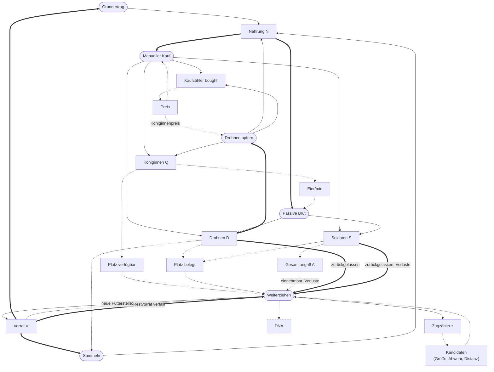
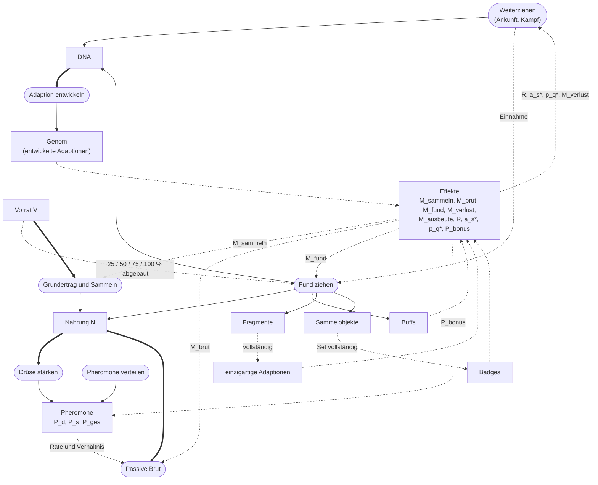

# IdleSwarm · Game-Design-Spezifikation v1

> Stand: 19.11.2026 · Gehört zu: [Projektplan](projektplan.md), [Produktplanung](produktplanung.md), [Technisches Konzept](technisches-konzept.md)

## 1. Geltung

Diese Spezifikation legt Formeln, Startwerte und Kostenkurven für die Meilensteine **M1.1 · Kernschleife & Modell**, **M1.2 · Weiterziehen & Kampf** und **M1.3 · Progression** fest. Sie ist die fachliche Vorlage für die Umsetzung in `balance/domain`. Für M1.1 bis M1.3 hat sie Vorrang vor dem Entwurf im [Technischen Konzept §5.2](technisches-konzept.md#52-modellgrößen-entwurf-für-spätere-größen).

- **Zahlenwerte sind „v1“:** Sie dürfen nachjustiert werden, bis die Bots die [Pacing-Ziele](projektplan.md#35-pacing-ziele-vorläufig) treffen; das Feintuning folgt in AP 1.5.5. Formeln und Zielbänder bleiben dabei unverändert.
- **Alle Konstanten sind über Parameter überschreibbar** ([ADR-007](adr/007-modell-seite-echarts-balancing.md)). So testet die Modell-Seite Varianten ohne Codeänderung.
- **Nicht enthalten:** die Darstellung der Sonar-Karte (AP 1.2.8), die Zyklen-Auswertung der Modell-Seite (AP 1.2.9) und Mechaniken ab M1.4 (siehe [Abschnitt 7](#7-ausblick)). Die Fundchance wird in M1.2 nur erzeugt und angezeigt, gezogen wird erst ab M1.3.
- **Kein Klick:** Seit [AP 1.1.9](projektplan.md#m11--kernschleife--modell) kennt das Spiel keinen Klick mehr, an seine Stelle tritt der [Grundertrag](#41-grundertrag).
- **M1.3 (entschieden mit M1.3):** Die Abschnitte [4.13](#413-effekt-system) bis [4.17](#417-sammlung-und-badges), [5.1](#51-spielstand-version-4), [6.3](#63-bots-ab-m13) und [6.4](#64-abschätzung-m13) sowie die M1.3-Zeilen in [2.1](#21-startzustand) und [2.3](#23-konstanten) legen Formeln, Startwerte, Kostenkurven und Spieldaten für AP 1.3.1–1.3.7 fest. Sie sind mit AP 1.3.1–1.3.7 umgesetzt; wo die Umsetzung eine Lücke mit einer Annahme gefüllt hat, steht diese als „entschieden mit M1.3“ im jeweiligen Abschnitt. Die Messung steht in [6.5](#65-messung-m13). Wie überall sind die Zahlen Werte v1 und dürfen bis AP 1.5.5 nachjustiert werden; jede Zahl ist über `params` überschreibbar ([2.3](#23-konstanten), Parameter je ID).

| Thema | Abschnitt | Stories |
|---|---|---|
| Grundertrag und Vorrat | [4.1](#41-grundertrag), [4.5](#45-abgeleitete-werte) | US-01.01–01.03 |
| Sammeln | [4.3](#43-simulationsschritt) | US-01.04 |
| Kauf von Einheiten | [3](#3-kostenkurven), [4.2](#42-manueller-kauf) | US-02.01–02.03 |
| Platz | [4.5](#45-abgeleitete-werte) | US-02.04 |
| Passive Brut | [4.3](#43-simulationsschritt) | US-02.05 |
| Futterstellen zur Auswahl, sichere Futterstelle | [4.6](#46-futterstellen-generator) | US-04.01, 04.02 |
| Reichweite | [4.7](#47-reichweite-und-sichtbarkeit) | US-04.03 |
| Einnehmbarkeit, Verluste, DNA | [4.8](#48-kampf) | US-04.04, 04.05 |
| Transportkapazität und Priorität | [4.9](#49-transportkapazität) | US-04.06 |
| Drohnen opfern | [4.10](#410-drohnen-opfern) | US-04.07, 04.08 |
| Jederzeit weiterziehen | [4.11](#411-weiterziehen-und-reise) | US-04.09 |
| Strategie und Auto-Weiterziehen | [4.12](#412-strategien-und-auto-weiterziehen) | US-04.10, 04.11 |
| Effekt-System | [4.13](#413-effekt-system) | – |
| Genom und Adaptionen | [4.14](#414-genom-ära-i) | US-05.01–05.04 |
| Pheromone | [4.15](#415-pheromone) | US-03.01–03.03 |
| Funde, einzigartige Adaptionen | [4.16](#416-funde) | US-06.01, 06.02 |
| Sammlung und Badges | [4.17](#417-sammlung-und-badges) | US-06.03, 06.04 |
| Bots, Abschätzung und Messung | [6.3](#63-bots-ab-m13), [6.4](#64-abschätzung-m13), [6.5](#65-messung-m13) | US-10.07, 10.08 |

## 2. Startwerte und Konstanten

### 2.1 Startzustand

| Größe | Startwert |
|---|---|
| Königinnen | 1 |
| Drohnen | 0 |
| Soldaten | 0 |
| Nahrung | 15 |
| DNA | 0 |
| Futterstelle | `vent` (Schlot), Größe 20.000, Vorrat voll (20.000) |
| Kaufzähler `bought` | 0 je Einheitentyp |
| Position | Ursprung `(0, 0)` der Ebene |
| Route | nur die Startfutterstelle |
| Zugzähler `z` | 0 |
| Kandidaten | 6, beim Start erzeugt ([4.6](#46-futterstellen-generator)) |
| Reise | keine |
| Auto-Weiterziehen | aus, Strategie „Ausgewogen“, Schwelle 0 % |
| Mitnahme-Priorität | ausgewogen |
| Pheromone | 3 auf Drohnen, 1 auf Soldaten, 0 gekaufte Drüsenpunkte ([4.15](#415-pheromone)) |
| Genom | nur die Wurzel `root`, keine entwickelte Adaption ([4.14](#414-genom-ära-i)) |
| Funde | Fundzähler 0, nichts gesammelt, keine Buffs; eigener Fund-RNG aus dem Seed ([4.16](#416-funde)) |

Die Startverteilung 3 : 1 der Pheromone ergibt dieselbe Brut wie das feste Verhältnis aus M1.2. Der Spielbeginn bleibt also bis zum ersten Kauf eines Drüsenpunkts, einer Adaption oder bis zum ersten Fund unverändert.

### 2.2 Einheiten

| Einheit | Basiskosten `c` | Preisfaktor `w` | Wirkung | Platz |
|---|---|---|---|---|
| Drohne | 10 | 1,07 | sammelt 0,2 Nahrung/s | belegt 1 |
| Soldat | 25 | 1,08 | Angriff 1 | belegt 2 |
| Königin | 60 | 1,20 | 6 Eier/min | bietet 10 |

Jeder Einheitentyp hat eigene Nahrungskosten. Eier/min ist nur eine Rate, keine Ressource.

### 2.3 Konstanten

| Symbol | Konstante | Wert v1 | Bedeutung |
|---|---|---|---|
| `g_0` | `baseFoodRate` | 1,5 | Grundertrag in Nahrung/s; gemessen in AP 1.1.9 ([Abschnitt 6](#6-messwerte-v1)) |
| `c_d` | `droneCost` | 10 | Basiskosten Drohne |
| `w_d` | `droneCostGrowth` | 1,07 | Preisfaktor Drohne |
| `r_d` | `droneCollectRate` | 0,2 | Nahrung/s je Drohne |
| `p_d` | `droneSpace` | 1 | Platzbedarf Drohne |
| `c_s` | `soldierCost` | 25 | Basiskosten Soldat |
| `w_s` | `soldierCostGrowth` | 1,08 | Preisfaktor Soldat |
| `a_s` | `soldierAttack` | 1 | Angriff je Soldat |
| `p_s` | `soldierSpace` | 2 | Platzbedarf Soldat |
| `c_q` | `queenCost` | 60 | Basiskosten Königin |
| `w_q` | `queenCostGrowth` | 1,20 | Preisfaktor Königin |
| `e_q` | `queenEggsPerMin` | 6 | Eier/min je Königin |
| `p_q` | `queenSpace` | 10 | Platzangebot je Königin |
| `a` | ~~`broodDroneShare`~~ | entfallen (bis M1.2: 3/4) | Drohnenanteil der Brut; seit M1.3 kein Parameter mehr, sondern `a = P_d / P_v` aus der Pheromon-Verteilung ([4.15](#415-pheromone)) |
| – | `startFood` | 15 | Nahrung beim Start |
| – | `startQueens` | 1 | Königinnen beim Start |
| `s_0` | `siteSize` | 20.000 | Größe der ersten Futterstelle und Basis der Größe aller weiteren |
| `R_0` | `baseRange` | 5 | Grundreichweite in Distanzeinheiten |
| `m` | `perceptionMargin` | 1 | Wahrnehmungssaum: so weit über die Reichweite hinaus sind Ziele mit Werten sichtbar |
| `k` | `candidateCount` | 6 | Kandidaten je Erzeugung |
| `d_min` | `candidateMinDistance` | 1 | kleinste Distanz eines Kandidaten |
| `d_max` | `candidateMaxDistance` | 7 | größte Distanz eines Kandidaten |
| `γ_G` | `siteSizeGrowth` | 1,4 | Wachstum der Größe je Weiterzug |
| `β_G` | `siteSizeDistanceBonus` | 0,1 | Größenzuschlag je Distanzeinheit über 1 |
| `b_0` | `siteDefenseBase` | 20 | Basis der Abwehr |
| `γ_B` | `siteDefenseGrowth` | 1,35 | Wachstum der Abwehr je Weiterzug |
| `β_B` | `siteDefenseDistanceBonus` | 0,15 | Abwehrzuschlag je Distanzeinheit über 1 |
| `σ` | `siteSpread` | 0,2 | Streuung des Zufallsfaktors `u` um 1 |
| `d_0` | `dnaBase` | 1 | Basis der DNA-Belohnung |
| `δ` | `dnaExponent` | 0,8 | Exponent der DNA-Belohnung |
| `λ` | `lossFactor` | 0,5 | Verlustfaktor |
| `κ` | `lossExponent` | 2 | Verlustexponent |
| `η_0` | `sacrificeYield` | 0,5 | Ausbeute beim Opfern von Drohnen (Umwandlungsverlust 50 %) |
| `v_min` | `minSacrificeLoss` | 0,1 | Mindest-Umwandlungsverlust; begrenzt die Ausbeute auf höchstens 0,9 |
| `t_r` | `travelSecondsPerDistance` | 10 | Reisedauer in s je Distanzeinheit |
| `ℓ_max` | `balancedMaxLossShare` | 0,25 | höchster erwarteter Verlustanteil für die Strategie „Ausgewogen“ |
| `θ_0` | `defaultAutoThreshold` | 0 | Standard-Schwelle des Auto-Weiterziehens (0 % = leer) |
| `θ_max` | `maxAutoThreshold` | 0,9 | höchste einstellbare Schwelle |
| `T_max` | `maxCatchUpHours` | 24 | Obergrenze des Nachholens in Stunden (Offline-Fortschritt, verborgener Tab, AP 1.5.1); was darüber liegt, verfällt |
| `v_U` | `mapUnlockStockShare` | 0,25 | Anteil der Größe, bis zu dem der Vorrat der aktuellen Futterstelle sinken muss, damit die Umgebung erscheint ([Onboarding, 4.18](#418-onboarding)) |
| – | `siteTypes` | siehe unten | Faktoren, Fundchance und Ziehungsgewicht je Futterstellentyp |

Weitere Symbole: `Q`, `D`, `S` sind die Anzahl Königinnen, Drohnen und Soldaten, `N` die Nahrung, `V` der Vorrat der Futterstelle, `G` ihre Größe, `B` die Abwehr eines Ziels, `P` die aktuelle Position, `R` die aktuelle Reichweite, `z` der Zugzähler und `dt` die Schrittdauer in Sekunden. Die Modifikatoren `M_sammeln`, `M_brut`, `M_verlust` und `M_ausbeute` sind bis M1.2 gleich 1; ab M1.3 füllt sie das [Effekt-System](#413-effekt-system).

**Konstanten für M1.3** (entschieden mit M1.3, Werte v1). Sie kommen zu `BalanceParams` hinzu und sind wie alle Konstanten über `params` überschreibbar.

| Symbol | Konstante | Wert v1 | Bedeutung |
|---|---|---|---|
| `P_d0` | `startPheromoneDrones` | 3 | Pheromonpunkte auf Drohnen beim Start |
| `P_s0` | `startPheromoneSoldiers` | 1 | Pheromonpunkte auf Soldaten beim Start |
| `P_0` | – | 4 | `P_d0 + P_s0`: Startpunkte und Bezugsgröße der Brutrate, `f(P_0) = 1` ([4.15](#415-pheromone)); abgeleitet, kein eigener Parameter |
| `c_P` | `glandCost` | 100 | Basispreis eines Drüsenpunkts in Nahrung |
| `w_P` | `glandCostGrowth` | 2 | Preisfaktor der Drüse |
| `c_G` | `genomeCost` | 8 | DNA-Kosten eines Knotens der Stufe 1 ([4.14](#414-genom-ära-i)) |
| `w_G` | `genomeCostGrowth` | √10 ≈ 3,1623 (exakt `√10`, im Code `Math.sqrt(10)`) | Kostenfaktor je Stufe; Stufen 1–5 kosten 8, 25, 80, 253, 800 DNA |
| `ρ` | `fallenRecycleYield` | 0,5 | Anteil von `c_s`, der je gefallenem Soldat als Nahrung zurückkommt (Autophagie, [4.13](#413-effekt-system)) |
| `n_A` | `findHarvestDraws` | 4 | Abbau-Ziehungen je Futterstelle, je eine bei 25 %, 50 %, 75 % und 100 % abgebautem Vorrat ([4.16](#416-funde)) |
| `σ_F` | `findSpread` | 0,2 | Streuung des Zufallsfaktors `u_F` der Fundmengen um 1 |
| – | Schlüssel je ID | siehe unten | Effektwerte, Fragmentzahlen, Fundgewichte und -mengen, Buffs, Badge-Boni |

- **`broodDroneShare` (`a`) entfällt** (entschieden mit M1.3, Änderung eines v1-Werts): An die Stelle des festen Anteils `a = 3/4` tritt die Pheromon-Verteilung `a = P_d / (P_d + P_s)` ([4.15](#415-pheromone)). Die Startverteilung `P_d0 : P_s0 = 3 : 1` hält den Wert 3/4.

**Parameter je ID** (entschieden mit M1.3; ADR-007 ohne Ausnahme): Jede Zahl der Spieldaten aus [4.14](#414-genom-ära-i), [4.16](#416-funde) und [4.17](#417-sammlung-und-badges) ist ein eigener Schlüssel in `BalanceParams`, flach wie bei den Futterstellentypen (`algalMatFindChance` …), damit die Modell-Seite sie als Zahlen bearbeiten kann. Je Bereich ordnet eine Tabelle jeder ID ihre Schlüssel zu, nach dem Vorbild von `SITE_TYPE_PARAMS` in `balance/domain/formulas.ts`. Spieldaten bleiben nur die Struktur: IDs, Ast, Stufe, Vorgänger, Anker, Effektziel, Operation, Bedingung, Fundorte, Fundart, Zuordnung von Fragment zu Adaption und von Sammelobjekt zu Set.

Benannt wird `<idCamel><Rolle>`, wobei `<idCamel>` die stabile ID in camelCase ist (`cilia-1` → `cilia1`, `sulfur-pearl` → `sulfurPearl`):

| Bereich | Zuordnung | Schlüssel je ID | Beispiel (Wert v1) |
|---|---|---|---|
| reguläre Adaption ([4.14](#414-genom-ära-i)) | `GENOME_NODE_PARAMS` | `<id>Effect`: Betrag bzw. Faktor des Effekts mit Zahl | `cilia1Effect` (0,2), `flagellumEffect` (1,5), `autophagyEffect` (0,4) |
| einzigartige Adaption ([4.14](#414-genom-ära-i)) | `UNIQUE_ADAPTATION_PARAMS` | `<id>Effect`, `<id>Fragments` (benötigte Fragmente) | `sulfurShellEffect` (1), `sulfurShellFragments` (5) |
| Eintrag der Fundtabelle ([4.16](#416-funde)) | `FIND_ENTRY_PARAMS` | `<id>Weight` für jeden Eintrag; dazu für DNA `foreignDnaFactor` (`φ_D`), für Nahrung `nutrientBubbleShare` (`φ_N`), für Buffs `<id>Factor` (`μ_B`) und `<id>Seconds` (`T_B`) | `foreignDnaWeight` (30), `foreignDnaFactor` (1), `nutrientBubbleShare` (0,05), `planktonBloomSeconds` (600), `sulfurPearlWeight` (5), `pumiceWeight` (3) |
| Badge ([4.17](#417-sammlung-und-badges)) | `BADGE_PARAMS` | `<setId>BadgeEffect` | `matRelicsBadgeEffect` (0,05), `whaleRelicsBadgeEffect` (0,95) |
| Futterstellentyp ([2.3](#23-konstanten)) | `SITE_TYPE_PARAMS` (besteht) | `<id>FindChance` (besteht) | `algalMatFindChance` (0,15) |

Ein Effekt ohne Zahl (`unlock fallenRecycling`) hat keinen Schlüssel. Hat eine Quelle künftig mehrere Effekte mit Zahl, bekommt der zweite den Schlüssel `<id>Effect2`. Die Ladeprüfung des Spielstands hängt von keinem dieser Werte ab ([5.1](#51-spielstand-version-4)).

**Futterstellentypen der Ära I** (`siteTypes`, stabile IDs):

| ID | Name | Größe× `f_G` | Abwehr× `f_B` | Fundchance | Gewicht `g` |
|---|---|---|---|---|---|
| `algal-mat` | Algenmatte | 0,5 | 0 | 15 % | 1 |
| `vent` | Schlot | 1 | 1 | 20 % | 1 |
| `bacterial-mat` | Bakterienrasen | 1,5 | 2,5 | 25 % | 1 |
| `methane-seep` | Methanquelle | 2,5 | 2 | 30 % | 1 |
| `whale-fall` | Walsturz | 3 | 3 | 40 % | 1 |

`vent` ist die bestehende ID der ersten Futterstelle. Die Reihenfolge der Tabelle ist die Reihenfolge der gewichteten Ziehung ([4.6](#46-futterstellen-generator)). Das Gewicht ist vorläufig: Alle Typen sind gleich wahrscheinlich.

**Fundchance ab M1.3** (entschieden mit M1.3, Änderung eines v1-Werts): Die Fundchance gilt ab M1.3 **je Ziehung**, und je Futterstelle wird bis zu fünfmal gezogen ([4.16](#416-funde)). Mit den Werten aus M1.2 käme ein Schwarm, der nur Algenmatten wählt, in der ersten Stunde auf rund 2 Funde und kaum DNA ([6.4](#64-abschätzung-m13)). Deshalb wurden sie erhöht:

| ID | Fundchance bis M1.2 | Fundchance ab M1.3 | erwartete Funde je Futterstelle (5 Ziehungen) |
|---|---|---|---|
| `algal-mat` | 5 % | 15 % | 0,75 |
| `vent` | 10 % | 20 % | 1,0 |
| `bacterial-mat` | 15 % | 25 % | 1,25 |
| `methane-seep` | 20 % | 30 % | 1,5 |
| `whale-fall` | 30 % | 40 % | 2,0 |

## 3. Kostenkurven

```
Preis = c · w^n
```

`n` ist die Anzahl bisher **manuell gekaufter** Einheiten dieses Typs (Kaufzähler `bought`). Passive Brut erhöht `n` nicht, die Umwandlung von Drohnen in eine Königin schon ([4.10](#410-drohnen-opfern)). Der Zähler bleibt beim Weiterziehen für alle Einheitentypen erhalten ([4.11](#411-weiterziehen-und-reise)).

| n | Drohne | Soldat | Königin |
|---|---|---|---|
| 0 | 10,00 | 25,00 | 60,00 |
| 1 | 10,70 | 27,00 | 72,00 |
| 5 | 14,03 | 36,73 | 149,30 |
| 10 | 19,67 | 53,97 | 371,50 |
| 20 | 38,70 | 116,52 | 2.300,26 |

Die Tabelle ist auf zwei Stellen gerundet. Gerechnet wird mit dem ungerundeten Preis.

## 4. Formeln

Einheitenzahlen sind intern kontinuierlich (`Num`, Bruchteile erlaubt). Die Anzeige rundet ab.

### Wirkungszusammenhänge

Das Diagramm zeigt, wie die Größen in M1.2 zusammenwirken. Abgerundete Knoten sind Vorgänge, eckige Knoten sind Größen. Konstanten, Modifikatoren, die Reise und die Einstellungen (Strategie, Schwelle, Priorität) sind nicht eingezeichnet.

| Darstellung | Bedeutung |
|---|---|
| durchgezogener Pfeil | Der Vorgang erhöht die Größe. |
| dicker Pfeil | Der Vorgang verbraucht die Größe. |
| gestrichelter Pfeil | Die Größe bestimmt den Wert oder die Stärke des Ziels oder ist seine Bedingung. |
| gestrichelter Rahmen | Die Größe wirkt in M1.2 auf nichts anderes. |



- **Wachstum:** Der Grundertrag trägt den Start. Danach sammeln Drohnen Nahrung, und Nahrung wird über Kauf und Brut zu neuen Drohnen. Königinnen verstärken diese Schleife über die Eier/min.
- **Konkurrenz:** Kauf und Brut verbrauchen dieselbe Nahrung.
- **Grenze:** Grundertrag und Drohnen leeren denselben Vorrat. Ist er leer oder lohnt ein anderes Ziel, zieht der Schwarm weiter.
- **Weiterziehen:** Platz entscheidet, wer mitkommt; Angriff entscheidet, welches Ziel einnehmbar ist und wie viele Soldaten fallen. Jeder Weiterzug erhöht `z` und damit Größe und Abwehr der nächsten Kandidaten.
- **Noch ohne Wirkung:** DNA wird ab M1.2 gesammelt und erst mit dem Genom in M1.3 ausgegeben. Ab M1.3 bezahlt sie Adaptionen; wie Genom, Pheromone und Funde in diese Schleife eingreifen, zeigt das Diagramm in [4.13](#413-effekt-system).

### 4.1 Grundertrag

Die Futterstelle liefert je Sekunde den festen Ertrag `g_0`, unabhängig von der Zahl der Einheiten. Er wird im [Simulationsschritt](#43-simulationsschritt) zusammen mit dem Sammeln der Drohnen verrechnet und vom selben Vorrat abgezogen. Bei leerem Vorrat und während einer Reise ist er 0.

Der Grundertrag hat zwei Aufgaben: Er trägt den Spielstart, in dem die Brut der ersten Königin mehr Nahrung braucht als wenige Drohnen liefern. Außerdem bleibt der Schwarm handlungsfähig, wenn er weder Drohnen noch Nahrung hat. Ein Klick oder Tap erzeugt keine Nahrung.

### 4.2 Manueller Kauf

Ein Kauf ist nur möglich, wenn `N ≥ Preis`. Er wird sofort angewendet, nicht erst im nächsten Tick, auch während einer Reise:

```
N -= Preis
Einheit += 1
bought(Einheitentyp) += 1
```

Ein Kauf ergibt genau +1 Einheit. **Platz begrenzt weder Kauf noch Brut**, er wirkt erst beim Aufbruch ([4.9](#49-transportkapazität)).

### 4.3 Simulationsschritt

Je Schritt der Dauer `dt` laufen nacheinander (0) Reise, (1) Grundertrag und Sammeln, (2) Brut, (3) Auto-Weiterziehen und (4) Freischaltungen des Onboardings ([4.18](#418-onboarding), seit M1.5). Der Logik-Takt beträgt 10 Hz, also `dt = 0,1` ([Technisches Konzept §4](technisches-konzept.md#4-simulation)).

**(0) Reise:** Nur während einer Reise; die Restdauer sinkt um `dt`, bei 0 kommt der Schwarm an ([4.11](#411-weiterziehen-und-reise)). Endet die Reise im Schritt, wird er an der Ankunft geteilt:

- **Reiseteil** (bis zur Ankunft): Grundertrag und Sammeln ruhen, die Brut (2) läuft. Sie läuft vor dem Kampf, unterwegs geschlüpfte Soldaten kämpfen also mit.
- **Ankunft:** Kampf, DNA, neue Futterstelle und neue Kandidaten ([4.11](#411-weiterziehen-und-reise)).
- **Rest des Schritts** (nach der Ankunft): läuft wie ein Schritt ohne Reise, also mit (1) und (2) an der neuen Futterstelle.

So hängt das Ergebnis nicht von der Schrittweite ab, und die Ankunft liegt exakt. Seit M1.3 teilt `step` einen Schritt außerdem an jeder Abbau-Schwelle der Funde und an jedem Ablauf eines Buffs und zieht dort die Funde ([4.16](#416-funde)).

**(1) Grundertrag und Sammeln:** Entfällt, solange eine Reise läuft, also auch im Reiseteil des Ankunftsschritts.

```
F = min((g_0 + D · r_d · M_sammeln) · dt, V)
N += F
V -= F
```

**(2) Brut**

```
E   = Q · e_q · M_brut              // Eier/min
e   = E / 60 · dt                   // Eier im Schritt
c̄   = a · c_d + (1 − a) · c_s       // mittlere Kosten, v1: 13,75
h   = min(e, N / c̄)                 // geschlüpft
D  += a · h
S  += (1 − a) · h
N  -= h · c̄
```

- Passive Brut kostet die Basiskosten **ohne Preisfaktor**.
- Das Verhältnis Drohnen : Soldaten ist bis M1.3 fest 3 : 1. Ab M1.3 bestimmen die Pheromone Brutrate und Verhältnis ([4.15](#415-pheromone)).
- Königinnen schlüpfen nicht passiv, sie werden nur gekauft oder aus Drohnen umgewandelt.
- Fehlt Nahrung, pausiert die Brut anteilig. Nahrung wird nie negativ.
- Die Brut läuft auch während einer Reise.

**(3) Auto-Weiterziehen:** Prüft am Ende des Schritts den Auslöser ([4.12](#412-strategien-und-auto-weiterziehen)).

**(4) Onboarding:** Schaltet am Ende des Schritts frei, was der Zustand erreicht hat ([4.18](#418-onboarding)); ändert keine Spielwerte.

**Beispiel 1** mit `Q = 1`, `D = 10`, `S = 0`, `N = 5`, `V = 1.000`, `dt = 0,1`, ohne Reise:

| Schritt | Rechnung | Ergebnis |
|---|---|---|
| Grundertrag und Sammeln | `F = min((1,5 + 10 · 0,2) · 0,1; 1.000) = 0,35` | `N = 5,35`, `V = 999,65` |
| Eier | `e = 6 / 60 · 0,1 = 0,01` | |
| Geschlüpft | `h = min(0,01; 5,35 / 13,75 ≈ 0,389) = 0,01` | `D = 10,0075`, `S = 0,0025` |
| Kosten | `0,01 · 13,75 = 0,1375` | `N = 5,2125` |

**Beispiel 2** (Nahrung reicht nicht) mit `Q = 1`, `D = 0`, `S = 0`, `N = 0,05`, `V = 0`, `dt = 0,1`: Ohne Vorrat gibt es keinen Grundertrag, also ist `h = min(0,01; 0,05 / 13,75 ≈ 0,00364) ≈ 0,00364`. Es schlüpfen rund 0,00273 Drohnen und 0,00091 Soldaten, danach ist `N = 0`.

### 4.4 Leere Futterstelle (Provisorium bis M1.2)

> **Entfallen mit M1.2:** An die Stelle dieser Regel und der Aktion „Neue Futterstelle“ tritt das [Weiterziehen](#411-weiterziehen-und-reise). Der Abschnitt bleibt stehen, weil die [Messung M1.1](#62-messung-m11-historisch) mit diesem Provisorium gemessen wurde.

Bis M1.1 galt:

- Bei `V = 0` brachten Grundertrag und Drohnen nichts mehr. Die Brut lief weiter, solange Nahrung da war.
- Nur bei leerem Vorrat stand die Aktion **„Neue Futterstelle“** bereit. Sie setzte `V` wieder auf die Größe derselben Futterstelle.
- Einheiten, Nahrung und Kaufzähler blieben erhalten.
- Auch die Bots nutzten diese Aktion.

### 4.5 Abgeleitete Werte

Diese Werte werden nicht gespeichert, sondern aus dem Zustand berechnet.

| Wert | Formel | Hinweis |
|---|---|---|
| Nahrung/s gesamt | `g_0 + D · r_d · M_sammeln` | 0 bei leerem Vorrat und während einer Reise |
| davon Drohnen | `D · r_d · M_sammeln` | 0 bei leerem Vorrat und während einer Reise |
| Eier/min | `Q · e_q · M_brut` | |
| Gesamtangriff | `A = S · a_s` | v1: `A = S · 1` |
| Platz verfügbar | `C = Q · p_q` | v1: `Q · 10` |
| Platz belegt | `O = D · p_d + S · p_s` | v1: `D · 1 + S · 2`; darf den verfügbaren Platz übersteigen |
| Warnfarbe Platz | `belegt ≥ 0,9 · verfügbar` | US-02.04 |
| Restzeit Futterstelle | `V / (g_0 + D · r_d · M_sammeln)` | auch ohne Drohnen bestimmbar |
| Effekt einer weiteren Königin | `+e_q · M_brut` Eier/min, `+p_q` Platz | Anzeige vor dem Kauf (US-02.03) |
| Reichweite | `R = R_0` | v1: 5; ab M1.3 durch Adaptionen erhöht ([4.13](#413-effekt-system)) |
| Distanz eines Kandidaten | `d = ‖Position − P‖` | euklidisch in der Ebene |
| Status eines Kandidaten | [4.7](#47-reichweite-und-sichtbarkeit) | in Reichweite, außer Reichweite, unerforscht |
| Mitkommende Einheiten | `D'`, `S'` aus [4.9](#49-transportkapazität) | gleich `D`, `S` bei `O ≤ C` |
| Zurückgelassene Einheiten | `D − D'`, `S − S'` | Anzeige vor dem Aufbruch (US-04.06) |
| Angriff nach Transport | `A' = S' · a_s` | gleich `A` bei `O ≤ C` |
| Einnehmbar | `A' ≥ B` | Urteil „einnehmbar“ oder „zu stark“ (US-04.04) |
| Erwartete Verluste | `L` aus [4.8](#48-kampf) mit `S'` und `A'` | 0 bei `B = 0` |
| Erwarteter Verlustanteil | `L / S'` | 0 bei `L = 0` |
| DNA-Belohnung | `d_0 · B^δ` | 0 bei `B = 0` |
| Fundchance | aus der Typtabelle ([2.3](#23-konstanten)) | nur Anzeige, gezogen ab M1.3 ([4.16](#416-funde)) |
| Reisedauer | `d · t_r` | v1: 10 s je Distanzeinheit |
| Ausbeute beim Opfern | `η · c_d` Nahrung je Drohne | v1: 5; Umwandlungsverlust `1 − η` = 50 % |
| Drohnen je Königin | `Preis_Königin / (η · c_d)` | v1 beim Start: 12 |
| Ziel der Strategie | [4.12](#412-strategien-und-auto-weiterziehen) | Markierung auf der Karte (US-04.10) |
| Auslösevorrat Auto | `θ · G` | |

Beispiele: Mit 50 Drohnen und vollem Vorrat beträgt die Restzeit `20.000 / (1,5 + 50 · 0,2) ≈ 1.739 s`, also rund 29 min. Mit `Q = 2`, `D = 15`, `S = 3` sind 21 von 20 Plätzen belegt (105 %).

### 4.6 Futterstellen-Generator

Beim Spielstart und nach jeder Ankunft erzeugt der Generator `k = 6` Kandidaten um die aktuelle Position `P`. Positionen liegen in einer Ebene und werden in Distanzeinheiten gemessen. `r` steht für die jeweils nächste Zufallszahl in `[0, 1)` aus dem seeded RNG im Zustand ([ADR-003](adr/003-fester-logik-takt-seeded-rng.md)); gleicher RNG-Zustand und gleiches `z` ergeben dieselben Kandidaten.

```
für i = 1 … k, je Kandidat genau fünf Ziehungen in dieser Reihenfolge:
  Typ    = gewichtete Ziehung über die Typtabelle (Gewicht g)
  φ      = 2π · r                                   // Winkel in [0, 2π)
  d      = d_min + (d_max − d_min) · r              // Distanz, v1 in [1, 7)
  u_G    = 1 − σ + 2σ · r                           // v1 in [0,8; 1,2)
  u_B    = 1 − σ + 2σ · r
  Position = P + d · (cos φ, sin φ)
  G      = s_0 · γ_G^(z+1) · f_G(Typ) · (1 + β_G · (d − 1)) · u_G
  B      = round(b_0 · γ_B^z · f_B(Typ) · (1 + β_B · (d − 1)) · u_B)
```

- **Gewichtete Ziehung:** Der Typ ist der erste in der Reihenfolge der Typtabelle, bei dem die aufsummierten Gewichte `r · Σg` übersteigen.
- **Größe** ist der volle Vorrat bei Ankunft und bleibt ungerundet. **Abwehr** wird kaufmännisch auf eine ganze Zahl gerundet.
- `z` ist die Zahl der bisherigen Weiterzüge. Die Kandidaten beim Spielstart entstehen mit `z = 0`, nach der ersten Ankunft mit `z = 1`. So wächst die Größe von Futterstelle zu Futterstelle um `γ_G`, und schon die ersten Kandidaten sind größer als die Startfutterstelle.
- **DNA-Belohnung** und **Fundchance** werden nicht erzeugt, sondern aus Abwehr bzw. Typ abgeleitet ([4.5](#45-abgeleitete-werte)).
- Der Generator verbraucht immer `5 · k` Zufallszahlen, auch wenn die Garantie unten greift.

**Garantie einer sicheren Futterstelle (US-04.02):** Nach der Ziehung muss mindestens eine Algenmatte in Reichweite liegen (`d ≤ R` mit der Reichweite zum Zeitpunkt der Erzeugung). Nur die Algenmatte hat Abwehr 0. Fehlt sie, wird genau ein Kandidat ersetzt:

1. Gibt es Kandidaten in Reichweite, wird der nächstgelegene von ihnen ersetzt.
2. Sonst wird der nächstgelegene Kandidat überhaupt ersetzt, und seine Distanz wird auf `R` gesetzt; der Winkel bleibt.
3. Bei gleicher Distanz entscheidet der kleinere Index.

Der Ersatz wird zur Algenmatte: Typ `algal-mat`, Größe mit derselben Formel, demselben `u_G` und der ggf. neuen Distanz, Abwehr 0. Die Algenmatte bringt keine DNA und wegen `f_G = 0,5` wenig Nahrung. Weil die Reichweite nur steigen kann, bleibt die Garantie bis zur nächsten Erzeugung erhalten.

**Beispiel 3** (Kandidaten beim Spielstart, `z = 0`, `P = (0, 0)`, `R = 5`). Die Ziehungen sind so gewählt, dass die Rechnung übersichtlich bleibt:

| # | Typ | `d` | `u_G` | `u_B` | Größe `G` | Abwehr `B` | DNA | Status |
|---|---|---|---|---|---|---|---|---|
| K1 | `vent` | 3 | 0,9 | 1,0 | 30.240 | 26 | 13,55 | in Reichweite |
| K2 | `bacterial-mat` | 3 | 1,1 | 0,8 | 55.440 | 52 | 23,59 | in Reichweite |
| K3 | `algal-mat` | 2 | 1,1 | 1,0 | 16.940 | 0 | 0 | in Reichweite |
| K4 | `vent` | 1 | 1,0 | 1,0 | 28.000 | 20 | 10,99 | in Reichweite |
| K5 | `whale-fall` | 5,8 | 1,0 | 1,0 | 124.320 | 103 | 40,76 | außer Reichweite |
| K6 | `methane-seep` | 6,5 | 1,0 | 1,0 | 108.500 | 73 | 30,95 | unerforscht |

Rechnung für K1: `G = 20.000 · 1,4¹ · 1 · (1 + 0,1 · 2) · 0,9 = 30.240`, `B = round(20 · 1,35⁰ · 1 · (1 + 0,15 · 2) · 1,0) = 26`, DNA `= 26^0,8 ≈ 13,55`. Für K5: `G = 20.000 · 1,4 · 3 · 1,48 = 124.320`, `B = round(20 · 3 · 1,72) = round(103,2) = 103`.

Wäre K3 keine Algenmatte, griffe die Garantie: Der nächstgelegene Kandidat in Reichweite ist K4 (`d = 1`). Er würde zur Algenmatte mit `G = 20.000 · 1,4 · 0,5 · 1 · 1,0 = 14.000` und `B = 0`.

### 4.7 Reichweite und Sichtbarkeit

Der Status eines Kandidaten wird aus seiner Distanz und der aktuellen Reichweite abgeleitet, nicht gespeichert. Steigt die Reichweite (z. B. durch die Adaption „Chemotaxis“ ab M1.3), sind Ziele sofort aufgedeckt (US-04.03).

```
d = ‖Position − P‖
R = R_0                        // v1: 5; ab M1.3 mit Adaptionen
```

| Bedingung | Status | Anzeige | wählbar |
|---|---|---|---|
| `d ≤ R` | in Reichweite | alle Werte | ja, wenn einnehmbar ([4.8](#48-kampf)) |
| `R < d ≤ R + m` | außer Reichweite | alle Werte | nein |
| `d > R + m` | unerforscht | nur „?“ | nein |

**Beispiel:** Mit `R = 5` und `m = 1` liegen in Beispiel 3 K1 bis K4 in Reichweite, K5 (`d = 5,8`) ist außer Reichweite, K6 (`d = 6,5`) ist unerforscht. Mit `R = 6` wäre K5 wählbar (sofern einnehmbar) und K6 außer Reichweite, aber sichtbar.

**Lesart „wählbar“ (entschieden mit M1.2):** Ziele außer Reichweite kann der Spieler ansehen, aber nicht ansteuern. Das Detailpanel zeigt sie mit allen Werten, „Aufbrechen“ ist gesperrt und nennt den Grund. Unerforschte Ziele sind ebenso auswählbar, zeigen aber nur „?“.

### 4.8 Kampf

Der Kampf ist binär: Ein Ziel ist einnehmbar, wenn der Angriff seine Abwehr erreicht. Sonst ist kein Aufbruch dorthin möglich.

```
A   = S · a_s
einnehmbar  ⇔  A ≥ B

L   = 0                                  wenn B = 0 (auch bei A = 0)
L   = S · λ · (B / A)^κ · M_verlust      wenn 0 < B ≤ A

DNA = d_0 · B^δ                          // 0 bei B = 0
```

- Weil bei einnehmbaren Zielen `B / A ≤ 1` gilt, fällt mit `λ = 0,5` und `M_verlust = 1` höchstens die Hälfte der Soldaten. Je überlegener der Angriff, desto geringer die Verluste.
- Vor dem Aufbruch werden Einnehmbarkeit und erwartete Verluste mit den mitkommenden Soldaten `S'` und `A' = S' · a_s` berechnet ([4.9](#49-transportkapazität)), damit das Urteil auch nach dem Zurücklassen gilt.
- Gekämpft wird bei der Ankunft mit den dann vorhandenen Soldaten. Unterwegs kann `A` nur steigen (Brut, Käufe), das Ziel bleibt also einnehmbar, und die Verluste sind höchstens so hoch wie angezeigt.
- Die DNA wird bei der Ankunft gutgeschrieben (US-04.05).

**Beispiel 4** (Einnahme) mit `S = 34`, also `A = 34`, gegen K1 mit `B = 26`: `34 ≥ 26`, also einnehmbar. `L = 34 · 0,5 · (26 / 34)² = 17 · 0,5848 ≈ 9,94` Soldaten fallen (Verlustanteil 29,2 %), danach bleiben `S ≈ 24,06`. Gutgeschrieben werden `26^0,8 ≈ 13,55` DNA. K2 mit `B = 52` ist zu stark: `34 < 52`, kein Aufbruch.

### 4.9 Transportkapazität

Beim Aufbruch kommen nur so viele Drohnen und Soldaten mit, wie Platz da ist. Königinnen kommen immer mit und belegen keinen Platz.

```
C = Q · p_q                              // Platz
O = D · p_d + S · p_s                    // Belegung

O ≤ C:            D' = D,  S' = S
O > C, je nach Mitnahme-Priorität:
  Drohnen zuerst:   D' = min(D, C / p_d),   S' = min(S, (C − D' · p_d) / p_s)
  Soldaten zuerst:  S' = min(S, C / p_s),   D' = min(D, (C − S' · p_s) / p_d)
  ausgewogen:       D' = D · C / O,         S' = S · C / O

zurückgelassen:   D − D',  S − S'        // gehen ohne Rückerstattung verloren
```

| ID | Priorität | Wirkung |
|---|---|---|
| `drones-first` | Drohnen zuerst | erst Drohnen, der restliche Platz für Soldaten |
| `soldiers-first` | Soldaten zuerst | erst Soldaten, der restliche Platz für Drohnen |
| `balanced` | ausgewogen (Standard) | beide Typen mit demselben Anteil `C / O` |

Vor dem Aufbruch wird angezeigt, wie viele Einheiten zurückbleiben (US-04.06). Wer mehr mitnehmen will, kauft vorher Königinnen oder wandelt Drohnen in Königinnen um ([4.10](#410-drohnen-opfern)).

**Beispiel 5** mit `Q = 20`, `D = 500`, `S = 130`: `C = 200`, `O = 500 + 260 = 760`, also reicht der Platz nicht.

| Priorität | mitkommend `D'` / `S'` | zurückgelassen Drohnen / Soldaten | `A'` |
|---|---|---|---|
| ausgewogen | `500 · 200/760 ≈ 131,58` / `130 · 200/760 ≈ 34,21` | ≈ 368,42 / ≈ 95,79 | ≈ 34,21 |
| Drohnen zuerst | 200 / 0 | 300 / 130 | 0 |
| Soldaten zuerst | 0 / 100 | 500 / 30 | 100 |

Mit „ausgewogen“ ist K1 aus Beispiel 3 einnehmbar (`34,21 ≥ 26`); erwartet fallen `34,21 · 0,5 · (26 / 34,21)² ≈ 9,88` Soldaten. Mit „Drohnen zuerst“ bleibt nur die Algenmatte K3 einnehmbar.

### 4.10 Drohnen opfern

Drohnen lassen sich jederzeit mit Verlust umwandeln, auch während einer Reise. So kommt der Spieler aus der Lage heraus, dass ihm Soldaten oder Platz fehlen.

```
η = min(η_0 · M_ausbeute, 1 − v_min)     // Ausbeute, v1: 0,5; höchstens 0,9

Drohnen → Nahrung (0 < n ≤ D):
  D -= n
  N += n · η · c_d

Drohnen → Königin (nur wenn D ≥ k_q):
  k_q = Preis_Königin / (η · c_d)       // aktueller Preis mit Preisfaktor
  D -= k_q
  Q += 1
  bought(queens) += 1
```

- Der Umwandlungsverlust `1 − η` wird vor dem Opfern angezeigt. Adaptionen (ab M1.3) erhöhen die Ausbeute über `M_ausbeute`, aber der Verlust sinkt nie unter `v_min` (US-04.07).
- Die Umwandlung in eine Königin ist ein Kauf mit Drohnen statt Nahrung und erhöht den Kaufzähler. Gedacht ist sie für den Aufbruch-Dialog (US-04.08), möglich ist sie jederzeit.
- Bewertet wird zum Basispreis `c_d` einer Drohne, nicht zum aktuellen Kaufpreis.

**Beispiel 6:** 10 Drohnen ergeben `10 · 0,5 · 10 = 50` Nahrung; 50 Nahrung gehen verloren. Eine Königin kostet beim Start `60 / (0,5 · 10) = 12` Drohnen, nach fünf Königinnenkäufen `149,30 / 5 ≈ 29,86` Drohnen.

### 4.11 Weiterziehen und Reise

Der Schwarm kann jederzeit zu jedem einnehmbaren Ziel in Reichweite aufbrechen, nur nicht während einer Reise (US-04.09). Der Aufbruch ist ein Kommando und wird sofort angewendet; das Auto-Weiterziehen löst denselben Ablauf aus ([4.12](#412-strategien-und-auto-weiterziehen)).

**Aufbruch** (Bedingungen: keine Reise, Ziel in Reichweite, `A' ≥ B`):

```
D, S  = D', S'                           // Transport, Zurückgelassene gehen verloren
V     = 0                                // Restvorrat verfällt
Reise = { Ziel: Kandidat, Restdauer: d · t_r }
```

Die Oberfläche weist vorher darauf hin, dass der Restvorrat verfällt und wie viele Einheiten zurückbleiben.

**Unterwegs:** Die Restdauer sinkt je Schritt um `dt`. Grundertrag und Sammeln ruhen, die Brut läuft weiter und verbraucht Nahrung. Manuelle Käufe und das Opfern von Drohnen sind möglich, ein weiterer Aufbruch nicht. Die Kandidaten bleiben bis zur Ankunft stehen.

**Ankunft** (Restdauer ≤ 0):

```
S    -= L                                // Kampf mit S und A bei Ankunft (4.8)
DNA  += d_0 · B^δ
Futterstelle = { Typ, G, Vorrat = G }    // voller Vorrat
P     = Position des Ziels; Route += Ziel
z    += 1
Kandidaten = Generator(P, z)             // 4.6
Reise = keine
```

- **Bleibt erhalten:** Nahrung, Königinnen, die Kaufzähler `bought` für alle Einheitentypen und die Einstellungen.
- Die Reise rechnet in Spielzeit und läuft deshalb auch im Offline-Fortschritt weiter. Jeder Schritt wird an der Ankunft geteilt ([4.3](#43-simulationsschritt)); der Headless-Runner teilt seine Schritte zusätzlich am vorhergesagten Auslöser des Auto-Weiterziehens ([Technisches Konzept §5.3](technisches-konzept.md#53-headless-runner-und-bots)).

**Ereignisse fürs Log** (Codes mit Daten, die Texte setzt die Oberfläche):

| Code | Daten |
|---|---|
| `departed` | Zieltyp, Distanz, zurückgelassene Drohnen und Soldaten, verfallener Vorrat, Auslöser `manual` oder `auto` |
| `arrived` | Typ der neuen Futterstelle, Verluste an Soldaten, gutgeschriebene DNA |
| `siteDepleted` | Typ der Futterstelle, deren Vorrat im Schritt auf 0 gefallen ist |

**Beispiel 7:** Ein Schwarm mit `Q = 7`, `D = 0`, `S = 34` und `N = 300` bricht zu K1 auf (`d = 3`, `B = 26`). Mit `C = 70` und `O = 68` passen alle mit, also `S' = 34`, `A' = 34`, und die erwarteten Verluste sind wie in Beispiel 4 rund 9,94. Die Reise dauert `3 · 10 = 30 s`.

| Schritt | Rechnung | Ergebnis |
|---|---|---|
| Eier unterwegs | `7 · 6 / 60 · 30 = 21` | |
| Geschlüpft | `h = min(21; 300 / 13,75 ≈ 21,82) = 21`, kein Sammeln | `D = 15,75`, `S = 34 + 5,25 = 39,25` |
| Brutkosten | `21 · 13,75 = 288,75` | `N = 11,25` |
| Kampf bei Ankunft | `L = 39,25 · 0,5 · (26 / 39,25)² ≈ 8,61` | `S ≈ 30,64` |

Die Verluste liegen unter den angezeigten 9,94, weil unterwegs Soldaten geschlüpft sind. Der Schwarm erhält 13,55 DNA, steht an einem Schlot mit 30.240 Vorrat, und es entstehen neue Kandidaten mit `z = 1`.

### 4.12 Strategien und Auto-Weiterziehen

Eine Strategie wählt unter den **einnehmbaren Zielen in Reichweite** genau eines aus. Das Ziel wird auf der Karte markiert (US-04.10) und vom Auto-Weiterziehen angesteuert.

| ID | Strategie | Hauptkriterium | bei Gleichstand zuerst |
|---|---|---|---|
| `least-resistance` | Geringster Widerstand | geringste erwartete Verluste `L` | größerer Vorrat `G` |
| `balanced` | Ausgewogen (Standard) | größter Vorrat `G` unter den Zielen mit `L / S' ≤ ℓ_max` | geringere erwartete Verluste `L` |
| `battle-hardened` | Kampfgehärtet | größte DNA-Belohnung | größerer Vorrat `G` |

- **Gleichstand:** Danach entscheidet die geringere Distanz, zuletzt der kleinere Index in der Kandidatenliste. Die Wahl ist damit deterministisch.
- **Rückfall:** Findet die Strategie kein Ziel, wählt der Schwarm die sichere Futterstelle (Abwehr 0) in Reichweite, unter mehreren die mit dem größeren Vorrat, dann wie oben. Mit der Garantie aus [4.6](#46-futterstellen-generator) findet jede Strategie mindestens die Algenmatte; der Rückfall sichert nur abweichende Parameter ab.

**Auto-Weiterziehen** (US-04.11) ist ein- und ausschaltbar und in einem neuen Spiel ausgeschaltet. Es wird in Schritt (3) jedes [Simulationsschritts](#43-simulationsschritt) geprüft, damit es auch im Offline-Fortschritt wirkt:

```
Auslöser:  Auto an  ∧  keine Reise  ∧  V ≤ θ · G
θ ∈ [0; θ_max], Standard θ_0 = 0        // 0 % = leer, höchstens 90 %
→ Aufbruch zum Ziel der Strategie, Auslöser auto
```

- **Eingabe:** Die Schwelle wird in ganzen Prozent eingegeben (0 bis `θ_max`, mit dem Standardwert also 0 bis 90 %; entschieden mit M1.2) und als Anteil gespeichert.
- **Geladene Schwelle über `θ_max`:** Die Ladeprüfung lässt `[0; 1]` zu ([5](#5-spielstand-version-3)). Wirksam ist höchstens `θ_max`, also `V ≤ min(θ, θ_max) · G`; der gespeicherte Wert bleibt unverändert. Die Umgebung zeigt den wirksamen Wert.

Strategie, Schwelle, Auto an/aus und Mitnahme-Priorität sind Spielereinstellungen und werden im Spielstand gespeichert ([5](#5-spielstand-version-3)).

**Beispiel 8** mit den Kandidaten aus Beispiel 3, `S = S' = 34` (genug Platz):

| # | `B` | einnehmbar | `L` | `L / S'` | `G` | DNA |
|---|---|---|---|---|---|---|
| K1 | 26 | ja | 9,94 | 29,2 % | 30.240 | 13,55 |
| K2 | 52 | nein | – | – | 55.440 | 23,59 |
| K3 | 0 | ja | 0 | 0 % | 16.940 | 0 |
| K4 | 20 | ja | `34 · 0,5 · (20/34)² ≈ 5,88` | 17,3 % | 28.000 | 10,99 |

K5 und K6 liegen nicht in Reichweite. „Geringster Widerstand“ wählt K3, „Ausgewogen“ wählt K4 (K1 überschreitet 25 %, K4 ist größer als K3), „Kampfgehärtet“ wählt K1.

### 4.13 Effekt-System

> **Entschieden mit M1.3**, Grundlage für AP 1.3.1. Die Abschnitte 4.13 bis 4.17 gehören zu AP 1.3.1 bis 1.3.6. Formeln aus M1.1 und M1.2 bleiben unverändert; die Effekte füllen nur die Modifikatoren und Basiswerte, die dort schon vorgesehen sind.

Effekte verändern abgeleitete Werte. Jede **Quelle** bringt eine feste Liste von Effekten mit:

| Quelle | dauerhaft | Abschnitt |
|---|---|---|
| reguläre Adaption (Genom-Knoten) | ja | [4.14](#414-genom-ära-i) |
| einzigartige Adaption (aus Fragmenten) | ja | [4.14](#414-genom-ära-i), [4.16](#416-funde) |
| Badge (vollständiges Set) | ja | [4.17](#417-sammlung-und-badges) |
| Buff (befristeter Fund) | nein, bis zum Ablauf | [4.16](#416-funde) |

Die Effekte werden bei jeder Berechnung aus dem Zustand gesammelt und **nie gespeichert**. Gespeichert sind nur die Quellen: IDs der entwickelten Adaptionen, Fundzähler und Buffs mit Ablaufzeit ([5.1](#51-spielstand-version-4)). Einzigartige Adaptionen und Badges werden aus den Fundzählern abgeleitet.

**Effektziele**

| ID | Symbol | Basiswert | Operationen | Quellen | wirkt in |
|---|---|---|---|---|---|
| `collectRate` | `M_sammeln` | 1 | `add`, `mul`, bedingt | alle | [4.3](#43-simulationsschritt) (1), [4.5](#45-abgeleitete-werte) |
| `broodRate` | `M_brut` | 1 | `add`, `mul` | alle | [4.3](#43-simulationsschritt) (2), [4.5](#45-abgeleitete-werte), [4.15](#415-pheromone) |
| `findChance` | `M_fund` | 1 | `add`, `mul` | alle | [4.16](#416-funde) |
| `combatLoss` | `M_verlust` | 1 | nur `mul` mit Faktor < 1 | dauerhafte | [4.8](#48-kampf), [4.12](#412-strategien-und-auto-weiterziehen) |
| `sacrificeYield` | `M_ausbeute` | 1 | `add`, `mul` | dauerhafte | [4.10](#410-drohnen-opfern) |
| `range` | `R` | `R_0` | `add` | dauerhafte | [4.6](#46-futterstellen-generator), [4.7](#47-reichweite-und-sichtbarkeit) |
| `attackPerSoldier` | `a_s*` | `a_s` | `add`, `mul` | dauerhafte | [4.5](#45-abgeleitete-werte), [4.8](#48-kampf), [4.9](#49-transportkapazität), [4.12](#412-strategien-und-auto-weiterziehen) |
| `spacePerQueen` | `p_q*` | `p_q` | `add`, `mul` | dauerhafte | [4.5](#45-abgeleitete-werte), [4.9](#49-transportkapazität) |
| `pheromonePoints` | `P_bonus` | 0 | nur `add`, ganzzahlig | dauerhafte | [4.15](#415-pheromone) |
| `fallenRecycling` | – | aus | `unlock` | dauerhafte | [4.8](#48-kampf) |

**Operationen**

- `add` addiert einen Betrag zum Basiswert. Bei den Modifikatoren `M_*` mit Basiswert 1 bedeutet `add +0,2` also „+20 % des Basiswerts“.
- `mul` multipliziert mit einem Faktor.
- `unlock` schaltet eine Regel ein. Mehrere Quellen derselben Freischaltung wirken wie eine.
- **Bedingung** `when: { siteType }`: Der Effekt zählt nur, solange der Schwarm an einer Futterstelle dieses Typs steht und nicht reist. In Ära I gibt es Bedingungen nur für `collectRate`.

**Parameter:** Der Betrag bzw. Faktor jedes Effekts mit Zahl ist ein eigener Schlüssel in `BalanceParams` (`<id>Effect`, `<id>BadgeEffect`, bei Buffs `<id>Factor`; Schema in [2.3](#23-konstanten), Parameter je ID). Spieldaten sind nur Quelle, Ziel, Operation und Bedingung. Die Zahlen in den Tabellen von 4.14, 4.16 und 4.17 sind die Werte v1 dieser Schlüssel.

**Verrechnung** (einheitlich für alle Ziele außer `unlock`):

```
X = max(0, (X_0 + Σ add) · Π mul)        // X_0 = Basiswert des Ziels
M = (1 + Σ add) · Π mul                   // für die Modifikatoren M_*
```

- Erst werden alle `add` summiert, dann wird mit allen `mul` multipliziert ([Technisches Konzept §5.2](technisches-konzept.md#52-modellgrößen-entwurf-für-spätere-größen)). Die Reihenfolge der Quellen spielt keine Rolle.
- Jede Quelle zählt höchstens einmal: eine Adaption einmal, ein Badge einmal, ein Buff je ID einmal ([4.16](#416-funde)).
- **Umsetzung** (AP 1.3.1): Die verrechneten Modifikatoren (`Modifiers`) halten je Ziel die Summen `add` (Σ add) und `mul` (Π mul), je Freischaltung einen Schalter; den Wert `X` bzw. `M` bildet erst die jeweilige Formel. Abgeleitet werden sie nur über `stateModifiers` aus dem Zustand ([Technisches Konzept §5.3](technisches-konzept.md#53-headless-runner-und-bots)).
- **Bedingte Effekte bei der Ankunft** (entschieden mit M1.3): Der Kampf bei der Ankunft gehört zum Reiseteil des Schritts ([4.3](#43-simulationsschritt)) und rechnet mit dessen Modifikatoren, also ohne bedingte Effekte. Erst danach gelten die bedingten Effekte des neuen Typs, auch für die Fundziehung der Ankunft. In Ära I gibt es bedingte Effekte nur für `collectRate`, der Kampf ist davon nicht betroffen.

**Grenzen**

- **Datenregel:** `add ≥ 0` und `mul > 0`. Senkende Effekte gibt es nur als `mul < 1`, in Ära I nur für `combatLoss`. Damit wird kein Wert negativ; `max(0, ·)` sichert nur abweichende Daten ab. Die Verluste sind also nie negativ und wegen `M_verlust ≤ 1` höchstens `λ · S` ([4.8](#48-kampf)). Umgesetzt als `isValidEffect` (`balance/domain/effects-logic.ts`), geprüft in den Tests der Spieldaten: nur die Operationen des Ziels laut Tabelle, `add ≥ 0` (bei `pheromonePoints` ganzzahlig), `mul` bei `combatLoss` in `(0; 1)`, sonst `≥ 1`, Bedingungen nur bei `collectRate`, `unlock` ohne Bedingung.
- **Opfern:** `η = min(η_0 · M_ausbeute, 1 − v_min)` bleibt wie in [4.10](#410-drohnen-opfern). Der Umwandlungsverlust sinkt also nie unter `v_min = 10 %`, egal wie viele Effekte `M_ausbeute` erhöhen.
- **Fundchance:** `p = min(1, p_Typ · M_fund)` ([4.16](#416-funde)).
- **Nur steigend:** Reichweite, Angriff je Soldat, Platz je Königin, Pheromonpunkte und Verlust-Modifikator kommen nur aus dauerhaften Quellen, und dauerhafte Quellen gehen nie verloren. Damit steigt `R` nur, und die Garantie der Algenmatte in Reichweite ([4.6](#46-futterstellen-generator)) bleibt bis zur nächsten Erzeugung erhalten. Ebenso kann der Angriff unterwegs nur steigen und `M_verlust` nur sinken: Das Urteil „einnehmbar“ und die angezeigten Verluste vor dem Aufbruch bleiben gültig ([4.8](#48-kampf)), und `P_ges` sinkt nie unter die verteilten Punkte ([4.15](#415-pheromone)).
- **Buffs** wirken deshalb nur auf `collectRate`, `broodRate` und `findChance`.
- **Sofortige Wirkung:** Ein Kauf oder Fund wirkt ab dem Moment, in dem er angewendet wird, auch während einer Reise (US-05.03). Steigt die Reichweite unterwegs, sind Ziele sofort aufgedeckt ([4.7](#47-reichweite-und-sichtbarkeit)); ein weiterer Aufbruch bleibt bis zur Ankunft gesperrt.

**Eingriffspunkte in die bestehenden Formeln**

| Stelle | M1.2 | mit Effekten |
|---|---|---|
| [4.3](#43-simulationsschritt) (1) Sammeln | `F = min((g_0 + D · r_d · M_sammeln) · dt, V)` | unverändert; `M_sammeln` mit den bedingten Effekten des aktuellen Typs |
| [4.3](#43-simulationsschritt) (2) Brut | `E = Q · e_q · M_brut`, `a = 3/4` | `E = Q · e_q · f(P_v) · M_brut`, `a = P_d / P_v` ([4.15](#415-pheromone)) |
| [4.5](#45-abgeleitete-werte) Angriff | `A = S · a_s` | `A = S · a_s*`, ebenso `A' = S' · a_s*` |
| [4.5](#45-abgeleitete-werte), [4.9](#49-transportkapazität) Platz | `C = Q · p_q` | `C = Q · p_q*` |
| [4.7](#47-reichweite-und-sichtbarkeit) Reichweite | `R = R_0` | `R = R_0 + Σ add(range)` |
| [4.8](#48-kampf) Verluste | `L = S · λ · (B / A)^κ · M_verlust` | unverändert mit `A` aus `a_s*`; dazu Autophagie, siehe unten |
| [4.10](#410-drohnen-opfern) Ausbeute | `η = min(η_0 · M_ausbeute, 1 − v_min)` | unverändert, `M_ausbeute` aus den Effekten |
| [4.12](#412-strategien-und-auto-weiterziehen) Strategien | `L` und `A'` mit `a_s` | dieselben Werte mit Effekten |
| [4.16](#416-funde) Funde | – | `p = min(1, p_Typ · M_fund)` |

Nicht betroffen sind Grundertrag `g_0`, Einheitenpreise, die Ziehungen des Generators und die DNA-Belohnung `d_0 · B^δ`.

**Autophagie** (`fallenRecycling`): Bei der Ankunft kommt je gefallenem Soldat ein Teil seiner Brutkosten als Nahrung zurück:

```
N += L · ρ · c_s                           // v1: 0,5 · 25 = 12,5 Nahrung je Gefallenem
```

**Beispiel 9** (Sammeln): Entwickelt sind Cilien-Schlag I (`add +0,2`) und II (`add +0,3`) sowie Geißelschlag (`mul ×1,5`), gefunden ist Thermosynthese (`add +0,25` an Schloten), und die Planktonblüte (`mul ×1,5`) läuft.

| Ort | Rechnung | `M_sammeln` | Nahrung/s mit `D = 100` |
|---|---|---|---|
| Schlot | `(1 + 0,2 + 0,3 + 0,25) · 1,5 · 1,5` | 3,9375 | `1,5 + 100 · 0,2 · 3,9375 = 80,25` |
| Algenmatte | `(1 + 0,2 + 0,3) · 1,5 · 1,5` | 3,375 | `1,5 + 100 · 0,2 · 3,375 = 69` |

**Beispiel 10** (Kampf, wie Beispiel 4 mit `S = 34` gegen K1 mit `B = 26`): Entwickelt sind Säurevakuole (`a_s* = 1 + 0,2 = 1,2`), Autophagie und Nesselzellen (`M_verlust = 0,75`). Dann ist `A = 34 · 1,2 = 40,8` und `L = 34 · 0,5 · (26 / 40,8)² · 0,75 = 17 · 0,4061 · 0,75 ≈ 5,18` statt 9,94 (Verlustanteil 15,2 % statt 29,2 %). Die Autophagie bringt `5,18 · 0,5 · 25 ≈ 64,7` Nahrung zurück. K2 mit `B = 52` bleibt zu stark (`40,8 < 52`).

**Weitere Beispiele:** Mit Brutwaben (`add +2`) und Knospung (`mul ×1,25`) bietet eine Königin `(10 + 2) · 1,25 = 15` Platz. Mit Autophagie (`M_ausbeute = 1 + 0,4 = 1,4`) beträgt die Ausbeute `η = min(0,5 · 1,4; 0,9) = 0,7`, eine Königin kostet beim Start also `60 / (0,7 · 10) ≈ 8,57` statt 12 Drohnen. Mit Chemotaxis ist `R = 5 + 1 = 6`.

**Wirkungszusammenhänge M1.3** (Darstellung wie im [Diagramm zu Abschnitt 4](#wirkungszusammenhänge), die Größen aus M1.2 sind zusammengefasst):



- **Zwei DNA-Quellen:** Kampf bei der Ankunft (`d_0 · B^δ`, unverändert) und Funde (PO-Entscheidung). Wer nicht kämpft, entwickelt Adaptionen nur über Funde.
- **Rückkopplung Kampf:** Angriff und Verluste aus dem Kampf-Ast machen mehr Ziele einnehmbar und senken den erwarteten Verlustanteil unter `ℓ_max`. Damit wählt auch „Ausgewogen“ öfter ein Kampfziel, und es fließt Kampf-DNA ([6.4](#64-abschätzung-m13)).
- **Nahrung bekommt eine zweite Senke:** die Drüse. Sie konkurriert mit Einheitenkäufen und Brut.

### 4.14 Genom Ära I

> **Entschieden mit M1.3**, Grundlage für AP 1.3.2 und AP 1.3.3.

Das Genom der Ära I hat eine Wurzel, drei Äste mit je fünf regulären Knoten und vier einzigartige Adaptionen. Namen und Anordnung folgen dem [Mockup K2-K](mockups/k2-kurzgesagt.html); die Zahlen des Mockups gelten nicht.

- **Wurzel** `root` („Urzelle“): ohne Kosten und Effekt, immer entwickelt, wird nicht gespeichert.
- **Vorgänger:** Jeder reguläre Knoten setzt seinen Vorgänger voraus, die erste Stufe die Wurzel (US-05.01). Die Äste sind lineare Ketten.
- **Kosten** in DNA nach Stufe `s` (1 bis 5), kaufmännisch gerundet:

  ```
  Kosten(s) = round(c_G · w_G^(s−1))      // v1: 8, 25, 80, 253, 800
  ```

  Je Ast kostet das 1.166 DNA, das ganze reguläre Genom 3.498 DNA.

**Reguläre Knoten** (stabile IDs). Die Spalte „Effekte“ nennt Ziel und Operation (Spieldaten) und den Wert v1 des Schlüssels `<id>Effect` in `BalanceParams` (z. B. `cilia1Effect = 0,2`, `buddingEffect = 1,25`). Die DNA-Kosten folgen aus Stufe, `c_G` und `w_G`:

| ID | Name | Ast | Stufe | Vorgänger | DNA | Effekte |
|---|---|---|---|---|---|---|
| `cilia-1` | Cilien-Schlag I | Sammeln | 1 | `root` | 8 | `collectRate` `add +0,2` |
| `cilia-2` | Cilien-Schlag II | Sammeln | 2 | `cilia-1` | 25 | `collectRate` `add +0,3` |
| `filter-feeder` | Filtrierer | Sammeln | 3 | `cilia-2` | 80 | `findChance` `add +0,25` |
| `chemotaxis` | Chemotaxis | Sammeln | 4 | `filter-feeder` | 253 | `range` `add +1` (5 → 6) |
| `flagellum` | Geißelschlag | Sammeln | 5 | `chemotaxis` | 800 | `collectRate` `mul ×1,5` |
| `yolk-reserve` | Dotterreserve | Brut | 1 | `root` | 8 | `broodRate` `add +0,2` |
| `brood-combs` | Brutwaben | Brut | 2 | `yolk-reserve` | 25 | `spacePerQueen` `add +2` (10 → 12) |
| `second-gland` | Zweite Drüse | Brut | 3 | `brood-combs` | 80 | `pheromonePoints` `add +1` |
| `nurse-cells` | Ammenzellen | Brut | 4 | `second-gland` | 253 | `broodRate` `add +0,3` |
| `budding` | Knospung | Brut | 5 | `nurse-cells` | 800 | `spacePerQueen` `mul ×1,25` (12 → 15) |
| `acid-vacuole` | Säurevakuole | Kampf | 1 | `root` | 8 | `attackPerSoldier` `add +0,2` |
| `autophagy` | Autophagie | Kampf | 2 | `acid-vacuole` | 25 | `sacrificeYield` `add +0,4`; `unlock fallenRecycling` |
| `nettle-cells` | Nesselzellen | Kampf | 3 | `autophagy` | 80 | `combatLoss` `mul ×0,75` |
| `chalk-shell` | Kalkpanzer | Kampf | 4 | `nettle-cells` | 253 | `combatLoss` `mul ×0,6` |
| `spine-cells` | Stachelzellen | Kampf | 5 | `chalk-shell` | 800 | `attackPerSoldier` `add +0,5` |

- **Abweichung vom Mockup:** „Filtrierer“ wirkte dort auf Klicks, die es nicht mehr gibt. Hier filtert er Partikel aus dem Wasser und erhöht die Fundchance. Neu gegenüber dem Mockup sind Geißelschlag, Ammenzellen, Knospung und Stachelzellen; Autophagie erhöht zusätzlich die Ausbeute beim Opfern, damit `M_ausbeute` eine Quelle hat.
- Mit allen regulären Knoten gilt: `M_sammeln = 1,5 · 1,5 = 2,25`, `M_brut = 1,5`, `M_fund = 1,25`, `R = 6`, `a_s* = 1,7`, `p_q* = 15`, `M_verlust = 0,45`, `η = 0,7`, `P_bonus = 1`.

**Einzigartige Adaptionen** (stabile IDs; US-06.02). „Benötigt“ ist der Wert v1 von `<id>Fragments`, der Effekt der von `<id>Effect` (z. B. `sulfurShellFragments = 5`, `sulfurShellEffect = 1`):

| ID | Name | Anker im Baum | Fragment | benötigt | Effekt |
|---|---|---|---|---|---|
| `thermosynthesis` | Thermosynthese | `cilia-1` | `thermophile` (Thermophile Mikrobe) | 3 | `collectRate` `add +0,25` an Schloten (`vent`) |
| `algal-symbiosis` | Algensymbiose | `cilia-1` | `chloroplast` (Chloroplast) | 2 | `collectRate` `add +0,25` an Algenmatten (`algal-mat`) |
| `crystal-sense` | Kristallsinn | `yolk-reserve` | `primal-crystal` (Urzeitkristall) | 2 | `findChance` `add +0,25` |
| `sulfur-shell` | Schwefelpanzer | `acid-vacuole` | `sulfur-pearl` (Schwefelperle) | 5 | `attackPerSoldier` `add +1` |

- **Freischaltung** (entschieden mit M1.3): Eine einzigartige Adaption wirkt sofort und dauerhaft, sobald alle Fragmente gefunden sind. Sie kostet **keine DNA**, die Fragmente sind ihr Preis. Sie hat keinen Vorgänger. Der Anker legt nur fest, wo sie im Baum hängt (wie im Mockup), und ist keine Voraussetzung.
- Bis dahin ist sie sichtbar, aber gesperrt, mit Fortschritt „Schwefelperle 2 / 5“ (US-06.02). Wo die Fragmente zu finden sind, steht in der [Fundtabelle](#416-funde).

**Entwickeln** (Kommando `evolve` mit Knoten-ID; US-05.03):

```
Bedingungen: regulärer Knoten, nicht entwickelt, Vorgänger entwickelt, DNA ≥ Kosten
DNA   -= Kosten
owned += ID
```

- Der Kauf wird sofort angewendet, auch während einer Reise. Es gibt keine Rückerstattung und kein Verlernen.
- Ist eine Bedingung verletzt, bleibt das Kommando ohne Wirkung.
- `owned += ID` sortiert den Knoten in der Reihenfolge der Spieldaten ein, nicht in der Reihenfolge der Käufe ([5.1](#51-spielstand-version-4)).

**Ereignis fürs Log** (ergänzt [4.11](#411-weiterziehen-und-reise)):

| Code | Daten |
|---|---|
| `evolved` | ID des entwickelten Knotens, abgezogene DNA (Kosten), Spielzeit `playedMs` |

Ein wirkungsloses `evolve` erzeugt kein Ereignis. Einzigartige Adaptionen melden ihre Freischaltung über das Ereignis `found` des Funds, der sie vervollständigt ([4.16](#416-funde)).

**Knotenstatus** (abgeleitet; US-05.02, US-05.04):

| Status | Bedingung |
|---|---|
| entwickelt | regulär: in `owned`; einzigartig: alle Fragmente gefunden |
| verfügbar | regulär, Vorgänger entwickelt, DNA ≥ Kosten |
| zu teuer | regulär, Vorgänger entwickelt, DNA < Kosten |
| gesperrt | regulär, Vorgänger nicht entwickelt |
| einzigartig, nicht gefunden | einzigartig, Fragmente unvollständig (mit Fortschritt x / benötigt) |

Der Hinweis auf verfügbare Adaptionen (US-05.04) zählt die Knoten mit Status „verfügbar“. Vor dem Kauf zeigt das Detailpanel den Effekt als „vorher → nachher“ des betroffenen Werts, z. B. „Reichweite 5 → 6“ oder „Angriff je Soldat 1 → 1,2“.

### 4.15 Pheromone

> **Entschieden mit M1.3**, Grundlage für AP 1.3.4. Entscheidet den Vorschlag aus [Projektplan §3.4](projektplan.md#34-game-design-entscheidungen-für-as1): Die Gesamtzahl der Punkte bestimmt die Brutrate, die Verteilung das Verhältnis.

Gespeichert sind die verteilten Punkte `P_d` (Drohnen) und `P_s` (Soldaten) und die Zahl `k` der gekauften Drüsenpunkte, alle ganzzahlig. Alles andere ist abgeleitet:

```
P_ges  = P_0 + k + P_bonus             // P_0 = P_d0 + P_s0 = 4; P_bonus aus Effekten (4.13)
P_v    = P_d + P_s                     // verteilte Punkte
P_frei = P_ges − P_v                   // ≥ 0, in der Oberfläche hervorgehoben
f(P_v) = P_v / P_0                     // f(P_0) = 1

E   = Q · e_q · f(P_v) · M_brut        // Eier/min
a   = P_d / P_v                        // Drohnenanteil der Brut, nur bei P_v > 0
c̄   = a · c_d + (1 − a) · c_s
```

Der übrige Brutschritt bleibt wie in [4.3](#43-simulationsschritt): `e = E / 60 · dt`, `h = min(e, N / c̄)`, `D += a · h`, `S += (1 − a) · h`, `N −= h · c̄`.

- **Start:** `P_d = 3`, `P_s = 1` ergibt `f = 1` und `a = 3/4`, also genau die Brut aus M1.2. Beispiel 1 bis 7 bleiben gültig.
- **Jeder Punkt zählt gleich:** Ein verteilter Punkt bringt `Q · e_q · M_brut / P_0` Eier/min, beim Start also +25 % der Grundrate je Punkt. Die Brut ist proportional zu den verteilten Punkten, die Drohnen-Brut zu `P_d`, die Soldaten-Brut zu `P_s`.
- **Freie Punkte wirken nicht** (entschieden mit M1.3): Nur verteilte Punkte brüten (US-03.01 „Alle Punkte müssen verteilt sein“). Freie Punkte entstehen durch den Kauf eines Drüsenpunkts, durch Effekte (`P_bonus`, z. B. Zweite Drüse) und wenn der Spieler mit „−“ einen Punkt abzieht.
- **`P_d = P_s = 0`:** Dann ist `E = 0`, die Brut ruht, `a` wird nicht gebraucht. Das ist nur möglich, wenn der Spieler alle Punkte abzieht, und braucht keinen Sonderfall.
- **Verworfen** wurde der TK-Entwurf `f = 1 + 0,1 · P` ([TK §5.2](technisches-konzept.md#52-modellgrößen-entwurf-für-spätere-größen)). Er bricht den Start, weil `f(4) = 1,4` die Brut der ersten Königin über den Grundertrag hebt (`1,4 · 1,375 = 1,925 > 1,5` Nahrung/s). Mit Bezug auf `P_0` (`1 + 0,1 · (P − P_0)`) bliebe der Start gleich, aber `P_v = 0` bräuchte einen Sonderfall, und ein Punkt brächte nur +10 %.

**Kommandos**

| Kommando | Bedingungen | Wirkung |
|---|---|---|
| `setPheromones` mit `drones`, `soldiers` | ganze Zahlen ≥ 0, `drones + soldiers ≤ P_ges` | `P_d = drones`, `P_s = soldiers`; kostenlos, kein Punkt geht verloren |
| `strengthenGland` | `N ≥ Preis_P` | `N −= Preis_P`, `k += 1`; der neue Punkt ist frei |

- Beide werden sofort angewendet, auch während einer Reise. Die neue Verteilung gilt damit ab dem nächsten Tick (US-03.02).
- Ist eine Bedingung verletzt, bleibt das Kommando ohne Wirkung.
- **Geladener Stand mit `P_v > P_ges`** (nur nach einem Absenken von `P_0` über `params` möglich): Wirksam sind `min(P_v, P_ges)` Punkte mit demselben Anteil `a`; der gespeicherte Wert bleibt, wie bei der Schwelle über `θ_max` ([4.12](#412-strategien-und-auto-weiterziehen)).

**Kostenkurve der Drüse** (Nahrung, wie im Mockup; ohne Platz):

```
Preis_P = c_P · w_P^k                  // v1: 100 · 2^k
```

| k | 0 | 1 | 2 | 5 | 10 | 20 |
|---|---|---|---|---|---|---|
| Preis | 100 | 200 | 400 | 3.200 | 102.400 | ≈ 1,05 · 10⁸ |

Zum Vergleich kostet die 74. Königin (`n = 73`) rund 3,6 · 10⁷ Nahrung ([6.1](#61-messung-m12-historisch)). Ein Drüsenpunkt bringt `Q / P_v`-mal so viele Eier wie eine weitere Königin, aber keinen Platz.

**Anzeige vor dem Kauf** (US-03.03): Preis, Punkte `P_ges → P_ges + 1` und die Wirkung „+`Q · e_q · M_brut / P_0` Eier/min, sobald verteilt“. Die Verteilung zeigt `a` und `1 − a` in Prozent als geteilten Balken (US-03.01).

**Beispiel 11** mit `Q = 10`, `M_brut = 1`, Start `P_d = 3`, `P_s = 1`: `E = 10 · 6 · 4/4 = 60` Eier/min, `c̄ = 13,75`, Nahrungsbedarf `60 / 60 · 13,75 = 13,75` Nahrung/s. Der erste Drüsenpunkt kostet 100 Nahrung; danach ist `P_ges = 5`, `P_frei = 1`, und `E` bleibt 60. Auf Drohnen verteilt (`P_d = 4`, `P_s = 1`): `E = 10 · 6 · 5/4 = 75` Eier/min, `a = 0,8`, `c̄ = 0,8 · 10 + 0,2 · 25 = 13`, Nahrungsbedarf `75 / 60 · 13 = 16,25` Nahrung/s.

### 4.16 Funde

> **Entschieden mit M1.3**, Grundlage für AP 1.3.5.

**Wann gezogen wird** (US-06.01: „beim Einnehmen und beim Abbauen“):

- **Einnahme:** genau eine Ziehung bei jeder Ankunft, auch an einer Algenmatte. Sie folgt auf Kampf, DNA, die neue Futterstelle, `z += 1` und die neuen Kandidaten ([4.11](#411-weiterziehen-und-reise)) und gilt für die neue Futterstelle (Typ, `G`, `z`).
- **Abbau:** je eine Ziehung, sobald der abgebaute Anteil `(G − V) / G` der aktuellen Futterstelle die Schwelle `j / n_A` erreicht, `j = 1 … n_A`. Mit `n_A = 4` also bei 25 %, 50 %, 75 % und 100 % (Vorrat leer, gleichzeitig mit `siteDepleted`). Erreicht ein Schritt mehrere Schwellen, wird in aufsteigender Reihenfolge gezogen.
- Abbau-Ziehungen entstehen nur durch Grundertrag und Sammeln in Schritt (1). Der Aufbruch setzt `V = 0`, löst aber keine Ziehung aus. Wer mit einer Schwelle `θ > 0` weiterzieht, erreicht nur die Abbau-Schwellen bis `1 − θ` und verzichtet auf die übrigen.
- Je Futterstelle wird also höchstens `1 + n_A = 5`-mal gezogen. Welche Abbau-Schwellen schon erreicht sind, folgt aus `V` und `G` und wird nicht gespeichert.
- **Schrittweite:** `step` teilt einen Schritt an jeder Abbau-Schwelle und an jedem Ablauf eines Buffs, wie an der Ankunft ([4.3](#43-simulationsschritt)). Weil die Abbaurate im Schritt konstant ist, liegt der Zeitpunkt exakt, und das Ergebnis hängt nicht von der Schrittweite ab. Der Headless-Runner und der Offline-Catch-up (seit AP 1.5.1) übernehmen dieselben Teilungspunkte (`nextSplitMs`).
- **Umsetzung** (entschieden mit M1.3): Die Ziehungen ruft `step` (`engine/domain/step-logic.ts`) auf, nicht das Kommando oder der Runner. Die Ziehung der Einnahme folgt unmittelbar auf die Ankunft, also nach dem Ereignis `arrived`, und rechnet mit den Modifikatoren nach der Ankunft (Typ der neuen Futterstelle, [4.13](#413-effekt-system)). An der Schwelle 100 % steht zuerst `siteDepleted`, dann `found`.

**Ziehung** (deterministisch): Funde ziehen aus einem **eigenen RNG-Strom** `finds.rngState` (entschieden mit M1.3), der beim Start aus dem Seed entsteht: `finds.rngState = seedToRngState(seed + '#finds')`, also derselbe FNV-1a-Hash wie für `rngState`, über den Seed mit dem festen Zusatz `#finds` (entschieden mit M1.3). Ohne den Zusatz begänne der Strom beim selben Zustand wie der Generator und wiederholte dessen Zufallsfolge. Spielstände hängen von der Ableitung ab; sie darf sich nicht ändern. So bleibt die Zufallsfolge des Generators unberührt; die Kandidaten hängen weiter nur vom Seed und den Weiterzügen ab, und die Messungen aus M1.2 bleiben vergleichbar. Jede Ziehung verbraucht genau drei Zufallszahlen, auch ohne Fund:

```
r_1, r_2, r_3 aus finds.rngState, in dieser Reihenfolge
p      = min(1, p_Typ · M_fund)                    // p_Typ aus 2.3
Fund   ⇔  r_1 < p
Eintrag = gewichtete Ziehung mit r_2 über die Einträge der Fundtabelle, die am Typ vorkommen
u_F    = 1 − σ_F + 2σ_F · r_3                       // v1 in [0,8; 1,2)
```

- Die gewichtete Ziehung arbeitet wie beim Generator ([4.6](#46-futterstellen-generator)) in der Reihenfolge der Fundtabelle.
- **Erster Fund** (entschieden mit M1.3): Ist der Fundzähler noch 0, wird der Fund unabhängig von `r_2` zu `foreign-dna`. So bringt der erste Fund jedes Spiels die erste Adaption ([6.4](#64-abschätzung-m13)). Er gilt nicht als Ersatz: Das Ereignis hat keinen ersetzten Eintrag (`replaced = null`).
- **Ziel schon erreicht:** Ist ein gezogenes Fragment schon vollständig (Adaption frei) oder ein Sammelobjekt schon gesammelt, wird der Fund zu `foreign-dna` mit demselben `u_F`. Das Ereignis nennt den ursprünglichen Eintrag. So bleiben späte Funde wertvoll.
- Jeder Fund erhöht den Fundzähler um 1, auch ein Ersatz.

**Wirkung je Fundart** (`φ_D = foreignDnaFactor`, Wert v1 1; `φ_N = nutrientBubbleShare`, Wert v1 0,05; `μ_B` und `T_B` hat jeder Buff selbst als `<id>Factor` und `<id>Seconds`, Werte v1 1,5 und 600 s):

| Art | Wirkung | Skalierung |
|---|---|---|
| DNA (einmalig) | `DNA += φ_D · d_0 · (b_0 · γ_B^z)^δ · u_F` | wie die DNA eines Schlots in Distanz 1 beim aktuellen `z`, ohne Rundung |
| Nahrung (einmalig) | `N += φ_N · G · u_F` | Anteil der Größe der aktuellen Futterstelle |
| Buff (befristet) | `Ablauf = max(Ablauf_alt, t) + T_B`; solange `t_Spiel < Ablauf`: Effekt `mul ×μ_B` | feste Dauer in Spielzeit, läuft auch unterwegs und offline |
| Fragment | Zähler des Fragments `+1`; bei Vollständigkeit wirkt die einzigartige Adaption | – |
| Sammelobjekt | Objekt gesammelt; bei vollständigem Set wirkt das Badge ([4.17](#417-sammlung-und-badges)) | – |

- `t` ist die Spielzeit `time.played` des Funds. Ein weiterer Fund desselben Buffs verlängert ihn um `T_B`; je Buff-ID gibt es höchstens einen Eintrag und damit nur einmal den Faktor.
- Die DNA eines Funds wächst wie die Kampf-DNA mit `γ_B^(δ · z) ≈ 1,27^z`. Die Nahrung wächst mit der Größe der Futterstelle (`γ_G = 1,4` je Weiterzug). Beide verlieren also mit `z` nicht an Wert.

| `z` | 0 | 1 | 5 | 10 | 20 | 27 |
|---|---|---|---|---|---|---|
| DNA je Fund (`u_F = 1`) | 10,99 | 13,97 | 36,5 | 121 | 1.338 | ≈ 7.180 |

Rechnung für `z = 5`: `(20 · 1,35⁵)^0,8 = 89,7^0,8 ≈ 36,5`. Nahrung beim Start (Schlot, `G = 20.000`): `0,05 · 20.000 = 1.000`.

**Fundtabelle Ära I** (stabile IDs; Reihenfolge = Ziehungsreihenfolge):

| ID | Name | Art | Fundorte | Gewicht | Wirkung |
|---|---|---|---|---|---|
| `foreign-dna` | Fremde DNA | DNA | alle | 30 | DNA wie oben |
| `nutrient-bubble` | Nährstoffblase | Nahrung | alle | 20 | Nahrung wie oben |
| `plankton-bloom` | Planktonblüte | Buff | alle | 8 | `collectRate` `mul ×1,5` für 10 min |
| `warm-current` | Warme Strömung | Buff | alle | 8 | `broodRate` `mul ×1,5` für 10 min |
| `thermophile` | Thermophile Mikrobe | Fragment | `vent` | 5 | Thermosynthese (3) |
| `sulfur-pearl` | Schwefelperle | Fragment | `vent`, `methane-seep` | 5 | Schwefelpanzer (5) |
| `chloroplast` | Chloroplast | Fragment | `algal-mat` | 5 | Algensymbiose (2) |
| `primal-crystal` | Urzeitkristall | Fragment | `bacterial-mat`, `methane-seep`, `whale-fall` | 5 | Kristallsinn (2) |
| 12 Sammelobjekte | siehe [4.17](#417-sammlung-und-badges) | Sammelobjekt | je Set | je 3 | – |

Jeder Eintrag hat sein Gewicht als eigenen Schlüssel `<id>Weight` in `BalanceParams` (`foreignDnaWeight`, `sulfurPearlWeight`, `stromatoliteWeight` …; [2.3](#23-konstanten)); die Tabelle nennt die Werte v1. Spieldaten sind nur Reihenfolge, Art, Fundorte und Ziel des Eintrags. Summe und Anteile je Typ mit den Werten v1:

| Typ | Summe der Gewichte | DNA | Nahrung | Buffs | Fragmente | Sammelobjekte |
|---|---|---|---|---|---|---|
| `algal-mat` | 89 | 33,7 % | 22,5 % | 18,0 % | 5,6 % | 20,2 % (6 Objekte) |
| `vent` | 94 | 31,9 % | 21,3 % | 17,0 % | 10,6 % | 19,1 % (6) |
| `bacterial-mat` | 89 | 33,7 % | 22,5 % | 18,0 % | 5,6 % | 20,2 % (6) |
| `methane-seep` | 94 | 31,9 % | 21,3 % | 17,0 % | 10,6 % | 19,1 % (6) |
| `whale-fall` | 89 | 33,7 % | 22,5 % | 18,0 % | 5,6 % | 20,2 % (6) |

**Anzeige:** Die Fundchance eines Ziels (US-04.01) ist `p` je Ziehung, mit `M_fund`. Die Oberfläche nennt dazu „bis zu 5 Ziehungen“.

**Ereignis fürs Log** (ergänzt [4.11](#411-weiterziehen-und-reise); Funde werden im Log hervorgehoben, US-06.01):

| Code | Daten |
|---|---|
| `found` | Typ der Futterstelle, Auslöser `arrival` oder `harvest` (mit abgebautem Anteil `j / n_A` der Schwelle als `harvestShare`, 0 bis 1; `null` bei `arrival`), Eintrag (ID, Art), ggf. ersetzter Eintrag, Menge (DNA oder Nahrung), Ablauf des Buffs, Fortschritt des Fragments (x / benötigt), freigeschaltete Adaption, erhaltenes Badge |

Ziehungen ohne Fund erzeugen kein Ereignis. Bei der Ankunft steht `found` nach `arrived`, an der Schwelle 100 % nach `siteDepleted`. Der ersetzte Eintrag fehlt beim ersten Fund und bei jedem Fund, der kein Ersatz ist (`replaced = null`).

### 4.17 Sammlung und Badges

> **Entschieden mit M1.3**, Grundlage für AP 1.3.6.

Sammelobjekte gehören zu Sets. Jedes Sammelobjekt gibt es einmal; ein weiterer Fund desselben Objekts wird zu DNA ([4.16](#416-funde)). Ist ein Set vollständig, gilt sein Badge dauerhaft mit einem kleinen Bonus (US-06.03). Badges werden aus den gesammelten Objekten abgeleitet und nicht gespeichert; die Badge-ID ist die Set-ID. Der Bonus jedes Badges ist der Schlüssel `<setId>BadgeEffect` in `BalanceParams` (z. B. `matRelicsBadgeEffect = 0,05`), das Gewicht jedes Sammelobjekts `<id>Weight` (Wert v1 3). Spieldaten sind nur die Zuordnung zu Sets, Fundorte, Ziel und Operation.

| Set-ID | Set | Badge | Sammelobjekte (ID, Name) | Fundorte | Bonus |
|---|---|---|---|---|---|
| `mat-relics` | Mattenschätze | Mattenkenner | `stromatolite` Stromatolith, `biofilm-disc` Biofilmscheibe, `green-pearl` Grünperle | `algal-mat`, `bacterial-mat` | `collectRate` `add +0,05` |
| `deep-stones` | Tiefengestein | Steinkundler | `pyrite` Pyrit, `basalt-pebble` Basaltkiesel, `magnetite` Magnetit | `vent`, `methane-seep` | `broodRate` `add +0,05` |
| `whale-relics` | Walsturz-Relikte | Aasfresser | `bone-splinter` Knochensplitter, `fat-pearl` Fettperle, `tooth-scale` Zahnschuppe | `whale-fall` | `combatLoss` `mul ×0,95` |
| `drift` | Treibgut | Treibgutsammler | `pumice` Bimsstein, `foam-ball` Schaumkugel, `clay-bead` Tonperle | alle | `findChance` `add +0,1` |

**Fortschritt** (US-06.04): Die Schublade „Funde“ zählt jedes Sammelobjekt und jedes Fragment als eigenes Feld:

```
y = 12 Sammelobjekte + Σ <id>Fragments     // Werte v1: 12 + (3 + 5 + 2 + 2) = 24
x = Σ gesammelte Sammelobjekte + Σ min(Fragmentzähler, benötigt)
```

Das passt zum Mockup („3 / 24“ mit zwei Schwefelperlen und einem Urzeitkristall). Noch nicht gefundene Felder erscheinen als „?“. Je Set zeigt die Schublade x / 3, je einzigartiger Adaption x / benötigt.

### 4.18 Onboarding

> **Entschieden mit M1.5 (PO), umgesetzt** mit AP 1.5.2–1.5.4 (Domäne `onboarding`). Grundlage für US-09.04.

Teile der Oberfläche erscheinen erst, wenn sie relevant werden. Eine Freischaltung ist monoton: Einmal freigeschaltet, bleibt ein Teil sichtbar, auch wenn die Bedingung später nicht mehr gilt. Geprüft wird am Ende jedes Simulationsschritts ([4.3](#43-simulationsschritt), nach dem Auto-Weiterziehen) und nach jedem wirksamen Kommando; ein wirkungsloses Kommando bleibt ohne Wirkung.

| ID | Teil | Bedingung |
|---|---|---|
| – | Start (immer sichtbar): Nahrung, Eier/min, Königin und Drohne, Titel/Vorrat, Log | – |
| `pheromones` | Schublade „Pheromone“ und Pheromonwert | `k > 0` oder `N ≥ Preis_P` (nächster Drüsenpunkt, [4.15](#415-pheromone)) |
| `map` | Zoom-Leiste „Umgebung“, Soldat-Knopf, Angriff, Schublade „Drohnen opfern“ | `V ≤ v_U · G` der aktuellen Futterstelle, oder `z > 0`, oder der Schwarm ist unterwegs |
| `finds` | Schublade „Funde“ | Fundzähler `finds.total > 0` |
| `genome` | Zoom-Leiste „Genom“ und DNA-Wert | DNA `> 0` oder mindestens ein Knoten entwickelt |

**Hinweise:** Jeder Hinweis erscheint einmal, ist wegklickbar und lässt sich in den Einstellungen zurücksetzen (Freischaltungen bleiben dabei). Ein Hinweis ist verfügbar, sobald sein Teil freigeschaltet ist.

| ID | gehört zu | Inhalt |
|---|---|---|
| `collect` | Start | Drohnen sammeln Nahrung |
| `pheromones` | `pheromones` | Pheromone verteilen, Drüse stärken |
| `map` | `map` | Umgebung und Weiterziehen |
| `finds` | `finds` | Funde und Sammlung |
| `genome` | `genome` | DNA und Genom |
| `auto-move` | `map` | Auto-Weiterziehen; wann er innerhalb der Umgebung erscheint (erstes Öffnen), entscheidet die Oberfläche |

**Einstellungen** (US-09.01, mit dem Spielstand gespeichert): Zahlenformat `short` (Kurzformen, Standard), `scientific`, `engineering` ([TK §9](technisches-konzept.md#9-zahlenformatierung)); Animationen `system` (Standard, folgt `prefers-reduced-motion`), `full`, `reduced`; Autosave-Intervall 10 s, 30 s (Standard), 60 s, 5 min. Die IDs sind stabil.

## 5. Spielstand Version 3

Version 2 hat den Spielstand um die aktuelle Futterstelle und die Kaufzähler ergänzt, Version 3 ergänzt Karte, Reise und Einstellungen. Die Feldnamen sind so umgesetzt (Version 3 mit AP 1.2.1–1.2.7). Aktuell ist Version 5 ([5.2](#52-spielstand-version-5)); Version 4 ([5.1](#51-spielstand-version-4)) und Version 5 übernehmen alle Felder dieser Tabelle unverändert.

| Feld | Inhalt | seit |
|---|---|---|
| `site` | stabile Typ-ID (`type`), `size`, `stock` | 2 |
| `bought` | Kaufzähler je Einheitentyp (`queens`, `drones`, `soldiers`) | 2 |
| `map` | aktuelle Position `position` (`x`, `y`), Kandidaten `candidates` (je `type`, `position`, `size`, `defense`), Route `route` (je `type`, `position`, ab der Startfutterstelle; höchstens die letzten 50 Punkte), Zugzähler `moves` (`z`) | 3 |
| `travel` | `null` oder Ziel `target` (wie ein Kandidat) und Restdauer `remainingMs` | 3 |
| `auto` | `enabled`, `strategy` (Strategie-ID), `threshold` (Anteil, einstellbar 0 bis `θ_max`) | 3 |
| `priority` | ID der Mitnahme-Priorität | 3 |

- Gespeichert werden je Kandidat nur Typ-ID, Position, Größe und Abwehr. Distanz, Status, DNA, Fundchance, Einnehmbarkeit und Verluste sind abgeleitet, ebenso die Reichweite.
- **Ladeprüfung:** Die Route muss mindestens einen und darf höchstens 50 Punkte enthalten. Die Schwelle `threshold` wird in `[0; 1]` akzeptiert, nicht nur bis `θ_max`: `θ_max` ist ein Balance-Wert, und ein späteres Absenken soll gespeicherte Spielstände nicht ungültig machen. Das Kommando zum Einstellen begrenzt die Schwelle weiterhin auf `[0; θ_max]`; eine geladene Schwelle über `θ_max` wirkt höchstens mit `θ_max` ([4.12](#412-strategien-und-auto-weiterziehen)).
- Die stabile ID der ersten Futterstelle ist `vent` (Schlot). Wie überall speichert der Spielstand nur IDs, keine Texte ([Technisches Konzept §3.4](technisches-konzept.md#34-zustandsmodell-entwurf)).

**Migration von Version 1:** Seed, RNG-Zustand und Zeiten bleiben erhalten. Futterstelle, Kaufzähler, Ressourcen und Einheiten werden auf die Startwerte aus [Abschnitt 2.1](#21-startzustand) gesetzt.

**Migration von Version 2:** Seed, RNG-Zustand und Zeiten bleiben erhalten. Alles andere wird auf die Startwerte aus [Abschnitt 2.1](#21-startzustand) gesetzt. Die Startkandidaten entstehen deterministisch aus dem übernommenen RNG-Zustand; der migrierte Spielstand enthält den danach fortgeschriebenen RNG-Zustand, wie ein neues Spiel.

### 5.1 Spielstand Version 4

> **Entschieden mit M1.3, umgesetzt** mit AP 1.3.4 (`STATE_VERSION = 4`). Version 4 ergänzt Pheromone, Genom und Funde; die Felder sind so umgesetzt.

| Feld | Inhalt | seit |
|---|---|---|
| `pheromones` | verteilte Punkte `drones` (`P_d`) und `soldiers` (`P_s`), gekaufte Drüsenpunkte `glands` (`k`); alle ganzzahlig | 4 |
| `genome` | `owned`: IDs der entwickelten regulären Adaptionen in der Reihenfolge der Spieldaten, ohne `root`; `evolve` sortiert neue Knoten dort ein ([4.14](#414-genom-ära-i)) | 4 |
| `finds` | `rngState` (Fund-RNG, uint32; beim neuen Spiel `seedToRngState(seed + '#finds')`, [4.16](#416-funde)), `total` (Fundzähler), `collected` (ID eines Fragments oder Sammelobjekts → Anzahl; nicht gefundene IDs fehlen), `buffs` (je `id` und Ablauf `expiresAtMs` in Spielzeit `time.played`, in der Reihenfolge der Buff-IDs) | 4 |

- **Abgeleitet und nicht gespeichert:** `P_ges`, `P_frei`, alle Effekte und Modifikatoren, Reichweite, Angriff je Soldat, Platz je Königin, freigeschaltete einzigartige Adaptionen, Badges, Knotenstatus, Fortschritt der Sammlung, Restdauer der Buffs und die schon erreichten Abbau-Schwellen der Futterstelle. Die Entwürfe `badges`, `stats` und `settings` aus dem [Technischen Konzept §3.4](technisches-konzept.md#34-zustandsmodell-entwurf) gehören nicht zu Version 4.
- **Ladeprüfung** (wie bei der Schwelle hängt sie nicht von Balance-Werten ab, damit ein späteres Ändern von `params` gespeicherte Stände nicht ungültig macht):
  - `pheromones`: `drones`, `soldiers` und `glands` sind ganze Zahlen ≥ 0. Ob `P_v ≤ P_ges` gilt, prüft das Laden nicht; wirksam sind höchstens `P_ges` Punkte ([4.15](#415-pheromone)).
  - `genome.owned`: nur bekannte IDs regulärer Knoten, keine doppelt, und zu jedem Knoten ist sein Vorgänger enthalten (Datenregel, kein Balance-Wert). Die Reihenfolge prüft das Laden nicht.
  - `finds.rngState` ist ein uint32, `finds.total` eine ganze Zahl ≥ 0. `collected` enthält nur bekannte IDs mit ganzen Zahlen ≥ 1; ein Zähler über der benötigten Zahl wirkt wie die benötigte Zahl und bleibt gespeichert.
  - `finds.buffs`: nur bekannte Buff-IDs, jede höchstens einmal, `expiresAtMs` endlich und ≥ 0. Abgelaufene Einträge sind zulässig; der nächste Schritt entfernt sie.
- Wie bisher speichert der Spielstand nur IDs und Rohwerte, keine Texte.

**Migration von Version 3** (PO-Entscheidung): wie bei den Migrationen 1→2 und 2→3. Seed, RNG-Zustand und Zeiten bleiben erhalten, alles andere wird auf die Startwerte aus [Abschnitt 2.1](#21-startzustand) gesetzt. Die Startkandidaten entstehen deterministisch aus dem übernommenen RNG-Zustand, der migrierte Spielstand enthält den danach fortgeschriebenen RNG-Zustand. `finds.rngState` entsteht wie beim neuen Spiel aus dem Seed. Wie in `v2-to-v3.ts` verwendet die Migration feste Startwerte statt `DEFAULT_BALANCE` (`V4_START`; für die Kandidaten die Generatorwerte `V3_GENERATOR_PARAMS` aus `v2-to-v3.ts`).

- **Stand der Version 2 oder älter** (entschieden mit M1.3, folgt aus der PO-Entscheidung „Migration setzt zurück“): Er durchläuft die Kette und wird zweimal zurückgesetzt, erst 2→3, dann 3→4. Seine Kandidaten entstehen deshalb aus dem RNG-Zustand nach der Migration 2→3, nicht aus dem ursprünglich gespeicherten.

### 5.2 Spielstand Version 5

> **Entschieden mit M1.5 (PO), umgesetzt** mit AP 1.5.2–1.5.4 (`STATE_VERSION = 5`). Version 5 ergänzt Einstellungen und Onboarding-Fortschritt; alle Felder von Version 4 bleiben unverändert. Das Ereignis-Log gehört weiterhin nicht zum Spielstand.

| Feld | Inhalt | seit |
|---|---|---|
| `settings` | `numberFormat` (`short`, `scientific`, `engineering`), `motion` (`system`, `full`, `reduced`), `autosaveIntervalMs` (10 000, 30 000, 60 000 oder 300 000) ([4.18](#418-onboarding)) | 5 |
| `onboarding` | `unlocked`: IDs der freigeschalteten Teile, `seenHints`: IDs der gesehenen Hinweise; beide ohne Doppelte in der Reihenfolge der ID-Listen ([4.18](#418-onboarding)) | 5 |

- **Ladeprüfung** (ohne Balance-Werte): Jede Einstellung muss aus ihrer Liste stammen. `unlocked` und `seenHints` enthalten nur bekannte IDs, keine doppelt; das Laden ordnet sie in die Reihenfolge der Listen. Ob die Freischaltungen zum Fortschritt passen, prüft das Laden nicht: Fehlende schaltet der nächste Schritt frei, zu viele bleiben (monoton).

**Migration von Version 4** (PO-Entscheidung): Sie behält den gesamten Fortschritt, setzt die Einstellungen auf den Standard und schaltet frei, was der Stand schon erreicht hat (Regeln aus [4.18](#418-onboarding), mit festen Werten `c_P = 100`, `w_P = 2`, `v_U = 0,25` statt `DEFAULT_BALANCE`, `V5_UNLOCK_PARAMS` in `v4-to-v5.ts`). Die Hinweise der freigeschalteten Teile gelten als gesehen, der Start-Hinweis `collect` auch, sobald der Stand Fortschritt hat (eine gekaufte Einheit oder ein freigeschalteter Teil). Stände der Versionen 1 bis 3 laufen durch ihre zurücksetzenden Migrationen und dann 4→5; sie beginnen also ohne Freischaltungen und mit allen Hinweisen.

## 6. Messwerte v1

Die Werte v1 bleiben unverändert, das Balancing folgt in AP 1.5.5. Die Zielbänder im [Projektplan §3.5](projektplan.md#35-pacing-ziele-vorläufig) gelten unverändert, und zwar nur für die Bots „Aktiv“ und „Idle“. „Drohnen-lastig“ und „Soldaten-lastig“ sind Analyse-Bots ohne Zielband (entschieden mit M1.2). Die Wartezeit-Kennzahlen bleiben spielbezogen definiert wie bisher ([6.2](#62-messung-m11-historisch): weder Königin noch Drohne bezahlbar), auch für die Analyse-Bots. Aktuell ist die [Messung M1.3](#65-messung-m13); die Messungen [M1.2](#61-messung-m12-historisch) und [M1.1](#62-messung-m11-historisch) bleiben als historische Stände stehen. Die Abschnittsnummern 6.1 bis 6.4 bleiben unverändert, weil Code und Dokumente auf sie verweisen.

### 6.1 Messung M1.2 (historisch)

> **Hinweis M1.3:** Diese Messungen stammen aus M1.2, ohne Effekt-System, Genom, Pheromone und Funde. Ihre Mess-Definitionen gelten weiter. Aktuell ist die [Messung M1.3](#65-messung-m13).

> **Gemessen** mit dem Headless-Runner (Stand AP 1.2.9, mit Weiterziehen, Kampf, Transport und den vier Bots). **Die Mess-Definitionen ([6.2](#62-messung-m11-historisch)) sind entschieden (M1.2).** Die Bewertung „Aktiv ≤ 60 s über die längste Wartezeit“ wird im Balancing (AP 1.5.5) neu bewertet, weil die längste Wartezeit von Aktiv am Spielbeginn eher die Kaufkraft misst als das Warten.

**Messaufbau**

- `runSimulation` mit Seed `modell`, `stepMs` 1000, Standardwerte aus [Abschnitt 2](#2-startwerte-und-konstanten), Dauer 24 h; die Kennzahl „1 h“ aus einem eigenen Lauf über 1 h. Der Generator zieht Zufall, das Ergebnis hängt also vom Seed ab.
- Alle vier Bots schalten bei ihrer ersten Entscheidung das Auto-Weiterziehen ein, Schwelle 0 %. Jeder Aufbruch ist also ein Auto-Aufbruch bei leerem Vorrat.
  - **Aktiv** und **Idle** kaufen wie in M1.1 (Soldaten nie). Strategie „Ausgewogen“ und Mitnahme-Priorität „ausgewogen“ bleiben auf den Startwerten.
  - **Drohnen-lastig** entscheidet im Takt von Aktiv und kauft wie Aktiv nur Königinnen und Drohnen nach Amortisation; Mitnahme „Drohnen zuerst“, Strategie „Geringster Widerstand“.
  - **Soldaten-lastig** entscheidet im Takt von Aktiv und kauft die günstigere von Soldat und Königin (Gleichstand: Soldat), keine Drohnen; Mitnahme „Soldaten zuerst“, Strategie „Kampfgehärtet“.
- Drohnen- und Soldaten-lastig sind Analyse-Bots ohne Zielband. Ihre Spalten stehen zum Vergleich neben „Aktiv“, weil sie im selben Takt entscheiden; Fettdruck und „im Zielband“ messen sie nur gegen das Band für „aktiv“ und bewerten sie nicht.
- Alle Kennzahlen mit der echten Futterstellengröße.

**Mess-Definitionen** (ergänzen [6.2](#62-messung-m11-historisch))

- **Dauer einer Futterstelle** (seit AP 1.2.9): von der Ankunft (die erste ab 0) bis zum Aufbruch, ohne die Reise. Die Reise vom Aufbruch bis zur Ankunft zählt getrennt als **Reisezeit**. So wird auch das Zielband „Dauer pro Futterstelle“ gelesen. Bei Schwelle 0 % fällt der Aufbruch auf den Moment des leeren Vorrats; die Werte gleichen deshalb denen der bisherigen Definition (bis zum leeren Vorrat).
- **Längster Aufenthalt:** längste Dauer einer Futterstelle; ohne Aufbruch bis zum Laufende.
- **Einnahme mit Kampf:** Ankunft an einem Ziel mit Abwehr `B > 0`. Algenmatten zählen nicht. **Längste Strecke ohne Kampfziel:** längste Strecke zwischen Laufbeginn, den Einnahmen mit Kampf und dem Laufende.
- **Liste je Futterstelle:** Eine Futterstelle entsteht erst bei der Ankunft. Endet ein Lauf während einer Reise, hat diese letzte Reise keinen Eintrag in der Liste je Futterstelle (Reisezeit, Diagramme „Dauer je Futterstelle“ und „Soldaten vor/nach Einnahme“).
- **Stillstand** (US-10.06): „Kein Kampfziel“ ist eine Strecke ohne Einnahme mit Kampf, „Kein Aufbruch“ ein Aufenthalt, jeweils strikt länger als die Schwelle; offene Strecken am Laufende zählen mit. Die Schwelle (Standard 60 min) ist ein Analyse-Parameter der Modell-Seite, keine Spielkonstante.

| Kennzahl | Ziel aktiv | Aktiv | Drohnen-lastig | Soldaten-lastig | Ziel idle | Idle |
|---|---|---|---|---|---|---|
| Erster Kauf | < 10 s | 0 s | 0 s | **30 s** | – | 0 s |
| Längste Wartezeit, erste 30 min | ≤ 60 s | **1 min 49 s** | **1 min 49 s** | **1 min 49 s**¹ | < 5 min | 1 min 07 s |
| Kauflücken, erste 30 min: Anzahl / Median / Maximum | Median 5–60 s | 62 / 17,5 s / 4 min 05 s | 65 / 14 s / 3 min 32 s | 80 / 16 s / 3 min 36 s | – | 6 / 5 min / 5 min |
| Weiterzüge in 24 h (davon auto) | – | 27 (27) | 27 (27) | 26 (26) | – | 27 (27) |
| Gewählte Typen | – | 27 × Algenmatte | 27 × Algenmatte | 20 × Algenmatte, 3 × Methanquelle, je 1 × Bakterienrasen, Walsturz, Schlot | – | 27 × Algenmatte |
| Erste Futterstelle (Schlot) | 3–15 min | 10,57 min | 10,57 min | 14,65 min | 10–60 min | 13,11 min |
| 2. / 3. / 4. Futterstelle | 3–15 min | 4,16 / 4,02 / 5,42 min | 3,60 / 3,37 / 4,71 min | 10,07 / **15,47 / 15,71** min | 10–60 min | **4,45 / 4,02 / 5,45 min** |
| Letzte fünf abgeschlossene Futterstellen | 3–15 min | **104,7 / 122,8 / 145,0 / 152,7 / 206,9 min** (23.–27.) | **103,9 / 122,0 / 144,2 / 151,9 / 206,0 min** (23.–27.) | **81,4 / 110,3 / 128,9 / 151,8 / 159,4 min** (22.–26.) | 10–60 min | **108,3 / 126,9 / 149,7 / 157,5 / 214,4 min** (23.–27.) |
| Futterstellen im Zielband | – | **10 von 27** (1.–10.) | **11 von 27** (1.–11.) | **7 von 26** (1., 2., 5., 7.–10.) | – | **13 von 27** (1., 9.–20.) |
| Längste Strecke ohne Kauf, 1 h | < 10 min | 5,30 min | 6,10 min | 4,82 min | < 60 min | 5,00 min |
| Längste Strecke ohne Kauf, 24 h | < 10 min | **119,43 min** | **130,52 min** | **70,92 min** | < 60 min | 55,00 min |

Fett: außerhalb des Zielbands (bei Drohnen- und Soldaten-lastig nur zum Vergleich, siehe Messaufbau). ¹ Wartezeit und Anteil Wartezeit zählen nur Königin und Drohne; bei Soldaten-lastig messen sie also nicht seine Käufe.

**Zyklen und Stillstand** (ohne Zielband)

| Kennzahl | Aktiv | Drohnen-lastig | Soldaten-lastig | Idle |
|---|---|---|---|---|
| Reisezeit Median (kürzeste–längste) | 19,9 s (11,4–48,8 s) | 19,9 s (11,4–48,8 s) | 23,5 s (11,5–49,6 s) | 19,9 s (11,4–48,8 s) |
| Einnahmen mit Kampf / DNA | 0 / 0 | 0 / 0 | 6 (2.–7. Futterstelle) / 259,46 | 0 / 0 |
| Soldaten mitgekommen `S'` (erster / letzter Aufbruch) | 38,4 / 148 | 0 / 0 | 75 / 335 | 31,6 / 138 |
| Längste Strecke ohne Kampfziel | 24 h (ganzer Lauf) | 24 h | 22 h 29 min (ab 1 h 31 min, bis Laufende) | 24 h |
| Längster Aufenthalt | 206,9 min | 206,0 min | 203,6 min (27., bis Laufende) | 214,4 min |
| Stillstand „Kein Kampfziel“ über 60 min | 1 (ganzer Lauf) | 1 (ganzer Lauf) | 1 (ab 1 h 31 min) | 1 (ganzer Lauf) |
| Stillstand „Kein Aufbruch“ über 60 min | 8, ab der 21. Futterstelle (7 h 15 min) | 8, ab der 21. (7 h 00 min) | 8, ab der 20. (7 h 43 min) | 8, ab der 21. (7 h 29 min) |

Die letzte Strecke „Kein Aufbruch“ ist jeweils offen bis zum Laufende.

**Platz und Transport** (ohne Zielband)

| Kennzahl | Aktiv | Drohnen-lastig | Soldaten-lastig | Idle |
|---|---|---|---|---|
| Warnschwelle erreicht / Platz überschritten | 40 s / 47 s | 40 s / 47 s | 56 s / 1 min 03 s | 1 min 04 s / 1 min 13 s |
| Belegung beim ersten Aufbruch | 756 von 200 (378 %) | 756 von 200 (378 %) | 724 von 150 (483 %) | 705 von 160 (441 %) |
| Zurückgelassen beim ersten Aufbruch (Drohnen / Soldaten) | 343,0 / 106,7 (73,5 % der Einheiten) | 266,3 / 145,1 (67 %) | 382,2 / 96,4 (87 %) | 330,0 / 107,9 (77,3 %) |
| Zurückgelassen in 24 h (Drohnen / Soldaten) | 366.792 / 122.202 | 362.066 / 120.873 | 301.818 / 100.202 | 355.216 / 118.337 |
| Gefallene Soldaten, DNA in 24 h | 0, 0 | 0, 0 | 236,5, 259,46 | 0, 0 |

**Endbestand nach 24 h**

| Größe | Aktiv | Drohnen-lastig | Soldaten-lastig | Idle |
|---|---|---|---|---|
| Königinnen (gekauft) | 74 (73) | 75 (74) | 69 (68) | 69 (68) |
| Drohnen (gekauft) | 40.223 (194) | 47.679 (194) | 62.084 (0) | 23.681 (208) |
| Soldaten (gekauft) | 13.405 (0) | 15.644 (0) | 21.034 (171) | 7.893 (0) |
| Nahrung | 30,10 Mio. | 5,60 Mio. | 10,84 Mio. | 7,34 Mio. |
| DNA | 0 | 0 | 259,46 | 0 |
| Zugzähler `z` | 27 | 27 | 26 | 27 |
| Platz belegt / verfügbar | 67.034 / 740 (9.059 %) | 78.966 / 750 (10.529 %) | 104.151 / 690 (15.094 %) | 39.468 / 690 (5.720 %) |
| Anteil Wartezeit über 24 h | 20,3 % | 21,6 % | 0,3 %¹ | 70,8 % |

**Auffälligkeiten**

- **Aktiv und Idle unverändert:** Ihre Werte gleichen denen aus AP 1.2.7. Die neue Dauer-Definition ändert bei Schwelle 0 % nichts.
- **Nur Algenmatten ohne Soldaten-Priorität:** Aktiv, Idle und Drohnen-lastig ziehen 27-mal zur Algenmatte. Bei Aktiv und Idle lag nur beim 2. und 3. Aufbruch überhaupt ein anderes Ziel einnehmbar in Reichweite, jeweils ein Schlot. „Ausgewogen“ verwirft es, weil der erwartete Verlustanteil über `ℓ_max = 25 %` liegt (Aktiv: 25,4 % und 43,8 % beim 2., 40,0 % beim 3. Aufbruch; Idle: 31,5 % beim 2., 43,7 % beim 3. Aufbruch). Drohnen-lastig nimmt mit „Drohnen zuerst“ keinen einzigen Soldaten mit (`S' = 0`), und „Geringster Widerstand“ wählt ohnehin das Ziel mit `L = 0`. Damit fallen bei diesen drei Bots nie Soldaten, es gibt in 24 h keine DNA, und „Kein Kampfziel“ umfasst den ganzen Lauf.
- **`S'` nach Transport begrenzt den Angriff:** Weil der Platz ab 47 s bzw. 73 s überläuft, nimmt „ausgewogen“ nur den Anteil `C / O` mit. Bei einer Brut von 3 : 1 ist `S' ≈ C / 5 = 2 · Q`, beim ersten Aufbruch 38,4 (Aktiv) bzw. 31,6 (Idle), gegen Abwehr 59 und 66 der Bakterienrasen. Aktiv und Idle ändern die Priorität nicht. Soldaten-lastig nimmt mit „Soldaten zuerst“ `S' = C / p_s = 5 · Q` mit (75 beim ersten Aufbruch).
- **Soldaten-lastig kämpft nur in der ersten Stunde:** Er nimmt an der 2. bis 7. Futterstelle Ziele mit Abwehr 66, 104, 128, 103, 163 und 106 ein (Bakterienrasen, Walsturz, dreimal Methanquelle, Schlot), verliert dabei zusammen 236,5 Soldaten und erhält 259,46 DNA. Beim ersten Kampf: 171 Soldaten vor dem Aufbruch, 75 mitgekommen, 85 bei der Ankunft, 26 gefallen, 59 nach der Einnahme. Die letzte Einnahme mit Kampf liegt bei 1 h 31 min; danach wächst die Abwehr mit `γ_B` schneller als `S' ≤ 5 · Q` (beim letzten Aufbruch 335 gegen Abwehr ab 80.343 der anderen Typen in Reichweite), und „Kampfgehärtet“ fällt auf die Algenmatte zurück. Die Kampfziele dauern 10 bis 18 min und liegen damit teils über dem Zielband.
- **Soldaten-lastig kauft spät zum ersten Mal:** Weil er keine Drohnen kauft, spart er am Start auf die günstigere von Soldat und Königin; der erste Kauf liegt bei 30 s statt bei 0 s.
- **Abwehr wächst schneller als der Angriff:** `z` steigt mit jedem Weiterzug, auch zur Algenmatte, und mit ihm die Abwehr um `γ_B = 1,35`. Der Angriff nach Transport ist höchstens `C · a_s / p_s = 5 · Q` und wächst nur mit den Königinnen. Beim letzten Aufbruch (Aktiv, `Q = 74`) stehen höchstens 370 gegen Abwehrwerte ab 97.194 der anderen Typen in Reichweite. Spätestens dann ist jeder Bot unabhängig von der Priorität auf die Algenmatte festgelegt; mit „ausgewogen“ schon ab dem 4. Aufbruch, mit „Soldaten zuerst“ ab dem 7.
- **Späte Futterstellen dauern über 3 h:** Die Größe der Algenmatte wächst je Weiterzug um `γ_G = 1,4`. Nach jedem Aufbruch bleiben nur `D' ≲ 10 · Q` Drohnen (beim letzten Aufbruch von Aktiv 444 von 68.249), die Sammelrate baut sich danach fast nur über die Brut wieder auf (`a · Q · e_q = 4,5 · Q` Drohnen/min). Über `T` Minuten sammelt der Schwarm damit rund `27 · Q · T²` Nahrung, die Dauer wächst also etwa mit `√(G / Q)`. Für die 27. Futterstelle (Aktiv, `G ≈ 85,0 Mio.`, `Q = 72` beim Aufbruch) ergibt das ≈ 209 min, gemessen 206,9 min. Die Dauer steigt je Weiterzug um etwa 18 %; ab der 11. (Aktiv), 12. (Drohnen-lastig) bzw. 21. Futterstelle (Idle) liegt sie über dem Zielband. Ab der 20. bzw. 21. Futterstelle (nach 7 h bis 7 h 43 min) dauert bei allen Bots jeder Aufenthalt länger als 60 min, daher die acht Stillstände „Kein Aufbruch“. Drohnen-lastig ist früh etwas schneller als Aktiv, weil er mehr Drohnen mitnimmt; Soldaten-lastig liegt spät unter den anderen, weil er einen Weiterzug weniger hat. Die 2. bis 8. Futterstelle von Idle sind kürzer als 10 min, weil die kleine Algenmatte (`f_G = 0,5`) mit dem mitgenommenen Schwarm schnell leer ist.
- **Transport vernichtet fast den ganzen Schwarm:** Beim letzten Aufbruch kommen 0,65 % der Einheiten mit (Aktiv: 444 Drohnen, 148 Soldaten von 68.249 bzw. 22.749). Kein Bot kauft Königinnen gezielt für den Platz oder wandelt Drohnen um.
- **Strecke ohne Kauf über 24 h:** Bei Aktiv (1.320,6 bis 1.440 min) und Drohnen-lastig (1.299,2 bis 1.429,7 min) beginnt die längste Strecke mit dem letzten Aufbruch; beide sparen auf die nächste Königin (Preis ≈ 3,6 · 10⁷), obwohl Drohnen bezahlbar sind, wie schon in M1.1. Soldaten-lastig verfehlt das Ziel mit 70,9 min (1.233,2 bis 1.304,1 min) knapper. Idle hält es ein.
- **Unverändert gegenüber M1.1:** Bis zum ersten Aufbruch verlaufen Aktiv und Idle wie in M1.1, Drohnen-lastig wie Aktiv. Erste Futterstelle, erster Kauf, längste Wartezeit und Platzüberlauf stimmen deshalb überein.

### 6.2 Messung M1.1 (historisch)

> **Hinweis M1.2:** Diese Messungen stammen aus M1.1 und nutzen das inzwischen entfallene [Provisorium aus §4.4](#44-leere-futterstelle-provisorium-bis-m12). Aktuell ist die [Messung M1.3](#65-messung-m13).

> **Gemessen** mit dem Headless-Runner (Stand AP 1.1.9, ohne Klick, mit Grundertrag `g_0 = 1,5`). Die Werte v1 bleiben unverändert, das Balancing folgt in AP 1.5.5. Die Zielbänder im [Projektplan §3.5](projektplan.md#35-pacing-ziele-vorläufig) gelten unverändert. Die Mess-Definitionen unten waren damals vorläufig; heute sind sie entschieden, siehe [6.1](#61-messung-m12-historisch).

**Messaufbau**

- Seed `modell`, `stepMs` 1000, Formeln und Werte wie oben. Die Spiellogik zieht noch keinen Zufall, das Ergebnis hängt also nicht vom Seed ab.
- **Aktiv:** entscheidet jede Sekunde und kauft die Einheit mit der kürzesten Amortisation. Ist diese noch zu teuer, spart er auf sie. Soldaten kauft er nicht.
- **Idle:** schaut alle 5 min vorbei und kauft dann alles Bezahlbare, Königin vor Drohne. Soldaten kauft er nicht.
- Beide lösen bei leerem Vorrat „Neue Futterstelle“ aus: Aktiv bei der nächsten Entscheidung, Idle beim nächsten Besuch.

**Mess-Definitionen (entschieden mit M1.2, siehe [6.1](#61-messung-m12-historisch))**

- Kauflücken und längste Wartezeit der ersten 30 min werden mit `siteSize: 1e12` gemessen, damit das [Provisorium](#44-leere-futterstelle-provisorium-bis-m12) sie nicht verfälscht. Die Futterstellen werden mit der echten Größe 20.000 gemessen.
- **Längste Wartezeit** (`longestWaitMs`): längste zusammenhängende Strecke der ersten 30 min, in der nach den Entscheidungen des Bots weder Königin noch Drohne bezahlbar ist.
- Das Idle-Ziel „< 5 min“ und die Obergrenze 60 s für Aktiv werden über die längste Wartezeit bewertet, weil sonst Besuchsabstand und bewusstes Sparen die Kauflücke bestimmen.
- **Kauflücke:** Abstand zweier Kaufzeitpunkte; Käufe im selben Moment zählen als einer.
- **Dauer einer Futterstelle:** von ihrem Beginn bis zum leeren Vorrat, ohne die Zeit bis zur Erneuerung.
- Die „Durststrecke ohne neue Option“ wird als längste Strecke ohne Kauf gemessen.

| Kennzahl | Futterstelle | Ziel aktiv | Aktiv | Ziel idle | Idle |
|---|---|---|---|---|---|
| Erster Kauf | 20.000 | < 10 s | 0 s | – | 0 s |
| Längste Wartezeit, erste 30 min | `1e12` | ≤ 60 s | **1 min 49 s** | < 5 min | 1 min 07 s |
| Kauflücken, erste 30 min: Anzahl | `1e12` | – | 91 | – | 6 |
| Kauflücken, erste 30 min: Median | `1e12` | 5–60 s | 7 s | – | 5 min |
| Kauflücken, erste 30 min: Maximum | `1e12` | – | 99 s | – | 5 min |
| Erste Futterstelle | 20.000 | 3–15 min | 10,57 min | 10–60 min | 13,11 min |
| 2. / 3. / 4. Futterstelle | 20.000 | 3–15 min | **2,72 / 1,91 / 1,53 min** | 10–60 min | **2,41 / 1,47 / 1,01 min** |
| Längste Strecke ohne Kauf, 1 h | 20.000 | < 10 min | 3,97 min | < 60 min | 5,00 min |
| Längste Strecke ohne Kauf, 24 h | 20.000 | < 10 min | **187,73 min** | < 60 min | **95,00 min** |
| Längste Strecke ohne Kauf, 24 h | `1e12` | < 10 min | **114,62 min** | < 60 min | 35,00 min |

Fett: außerhalb des Zielbands.

Ergänzend, ohne Zielband: Der Anteil Wartezeit beträgt in den ersten 30 min 15,9 % (Aktiv) und 4,9 % (Idle), jeweils mit `siteSize: 1e12`. Über 24 h mit echter Futterstelle sind es 0,42 % und 59,14 %. Die Nahrungsrate verdoppelt sich im Median alle 448 s (Aktiv) und 460 s (Idle), abgetastet je Minute über 24 h mit echter Futterstelle.

**Vergleich mit dem Stand vor dem Klick-Ausbau (AP 1.1.8):** Die erste Futterstelle dauert bei Aktiv 10,57 statt 9,60 min, bei Idle 13,11 statt 15,50 min. Die längste Wartezeit steigt bei Aktiv von 14,7 s auf 1 min 49 s und sinkt bei Idle von 3 min 15 s auf 1 min 07 s. Die längsten Strecken ohne Kauf über 24 h ändern sich kaum. Die Nahrungsrate verdoppelt sich langsamer (448 statt 225 s bzw. 460 statt 354 s), weil sie nach dem ersten Drohnenkauf mit Grundertrag bei 1,7 statt 0,2 Nahrung/s beginnt.

**Außerhalb der Zielbänder oder nur mit der vorläufigen Definition passend**

- **Längste Wartezeit Aktiv:** Die 1 min 49 s liegen ganz am Spielbeginn (0 bis 109 s). Aktiv kauft dort bei jeder Entscheidung sofort die nächste Drohne, 14 Käufe im Abstand von 14 s bis 5 s. Danach ist jeweils nichts mehr bezahlbar, und nach der vorläufigen Definition zählt die ganze Strecke als eine Wartezeit. Erst als Aktiv auf die erste Königin spart (Kauf bei 116 s), bleibt eine Drohne bezahlbar. Als Kauflücke gemessen ist die längste Pause in dieser Phase 14 s. Die Definition misst hier also eher die Kaufkraft als das Warten.
- **Kauflücken Aktiv:** 35 von 91 Lücken liegen unter 5 s (kürzeste 1 s), 7 über 60 s (63 bis 99 s). In den langen Lücken spart Aktiv auf eine Königin, obwohl eine Drohne bezahlbar ist.
- **Kauflücken Idle:** Alle 6 Lücken betragen genau 5 min, also den Besuchsabstand. Als Kauflücke wäre „< 5 min“ damit nicht erfüllt; die längste Wartezeit liegt im Zielband.
- **Wiederaufgefüllte Futterstellen:** Keine liegt im Zielband (Aktiv 0 von 71.287, längste 2,72 min; Idle 0 von 285, längste 2,41 min). Am Ende von 24 h dauern sie nur noch 0,2 s bzw. 0,4 s.
- **Strecke ohne Kauf über 24 h:** Aktiv verfehlt das Ziel mit und ohne Provisorium. Idle verfehlt es mit echter Futterstelle und hält es nur mit `siteSize: 1e12` ein.
- **Platz:** Er läuft früh und dauerhaft über, siehe unten.

**Auffälligkeiten**

- **Grundertrag trägt den Start:** Bei einer Königin liegt er mit 1,5 Nahrung/s knapp über dem Nahrungsbedarf ihrer Brut (`0,1 · 13,75 = 1,375` Nahrung/s). Ohne Käufe sinkt die Nahrung deshalb nie, sie wächst langsam. Ohne Grundertrag, wie vor AP 1.1.9 ohne Klicks, wäre die Startnahrung nach ca. 10,9 s aufgebraucht.
- **Wiederauffüllen beschleunigt sich selbst:** Der Schwarm bleibt erhalten, die Futterstelle wächst aber nicht mit. Dieser Effekt gehört zum [Provisorium](#44-leere-futterstelle-provisorium-bis-m12) und entfällt mit dem Weiterziehen.
- **Platz läuft früh über:** Die Warnschwelle wird bei Aktiv nach 40 s erreicht, bei Idle nach 1 min 04 s. Die Belegung übersteigt den Platz nach 47 s bzw. 1 min 13 s. Am Ende der ersten Futterstelle sind 758 von 200 Plätzen belegt (379 %, Aktiv) bzw. 706 von 160 (441 %, Idle), nach 30 min 1.391 % bzw. 1.165 %. In M1.1 hat das keine Folgen, für das Weiterziehen in M1.2 aber schon.
- **Späte Käufe werden selten:** Aktiv spart spät im Lauf lange auf die nächste Königin, obwohl Drohnen bezahlbar sind. Daher stammt seine längste Strecke ohne Kauf über 24 h.
- **Die Brut konkurriert mit Käufen:** Eine Königin verbraucht bis zu 1,375 Nahrung/s, das entspricht fast dem ganzen Grundertrag oder dem Ertrag von knapp 7 Drohnen. Idle kauft beim ersten Besuch 7 Königinnen; danach ist der Nettozufluss negativ (−4,8 Nahrung/s), und die Brut pausiert anteilig, bis genug Drohnen geschlüpft sind. Daher stammt seine längste Wartezeit.
- **Soldaten binden Nahrung:** Sie machen ein Viertel der Brut aus, aber rund 45 % ihrer Kosten, und haben in M1.1 noch keine spielerische Wirkung.

### 6.3 Bots ab M1.3

> **Entschieden mit M1.3**, Grundlage für AP 1.3.7. Die Bots bleiben einfach und deterministisch. Takt, Auto-Weiterziehen, Strategie, Mitnahme-Priorität und Einheitenkäufe bleiben wie in [6.1](#61-messung-m12-historisch); neu sind Genom, Drüse und Verteilung.

Je Entscheidung in dieser Reihenfolge:

1. **Genom:** Solange die DNA reicht, entwickelt der Bot den günstigsten verfügbaren Knoten seiner bevorzugten Äste, bei gleichen Kosten nach der Ast-Reihenfolge. Sind die bevorzugten Äste voll, folgen die übrigen. Ist der günstigste Knoten zu teuer, spart der Bot auf ihn. Einzigartige Adaptionen kommen von selbst.
2. **Nahrung:** Einheiten wie in M1.2, dazu der Drüsenpunkt als weitere Option (Tabelle).
3. **Pheromone:** Bei der ersten Entscheidung setzt der Bot die Verteilung auf die ganzzahlige Aufteilung von `P_v`, die seinem Zielanteil `a*` am nächsten liegt (Gleichstand: mehr Drohnen). Danach verteilt er jeden freien Punkt einzeln auf den Typ, der `|a − a*|` kleiner macht, bei Gleichstand auf Drohnen.

| Bot | Zielanteil `a*` | Start | bevorzugte Äste | Drüsenpunkt |
|---|---|---|---|---|
| Aktiv | 3/4 | 3 : 1 (unverändert) | Sammeln, Brut, Kampf | dritte Option der Amortisation: Ertrag = `Q / P_v` × Ertrag einer weiteren Königin |
| Idle | 3/4 | 3 : 1 (unverändert) | Sammeln, Brut, Kampf | beim Besuch nach den Königinnen und vor den Drohnen, alle bezahlbaren |
| Drohnen-lastig | 1 | 4 : 0 | Sammeln, Brut; Kampf zuletzt | wie Aktiv |
| Soldaten-lastig | 1/2 | 2 : 2 | Kampf, Brut; Sammeln zuletzt | günstigste Option von Soldat, Königin und Drüsenpunkt (Gleichstand: Soldat, dann Königin) |

- Aktiv bewertet eine Königin seit M1.3 mit dem Drohnenanteil `a` aus der Verteilung statt mit dem festen Anteil aus M1.2.
- Soldaten-lastig bekommt Drohnen nur aus der Brut. Mit `a* = 1/4` hätte er kaum Einkommen, deshalb 1/2.

**Annahmen der Umsetzung** (entschieden mit M1.3, AP 1.3.7; die Regeln oben ließen sie offen):

- **Gleichstand der Amortisation:** Drohne vor Königin vor Drüsenpunkt (Aktiv, Drohnen-lastig).
- **Ertrag eines Drüsenpunkts** wörtlich nach der Tabelle: `Q / P_v` × Ertrag einer weiteren Königin, so wie Aktiv ihn bewertet (über gesparte Drohnenkäufe). Ohne verteilte Punkte (`P_v = 0`) bringt er nichts.
- **Neue Drüsenpunkte** aus Schritt 2 bleiben frei, bis der Bot sie im Schritt 3 „Pheromone“ derselben Entscheidung verteilt.
- **„Spart“ beim Genom** heißt: Ist das Ziel zu teuer, entwickelt der Bot keinen anderen Knoten, auch keinen aus anderen Ästen, bis die DNA für das Ziel reicht.
- **Startverteilungen:** Die Regel „nächste ganzzahlige Aufteilung von `P_v = 4`“ ergibt Drohnen-lastig 4 : 0 und Soldaten-lastig 2 : 2; Aktiv und Idle bleiben bei 3 : 1. Der Bot setzt sie bei seiner ersten Entscheidung, der Startzustand des Spiels bleibt 3 : 1.
- **Kauf-Kennzahlen:** Drüsenpunkte und Adaptionen zählen als Kauf (entschieden mit M1.3, PO): erster Kauf, Kauflücken, Strecke ohne Kauf und „Käufe gesamt“. Die Wartezeit zählt weiter nur Königin und Drohne ([6.2](#62-messung-m11-historisch)).

**Zusätzliche Kennzahlen für AP 1.3.7** (entschieden mit M1.3, umgesetzt): Zeitpunkt des ersten Drüsenpunkts, des ersten Funds und der ersten Adaption; Funde gesamt und je Art; DNA aus Kampf und aus Funden über die Zeit (US-10.07); Zeitpunkte aller entwickelten Knoten. Für das Zielband „Neue Mechanik/Ansicht alle 5–15 min in der ersten Stunde“ zählt als neue Option: der erste Drüsenpunkt, der erste Weiterzug, der erste Fund, jede Adaption, jede einzigartige Adaption und jedes Badge.

### 6.4 Abschätzung M1.3

> **Grobe Abschätzung, keine Messung.** Grundlage sind die Messwerte aus [6.1](#61-messung-m12-historisch) mit Seed `modell`. Angenommen ist, dass die Bots wie in M1.2 weiterziehen (Aktiv und Idle 27-mal zur Algenmatte, Soldaten-lastig wie gemessen) und die Effekte die Zahl der Weiterzüge nicht ändern. Gerechnet ist mit Erwartungswerten. Die Messung aus AP 1.3.7 steht in [6.5](#65-messung-m13), der Vergleich am Ende dieses Abschnitts.

**Ziehungen.** Aktiv ist nach 1 h etwa an der 9. Futterstelle: Die Dauern wachsen ab der 4. um rund 18 % je Weiterzug (5,42; 6,4; 7,5; 8,9; 10,5 min …), dazu je rund 20 s Reise. Bis 1 h kommen so die 4 Abbau-Ziehungen am Schlot, 8 Ankünfte und 7 × 4 Abbau-Ziehungen an vollständig abgebauten Algenmatten zusammen, also 40 Ziehungen. Idle kommt auf 35 (4 + 7 + 6 × 4), Soldaten-lastig auf 20 (4 + 4 + 3 × 4), davon 13 an Kampfzielen. In 24 h sind es bei Aktiv und Idle rund 135 (4 + 27 + 26 × 4).

**Erwartete Funde**

| Variante | Aktiv 1 h | Idle 1 h | Soldaten-lastig 1 h | Aktiv 24 h |
|---|---|---|---|---|
| a) Werte v1, nur bei der Einnahme | 0,4 | 0,35 | 0,85 | 1,35 |
| b) Fundchancen v1, 1 + 4 Ziehungen | 2,2 | 1,95 | 3,85 | 7,0 |
| c) M1.3: Fundchancen 15–40 %, 1 + 4 Ziehungen | 6,2 | 5,45 | 5,9 | 20,5, mit Filtrierer ≈ 25 |

Rechnung für c) bei Aktiv in 1 h: `4 · 0,20 + 36 · 0,15 = 0,8 + 5,4 = 6,2`. Für Soldaten-lastig: Schlot `0,8`, Bakterienrasen `5 · 0,25 = 1,25`, Walsturz `5 · 0,40 = 2,0`, Methanquelle `5 · 0,30 = 1,5`, Ankunft an der zweiten Methanquelle `0,3`.

**Erwartete DNA nach 1 h** (Variante c)

| Bot | aus Kampf | aus Funden | gesamt | Knoten (günstigste zuerst) |
|---|---|---|---|---|
| Aktiv | 0 | erster Fund 11–14, dazu ≈ 1,75 DNA-Funde (`5,2 · 33,7 %`) zu je 18–75 DNA (`z = 2 … 8`), zusammen ≈ 80 | ≈ 80 | ≈ 5 (3 × 8 + 2 × 25 = 74) |
| Idle | 0 | ≈ 12 + 1,5 · 35 ≈ 65 | ≈ 65 | ≈ 4 |
| Soldaten-lastig | 159 (Abwehr 66, 104, 128, 103: `28,6 + 41,1 + 48,5 + 40,8`) | ≈ 50 | ≈ 210 | ≈ 7 (3 × 8 + 3 × 25 + 80 = 179) |

Mit den Fundchancen aus M1.2 (Variante a oder b) hätten Aktiv und Idle in der ersten Stunde im Mittel höchstens einen DNA-Fund; das Genom bliebe für Spieler ohne Kampf praktisch gesperrt. Deshalb wurden die Fundchancen erhöht ([2.3](#23-konstanten)).

**Erste Stunde für Aktiv** (Variante c, Erwartung):

| Zeitpunkt | neue Option |
|---|---|
| ≈ 4–5 min | erster Drüsenpunkt: Er lohnt sich gegenüber einer Königin ab `Q = 4` (`100 / (4/4) = 100 < 60 · 1,2³ ≈ 104`) |
| bis 10,6 min mit 59 % (`1 − 0,8⁴`), bis 15 min mit 82 % | erster Fund, wegen der Regel „erster Fund = DNA“ sofort die erste Adaption; auch mit `u_F = 0,8` sind es mindestens 8,79 DNA ≥ 8 |
| 10,6 min | erster Weiterzug (wie M1.2) |
| ≈ 15–35 min | weitere Funde (Nahrung, Buff, Sammelobjekt), zweite und dritte Adaption |
| ≈ 35–60 min | vierte und fünfte Adaption, weitere Drüsenpunkte |

Im Mittel kommt damit alle 5–10 min eine neue Option, also im Zielband. Die Streuung ist groß: Ohne Fund bis 15 min bleiben 18 % der Seeds (`0,8⁴ · 0,85⁵`), bis 20 min 8 %; nach dem ersten Fund bleibt in rund 17 % der Seeds (`e^(−1,75)`) der zweite DNA-Fund in der ersten Stunde aus.

**Nach 24 h** (Aktiv, Variante c): ≈ 20–25 Funde, davon zunächst rund ein Drittel DNA. Später werden doppelte Sammelobjekte und Fragmente zu DNA, der Anteil steigt gegen 60 %. Weil die DNA je Fund mit `1,27^z` wächst, kommen ≈ 10.000–15.000 DNA zusammen, mehr als drei Viertel davon in den letzten 8 h. Das reguläre Genom (3.498 DNA) ist nach etwa 10–12 h vollständig.

**Wirkung auf die späten Futterstellen:** Die Dauer wächst etwa mit `√(G / (Q · f · M_sammeln · M_brut))` ([6.1](#61-messung-m12-historisch)). Mit vollem Genom (`M_sammeln = 2,25`, `M_brut = 1,5`) und rund 15 gekauften Drüsenpunkten (`f = 20/4 = 5`, Preis des 15. Punkts ≈ 1,6 Mio. Nahrung) sinkt sie um den Faktor `√16,9 ≈ 4,1`, die 27. Futterstelle von Aktiv also von 207 auf rund 50 min. Dazu kommen mit 15 Platz je Königin 50 % mehr Einheiten mit. Das verschiebt die Stillstände „Kein Aufbruch“ nach hinten, erhöht aber auch die Zahl der Weiterzüge und damit `z`.

**Folgerungen**

- Ohne höhere Fundchancen trägt M1.3 die erste Stunde nicht. Mit Variante c liegen Aktiv und Idle im Mittel im Zielband „Neue Mechanik alle 5–15 min“.
- **Rückkopplung Kampf:** Schon Säurevakuole (`a_s* = 1,2`) senkt den Verlustanteil um den Faktor `1/1,44`. Beim 2. Aufbruch von Aktiv fiele der Schlot von 25,4 % auf 17,6 % und läge damit unter `ℓ_max = 25 %`. Ob Aktiv und Idle dadurch kämpfen, hängt von der Kaufreihenfolge ab (Kampf ist bei ihnen der dritte Ast). Das misst AP 1.3.7.
- **Offener Punkt für AP 1.5.5 – DNA-Senke:** Ab etwa 12 h hat Aktiv das Genom vollständig, danach fehlt der DNA eine Senke bis AS2. Mögliche Mittel: `w_G` erhöhen, `foreignDnaFactor` senken, die DNA je Fund schwächer mit `z` wachsen lassen oder eine neue Senke einführen. Entschieden wird im Balancing (AP 1.5.5). Gemessen ist das Genom schon nach knapp 3 h vollständig (Vergleich unten).

**Vergleich Abschätzung ↔ Messung M1.3** (Seed `modell`, [6.5](#65-messung-m13))

| Größe | Abschätzung | Messung |
|---|---|---|
| Weiterzüge in 24 h (Aktiv / Idle) | 27 / 27 (wie M1.2 angenommen) | 37 / 36 |
| Erster Drüsenpunkt (Aktiv) | ≈ 4–5 min | 3 min 22 s |
| Erster Fund und erste Adaption (Aktiv) | bis 10,6 min mit 59 % | 6 min 21 s |
| Erster Weiterzug (Aktiv) | 10,6 min | 9 min 18 s |
| Funde in 1 h (Aktiv / Idle / Soldaten-lastig) | 6,2 / 5,45 / 5,9 | 12 / 11 / 5 |
| DNA nach 1 h (Aktiv / Idle / Soldaten-lastig) | ≈ 80 / ≈ 65 / ≈ 210 | 80,4 / 80,4 / 156,3 (118,1 aus Kampf) |
| Knoten nach 1 h (Aktiv / Idle / Soldaten-lastig) | ≈ 5 / ≈ 4 / ≈ 7 | 5 / 5 / 5 |
| Größter Abstand neuer Optionen, erste 60 min (Aktiv) | im Mittel 5–10 min | 30 min 56 s (ab 29 min 04 s) |
| Funde in 24 h (Aktiv) | ≈ 20–25 | 44 |
| DNA aus Funden in 24 h (Aktiv) | ≈ 10.000–15.000 | 36.074,52 |
| Reguläres Genom vollständig (Aktiv / Idle) | nach etwa 10–12 h | nach 2 h 53 min / 3 h 00 min |
| Kampf bei Aktiv und Idle (Rückkopplung) | offen | kein Kampf in 24 h |

- **Ursache:** Genom und Drüse beschleunigen das Sammeln. Die Bots ziehen deshalb öfter weiter (Aktiv 37 statt 27), es gibt mehr Ziehungen, und `z` steigt höher. Weil die DNA je Fund mit `≈ 1,27^z` wächst, liegt die Fund-DNA nach 24 h beim 2,4- bis 3,6-Fachen der Abschätzung.
- **Folge:** Das Genom ist nach etwa 3 h statt nach 10–12 h vollständig. Danach sammeln sich über 32.000 DNA ohne Senke an. Die offene DNA-Senke wird damit dringlicher; sie gehört zum Balancing in AP 1.5.5 ([Abschnitt 7](#7-ausblick)).
- **Erste Stunde:** Die ersten Optionen kommen früher als abgeschätzt (Drüse, Fund, Adaption und Weiterzug bis 9 min 18 s), danach nur noch zwei Adaptionen bei 24 min 49 s und 29 min 04 s und bis 60 min keine weitere. Der größte Abstand liegt damit über dem Zielband ([6.5](#65-messung-m13)).

### 6.5 Messung M1.3

> **Gemessen** mit dem Headless-Runner (Stand AP 1.3.7, mit Effekt-System, Genom, Pheromonen, Funden, Sammlung und den Bots aus [6.3](#63-bots-ab-m13)). Die Werte v1 bleiben unverändert, das Balancing folgt in AP 1.5.5. Die Mess-Definitionen aus [6.1](#61-messung-m12-historisch) und [6.2](#62-messung-m11-historisch) gelten weiter, ergänzt um die unten.

**Messaufbau**

- `runSimulation` mit Seed `modell`, `stepMs` 1000, Standardwerte aus [Abschnitt 2](#2-startwerte-und-konstanten) mit den Werten v1 für M1.3, Dauer 24 h; die Kennzahlen „1 h“ aus einem eigenen Lauf über 1 h. Abgetastet wird alle 60 s wie im Worker der Modell-Seite. Generator und Funde ziehen Zufall, das Ergebnis hängt also vom Seed ab.
- Die Bots entscheiden wie in [6.3](#63-bots-ab-m13): Takt, Auto-Weiterziehen (Schwelle 0 %), Strategie, Mitnahme-Priorität und Einheitenkäufe wie in [6.1](#61-messung-m12-historisch), dazu Genom, Drüse und Verteilung der Pheromone.
- Wie in M1.2 sind Drohnen- und Soldaten-lastig Analyse-Bots ohne Zielband; Fettdruck misst sie nur zum Vergleich gegen das Band für „aktiv“.

**Mess-Definitionen** (entschieden mit M1.3, ergänzen [6.1](#61-messung-m12-historisch) und [6.2](#62-messung-m11-historisch))

- **Abstand neuer Optionen** (Zielband „Neue Mechanik/Ansicht alle 5–15 min in der ersten Stunde“): Neue Optionen sind die Freischaltungen nach [6.3](#63-bots-ab-m13), also der erste Drüsenpunkt, der erste Weiterzug, der erste Fund, jede Adaption, jede einzigartige Adaption und jedes Badge. Gemessen wird der größte Abstand im Fenster [0; 60 min], einschließlich der Strecken ab Laufbeginn und bis zum Fensterende.
- **Bandgrenzen:** Bei „x–y“ und „≤“ sind die Grenzen eingeschlossen, bei „<“ ausgeschlossen. Ein fehlender Messwert (z. B. nie gekauft) gilt als Abweichung.
- **Upgrade-Bewertung** (Upgrade-Tabelle, US-10.07): am Endzustand des Bots, ohne und mit dem Upgrade bei allen übrigen Quellen. Eine Amortisation gibt es nur für Nahrungskosten (Drüsenpunkt, Königin, Drohne), nicht für DNA und Fragmente.
- **Kauf:** Drüsenpunkte und Adaptionen zählen als Kauf (entschieden mit M1.3, PO). Erster Kauf, Kauflücken, Strecke ohne Kauf (die „Durststrecke ohne neue Option“) und „Käufe gesamt“ zählen Einheiten, Drüsenpunkte und Adaptionen; Käufe im selben Moment zählen weiter als einer. Die Wartezeit („längste Wartezeit“, „Anteil Wartezeit“) bleibt spielbezogen und zählt nur Königin und Drohne ([6.2](#62-messung-m11-historisch)).
- **DNA gesamt** ist DNA aus Kampf plus DNA aus Funden der Art DNA.

| Kennzahl | Ziel aktiv | Aktiv | Drohnen-lastig | Soldaten-lastig | Ziel idle | Idle |
|---|---|---|---|---|---|---|
| Erster Kauf | < 10 s | 0 s | 0 s | **1 min 17 s** | – | 0 s |
| Längste Wartezeit, erste 30 min | ≤ 60 s | **2 min 14 s** (ab 19 min 27 s) | **1 min 25 s** (ab 15 min 38 s) | **7 min 02 s** (ab 17 min 56 s)¹ | < 5 min | 1 min 07 s (ab 5 min) |
| Kauflücken, erste 30 min: Anzahl / Median / Maximum | Median 5–60 s | 67 / 14 s / 3 min 17 s | 68 / 16 s / 2 min 50 s | 71 / 16 s / 7 min 24 s | – | 6 / 5 min / 5 min |
| Weiterzüge in 24 h (davon auto) | – | 37 (37) | 38 (38) | 34 (34) | – | 36 (36) |
| Gewählte Typen | – | 37 × Algenmatte | 38 × Algenmatte | 28 × Algenmatte, je 2 × Bakterienrasen und Walsturz, je 1 × Methanquelle und Schlot | – | 36 × Algenmatte |
| Erste Futterstelle (Schlot) | 3–15 min | 9,30 min | 7,73 min | **17,84 min** | 10–60 min | 12,57 min |
| 2. / 3. / 4. Futterstelle | 3–15 min | **2,9995 / 2,76** / 3,57 min | **2,27 / 2,05 / 2,76** min | 12,43 / **16,70** / 14,11 min | 10–60 min | **3,55 / 2,63 / 3,66 min** |
| Letzte fünf abgeschlossene Futterstellen | 3–15 min | **93,3 / 108,2 / 142,6 / 179,6 / 187,7 min** (33.–37.) | **91,2 / 122,0 / 152,7 / 163,4 / 171,5 min** (34.–38.) | **89,7 / 80,9 / 110,5 / 117,8 / 136,3 min** (30.–34.) | 10–60 min | **89,0 / 96,7 / 110,9 / 146,6 / 186,8 min** (32.–36.) |
| Futterstellen im Zielband | – | **17 von 37** (1., 4.–19.) | **15 von 38** (1., 5., 7.–19.) | **11 von 34** (2., 4.–13.) | – | **16 von 36** (1., 15.–29.) |
| Längste Strecke ohne Kauf, 1 h | < 10 min | 4,45 min | 3,57 min | 8,42 min | < 60 min | 5,00 min |
| Längste Strecke ohne Kauf, 24 h | < 10 min | **153,10 min** (ab 1.210,75 min) | **132,05 min** (ab 1.031,22 min) | **56,43 min** | < 60 min | **60,00 min** (1.255–1.315 min) |

Fett: außerhalb des Zielbands (bei Drohnen- und Soldaten-lastig nur zum Vergleich gegen „aktiv“). ¹ Die Wartezeit zählt nur Königin und Drohne; bei Soldaten-lastig misst sie also nicht seine Käufe.

**Progression** (ohne Zielband, bis auf den Abstand neuer Optionen bei Aktiv)

| Kennzahl | Aktiv | Drohnen-lastig | Soldaten-lastig | Idle |
|---|---|---|---|---|
| Erster Drüsenpunkt | 3 min 22 s | 2 min 31 s | 10 min 11 s | 10 min 00 s |
| Erster Fund | 6 min 21 s | 5 min 22 s | 11 min 55 s | 8 min 36 s |
| Erste Adaption | 6 min 21 s | 5 min 22 s | 11 min 56 s | 10 min 00 s |
| Erster Weiterzug | 9 min 18 s | 7 min 44 s | 17 min 50 s | 12 min 34 s |
| Erste Einnahme mit Kampf | – | – | 18 min 20 s | – |
| Genom-Knoten nach 1 h / am Laufende | 5 / 15 | 4 / 15 | 5 / 15 | 5 / 15 |
| Genom komplett | 2 h 53 min | 2 h 21 min | 5 h 29 min | 3 h 00 min |
| DNA aus Kampf / Funden, 1 h | 0 / 80,4 | 0 / 80,4 | 118,13 / 38,18 | 0 / 80,4 |
| DNA aus Kampf / Funden, 24 h | 0 / 36.074,52 | 0 / 36.074,52 | 305,56 / 36.804,24 | 0 / 36.074,52 |
| DNA-Einnahmen über den Genomkosten (3.498) ab | 2 h 54 min | 2 h 22 min | 5 h 30 min | 2 h 59 min |
| DNA-Bestand nach 24 h | 32.576,5 | 32.576,5 | 33.611,8 | 32.576,5 |
| Funde in 1 h | 12 | 13 | 5 | 11 |
| Funde in 24 h (DNA / Nahrung / Buff / Fragment / Sammelobjekt) | 44 (13 / 12 / 12 / 2 / 5) | 44 (13 / 12 / 12 / 2 / 5) | 46 (15 / 12 / 11 / 3 / 5) | 44 (13 / 12 / 12 / 2 / 5) |
| Einzigartige Adaptionen / Badges, 24 h | 1 (Algensymbiose, 7 h 34 min) / 0 | 1 (6 h 23 min) / 0 | 1 (11 h 44 min) / 0 | 1 (7 h 52 min) / 0 |
| Drüsenpunkte, 24 h | 25 | 25 | 21 | 22 |
| Größter Abstand neuer Optionen, erste 60 min (Ziel aktiv 5–15 min) | **30 min 56 s** (29 min 04 s – 60 min) | 37 min 17 s | 28 min 13 s | 25 min (35–60 min), ohne Zielband |

Freischaltungen von Aktiv in der ersten Stunde: Drüsenpunkt 3 min 22 s, Fund und erste Adaption 6 min 21 s, Weiterzug 9 min 18 s, je zwei Adaptionen bei 24 min 49 s und 29 min 04 s, danach bis 60 min keine.

**Zielband-Warnungen über 24 h** (Warnliste der Modell-Seite, US-10.08)

- **Aktiv:** 23 von 42 Messungen außerhalb. Die 2. und 3. Futterstelle liegen unter 3 min (2 min 59,97 s und 2 min 45 s), die längste Wartezeit über 60 s (2 min 14 s), der größte Abstand neuer Optionen über 15 min (30 min 56 s), die 20. bis 37. Futterstelle über 15 min (17 min 34 s bis 3 h 07 min, ab 2 h 25 min Spielzeit), die längste Strecke ohne Kauf über 10 min (2 h 33 min).
- **Idle:** 21 von 38 Messungen außerhalb. Die 2. bis 14. Futterstelle liegen unter 10 min (2 min 38 s bis 8 min 05 s), die 30. bis 36. über 60 min (1 h 05 min bis 3 h 06 min). Die längste Strecke ohne Kauf trifft mit genau 60,00 min die Grenze; das Band „< 60 min“ schließt sie aus. Idle kauft Drüsenpunkte und Adaptionen nur bei seinen Besuchen, die Strecke bleibt darum auch mit ihnen als Kauf gleich.

**Auffälligkeiten**

- **Drüse und Adaption als Kauf:** Seit sie als Kauf zählen (zuvor gemessen nur mit Einheitenkäufen), steigt die Zahl der Kauflücken in den ersten 30 min bei Aktiv von 58 auf 67, bei Drohnen-lastig von 57 auf 68 und bei Soldaten-lastig von 65 auf 71. Die längste Strecke ohne Kauf über 24 h sinkt bei Aktiv von 177,38 auf 153,10 min und bei Drohnen-lastig von 153,37 auf 132,05 min; beide verfehlen das Band weiter. Soldaten-lastig (56,43 min) und Idle (60,00 min) ändern sich nicht, der erste Kauf bei keinem Bot. Die Warnliste bleibt bei 23 von 42 (Aktiv) und 21 von 38 Messungen (Idle). Käufe gesamt in 24 h: Aktiv 370 (davon 330 Einheiten), Drohnen-lastig 376 (336), Soldaten-lastig 325 (289), Idle 381 (344).
- **Mehr Weiterzüge als in M1.2:** Genom und Drüse erhöhen die Sammelrate. Aktiv zieht 37-mal weiter statt 27-mal, die anderen Bots ähnlich; dadurch wird `z` größer, und die späten Futterstellen sind größer.
- **Frühe Futterstellen zu kurz:** Mit der höheren Sammelrate sind die 2. bis 4. Algenmatte bei Aktiv, Drohnen-lastig und Idle schneller leer als in M1.2 und liegen teils unter dem Band. Späte Futterstellen dauern weiter bis über 3 h.
- **Fund-DNA bei drei Bots gleich:** Aktiv, Idle und Drohnen-lastig ziehen dieselbe Folge von Algenmatten. Weil Funde aus dem eigenen Fund-RNG ziehen, sind ihre Funde und die DNA daraus identisch.
- **Genom nach rund 3 h komplett:** Danach wachsen mehr als 32.000 DNA ohne Senke an. Die Abschätzung in [6.4](#64-abschätzung-m13) nannte 10–12 h und 10.000–15.000 DNA.
- **Kein Kampf bei Aktiv und Idle:** Trotz Säurevakuole kämpfen beide nie. Die Rückkopplung aus [6.4](#64-abschätzung-m13) tritt beim Seed `modell` nicht ein. Nur Soldaten-lastig kämpft (erste Einnahme mit Kampf bei 18 min 20 s, 305,56 DNA aus Kampf in 24 h).
- **Upgrade-Tabelle** (Aktiv, Endzustand nach 24 h): Cilien-Schlag I bringt +12,9 % Nahrung/s, Cilien-Schlag II +20,7 %, Geißelschlag +50 %. Der nächste Drüsenpunkt amortisiert sich in 10,7 s, die nächste Königin in 6,4 s.
- **Rechendauer:** Ein Lauf über 24 h dauert 1,1–1,7 s je Bot.

## 7. Ausblick

- **M1.2, erledigt:** Die Sonar-Karte (AP 1.2.8) stellt Kandidaten, Status, Reichweite, Route und das Ziel der Strategie dar. Die Modell-Seite wertet Zyklen aus (AP 1.2.9: Dauer und Ertrag je Futterstelle, Reisezeit, Soldaten-Bilanz, Stillstands-Warnungen) und hat die Bots „Drohnen-lastig“ und „Soldaten-lastig“. Alle vier Bots ziehen über das Auto-Weiterziehen weiter; die Messwerte stehen in [Abschnitt 6.1](#61-messung-m12-historisch).
- **M1.3, erledigt:** Das Effekt-System ([4.13](#413-effekt-system)) füllt die Modifikatoren `M_sammeln`, `M_brut`, `M_verlust`, `M_ausbeute` und `M_fund` sowie Reichweite, Angriff je Soldat, Platz je Königin und Pheromonpunkte. Das Genom der Ära I ([4.14](#414-genom-ära-i)) gibt DNA für 15 reguläre Adaptionen aus; vier einzigartige Adaptionen entstehen aus Fragmenten. Pheromone ([4.15](#415-pheromone)) lösen das feste Brutverhältnis ab, die Drüse kostet Nahrung. Funde ([4.16](#416-funde)) werden bei jeder Einnahme und an vier Abbau-Schwellen gezogen und bringen neben dem Kampf die einzige DNA. Dazu kommen Sammlung und Badges ([4.17](#417-sammlung-und-badges)), Spielstand Version 4 ([5.1](#51-spielstand-version-4)) und die Bots für AP 1.3.7 ([6.3](#63-bots-ab-m13)). Umgesetzt in AP 1.3.1 bis 1.3.7; die Modell-Seite zeigt Upgrade-Wirkung, DNA-Fluss, Zielbänder und Warnungen, die Messwerte stehen in [Abschnitt 6.5](#65-messung-m13).
- **AP 1.5.5:** Feintuning aller Werte v1 gegen die Zielbänder. Offene Punkte aus M1.3:
  - **DNA-Senke:** Gemessen ist das reguläre Genom bei Aktiv nach 2 h 53 min vollständig, nach 24 h liegen rund 32.600 DNA ungenutzt ([6.4](#64-abschätzung-m13), [6.5](#65-messung-m13)). Bis AS2 fehlt der DNA eine Senke.
  - **Pacing-Abweichungen aus der Messung M1.3:** frühe Futterstellen unter dem Band (Aktiv 2. und 3., Idle 2. bis 14.), späte über dem Band (Aktiv ab der 20., Idle ab der 30.), größter Abstand neuer Optionen in der ersten Stunde 30 min 56 s statt höchstens 15 min, längste Strecke ohne Kauf über 24 h (Aktiv 2 h 33 min, Idle genau 60 min) und die längste Wartezeit von Aktiv (2 min 14 s).
  - Kein Kampf bei Aktiv und Idle trotz Kampf-Ast; die Rückkopplung aus [6.4](#64-abschätzung-m13) bleibt aus.
- **Nach Ära I:** Weitere Effektziele (z. B. Grundertrag, Reisedauer, Preise) und Bedingungen kommen mit späteren Mechaniken dazu, ohne die Verrechnungsregel aus 4.13 zu ändern.
