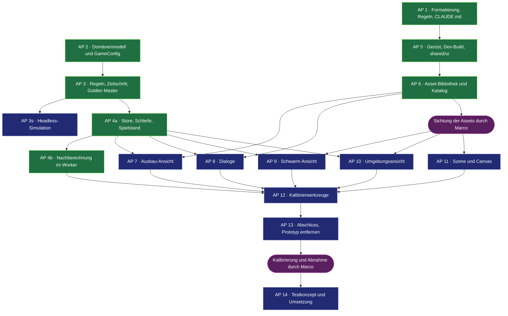

# Plan: Umbau des Prototyps in die Angular-App

Stand: 27.11.2026

Der Prototyp (`public/prototype/index.html`) wird Schritt für Schritt in die Angular-App überführt. Jedes Arbeitspaket (AP) ist ein eigener Feature-Branch mit Pull Request nach `development`; vor dem Abschluss sind Lint, Format, Tests, Build und E2E grün, und die Regeldateien sind nachgeführt. Abgeschlossene Pakete werden in der Übersicht und in der Statustabelle markiert.

## Übersicht

Legende: grün = abgeschlossen, gelb = in Arbeit, blau = offen, violett gestrichelt = Schritt von Marco. AP 1 und AP 2 können parallel beginnen; AP 5 und AP 6 laufen parallel zur Logik (AP 2 bis 4).

## Status

| AP | Titel | Status |
| --- | --- | --- |
| 1 | Formatierung, Regeln, CLAUDE.md | abgeschlossen |
| 2 | Domänenmodell und GameConfig | abgeschlossen |
| 3 | Regeln, Zeitschritt, Golden Master | abgeschlossen |
| 3s | Headless-Simulation | offen |
| 4a | Store, Schleife, Spielstand | abgeschlossen |
| 4b | Nachberechnung im Worker | abgeschlossen |
| 5 | Gerüst, Dev-Build, shared/ui | abgeschlossen |
| 6 | Asset-Bibliothek und Katalog | abgeschlossen |
| – | Sichtung der Assets durch Marco | offen |
| 7 | Ausbau-Ansicht | offen |
| 8 | Dialoge | offen |
| 9 | Schwarm-Ansicht | offen |
| 10 | Umgebungsansicht | offen |
| 11 | Szene und Canvas | offen |
| 12 | Kalibrierwerkzeuge | offen |
| 13 | Abschluss, Prototyp entfernen | offen |
| – | Kalibrierung und Abnahme durch Marco | offen |
| 14 | Testkonzept und Umsetzung | offen |

## Entscheidungen

| Thema | Entscheidung |
| --- | --- |
| Messmodus (`?messung`) | wird nicht portiert |
| Testtempo (1× bis 100×) | nur im Dev-Build (`npm start`, GitHub Pages), nicht auf `main` |
| Spielstand | eigener Schlüssel, Version ab 1; keine Übernahme und kein Import von Prototyp-Spielständen |
| Offline-Nachberechnung | im Web Worker, schon in AP 4b |
| Prototyp | ab Start des Umbaus eingefroren, wird in AP 13 entfernt |
| Asset-Übersicht | Seite `/katalog` im Dev-Build mit echten Komponenten und Renderern; kein Storybook, keine eigene App, kein statisches HTML |
| Reihenfolge der Oberfläche | Asset-Bibliothek und Katalog vor den Ansichten. Ausbau-Ansicht und Dialoge starten direkt nach AP 6; Schwarm- und Umgebungsansicht sowie Szene und Canvas warten auf die Sichtung |
| Spielwerte | als Parameter `GameConfig` durch die Domäne, Standardwerte in `game/domain/data/game-config.data.ts` |
| Kalibrierung | Werte-Panel, Startpresets, Pacing-Anzeige (AP 12) und Headless-Simulation (AP 3s) |
| Testing bis zur Abnahme | lose: Formatierung, Golden Master, E2E-Smoke; Abdeckungs-Untergrenze ausgesetzt, `.claude/rules/testing.md` mit Übergangshinweis; danach Testkonzept (AP 14) |
| Domänenschnitt | `game`, `dev`, `shared` (siehe unten) |
| Spielstand v1 | englische IDs und Feldnamen; persistiert und stabil, Umbenennen entscheidet Marco |
| Reihenfolge der ID-Listen | wie im Prototyp; Zufall (`pickWeighted`) und Kette hängen davon ab |
| Regeln der Logik | `GameConfig` als Parameter, keine globale Config; Zustand wird mutiert; Reihenfolge der Zufallszahlen und Gleitkomma-Operationen exakt wie im Prototyp; feste Längen aus der Config abgeleitet |
| `newGame` | mit den nötigen Helfern in AP 2; `derive` bleibt AP 3, `discover` bekommt die Reichweite direkt |
| Fundtexte | Platzhalter aus `GameConfig` |
| Tests in AP 2 | Referenzwerte für `rng-logic`, Fixture der Startzustände von `newGame` aus dem Prototyp |
| Spieleraktionen | Markieren, Markierung lösen und Verlassen als Domänenfunktionen mit Ergebniscodes in AP 3 (`toggleMark`, `clearMark`, `requestLeave`) |
| Ereignisse | `step` meldet `GameEvent`-Codes über einen optionalen Callback statt Texten |
| Golden Master | aufgezeichnete Aktionen mit Ergebnissen, Ereignisse und Prüfpunkte je Szenario; Erzeugerskript unter `tools/golden-master/`; eingefrorene Config-Kopie `PROTOTYPE_GAME_CONFIG` |
| Eigenheiten des Prototyps | bleiben 1:1; offen ist nur `spawnTimers` in der letzten Zone (entscheidet Marco) |
| Store | `GameStoreService` hält den Zustand privat; Schnappschuss per `structuredClone` je Frame mit Schritt, je Aktion und je Speichern (ADR 0001) |
| Speicherschlüssel | `idleswarm-save` |
| Tests in AP 4 | gezielte Specs für Laden und Migration, Akkumulator, Schleife über ersetzte Tokens, Worker-Protokoll |
| Nachberechnung | Store gesperrt (Aktionen `null`), kein Speichern während der Sperre; Lücken währenddessen werden nachgereicht; Zusammenfassungen werden zusammengeführt |
| Dev-Build | eigene Build-Konfiguration `pages` (Produktions-Build mit Dev-Domäne) für GitHub Pages und die CI außer Ziel `main` |
| Maße und Tokens | Maße aus dem Prototyp auf die Tailwind-Standardskala gerundet, keine eigenen Größen- oder Radius-Tokens; Farben und Schatten 1:1 als Tokens; Tailwind-Standardpalette geleert |
| Schrift auf Pink | dunkle Schrift `on-accent` statt Weiß (Kontrast ≥ 4,5:1) |
| Inhalte des Gerüsts | HUD, Kontextzeilen, Chips, Toasts und Nachberechnungs-Overlay schon in AP 5 |
| Menü bis AP 8 | Menüknopf öffnet einen Platzhalter-Dialog |
| Farben der Illustrationen | Angular-freie TS-Palette `game/ui/art/art-palette.ts`, Werte 1:1 aus dem Prototyp; UI-Farben bleiben Tokens (ADR 0002) |
| Fressling als Amöbe | bewusste Abweichung vom Prototyp: 5 Varianten, im Canvas als Vektor animiert, auf der Karte reduziert, Icon und Kette Variante 0 (ADR 0003, entfällt in AP 13) |
| Darstellung der Schwarm-Szene | nur Canvas wie im Prototyp-Standard; die SVG-Formation mit CSS-Animationen wird nicht portiert; Hintergründe statisch |
| Ablage reiner Zeichenfunktionen | Angular-frei als `game/ui/<ordner>/*.utils.ts` neben den Komponenten, gemeinsame in `game/ui/art` |
| SVG-Teilkomponenten | Attributselektor `g[app-…]`; ESLint (`@angular-eslint/component-selector`) um `attribute` erweitert |
| Katalog-E2E | `e2e/catalog.e2e.ts` nur gegen den Pages-Build (`E2E_BUILD_CONFIGURATION=pages`) |

## Domänenschnitt

| Domäne | Inhalt |
| --- | --- |
| `game` | Die ganze Simulation (Regeln, Spielwerte, Zeitschritt, Zustand, Schleife, Spielstand, Worker) und alle Spielansichten. `game/ui` ist in Unterordner gegliedert, z. B. `scene`, `map`, `neuron`, `hud`, `chain`. |
| `dev` | Nur im Dev-Build: Katalog, Kalibrierwerkzeuge, Schaltfläche fürs Testtempo. Entfällt im Produktiv-Build per Dateiersetzung. |
| `shared` | Ohne Fachwissen: Zahlenformatierung de-DE (`util`), Pipes und generische UI-Elemente wie Button, Segment, Pill, Tag, Bottom-Sheet, Toast, Dialograhmen (`ui`). |

Abhängigkeitsrichtung `dev → game → shared`, von ESLint erzwungen. `game` stellt für `dev` ein Token für `GameConfig` und eine Schnittstelle für das Testtempo bereit; das Menü hat einen Erweiterungspunkt für die Schaltfläche fürs Testtempo.

## Arbeitspakete

### AP 1 · Formatierung, Regeln, CLAUDE.md (klein)

- `fmt`, `fmtInt`, `fmtTime`, `fmtDuration` als reine Funktionen in `shared/util` mit Tests, dazu Pipes in `shared/ui/pipes`.
- CLAUDE.md: Prototyp ist eingefroren; Domänentabelle um `dev` und `shared/ui` erweitert; §10 mit Übergangshinweis zur losen Teststrategie.
- Abdeckungs-Untergrenze in `vitest-base.config.mts` aussetzen (Abdeckung wird weiter gemessen).
- ESLint-Regel für die Richtung `dev → game → shared`.

### AP 2 · Domänenmodell und GameConfig (mittel)

- `GameConfig` mit Standardwerten in `data/game-config.data.ts`; Einheiten, Ausbauten, Stellentypen und Fundstücke als `as const`-ID-Listen.
- Namen und Texte aus `CFG` (`name`, `plural`, `dat`, `text`) wandern als `$localize`-Texte in den `feature`/`ui`-Layer.
- Modelle `GameState`, `Site`, `Find`, `Travel`; Spielstand-Format ab Version 1 mit englischen Feldnamen.
- `rng-logic.ts` (mulberry32, `pickWeighted`) und `newGame` mit den nötigen Helfern (`site-logic`, `find-logic`, `upgrade-logic`, `geometry-logic`); `derive` folgt in AP 3, `discover` bekommt die Reichweite direkt.

### AP 3 · Regeln, Zeitschritt, Golden Master (groß)

- `step` aufgeteilt in `chain-logic`, `harvest-logic`, `site-logic`, `travel-logic`, `find-logic`; dazu `derive` und die Käufe (`buyUnit`, `buyUpgrade`, `buyChainUp`). Der Erzeugungs-Ausbau bleibt hinter `chainUp.enabled`.
- Golden Master: Die Logik des Prototyps läuft mit festem Seed unter Node und erzeugt einen Snapshot; der Port muss ihn mit einer eingefrorenen Kopie der Prototyp-Werte genau treffen. Ändert sich später bewusst die Mechanik, wird der Test gelöscht statt angepasst.
- Der Golden Master bildet den Prototyp-Spielstand (Version 3) auf `version: 1` ab, wie das Erzeugerskript der `newGame`-Fixture aus AP 2.
- `pickWeighted` und die Startstellen in `newGame` (`map.initialSites`) folgen der Reihenfolge der ID-Liste statt der Schlüsselreihenfolge des Objekts; bei den Standardwerten ist beides gleich.

### AP 3s · Headless-Simulation (klein)

- Skript außerhalb der App (Ort, z. B. `tools/`, im Paket festlegen), das mit einfacher Strategie durchspielt und die Pacing-Kurve ausgibt.
- Klären, wie der Alias `@app/*` aufgelöst wird (über Vitest, Build-Schritt oder Dev-Werkzeug); keine Laufzeitabhängigkeit.

### AP 4a · Store, Schleife, Spielstand (mittel)

- Store mit Signals; die Domäne arbeitet mutierend auf einem internen Zustand, der Store gibt pro Frame einen neuen Signalwert aus (ADR).
- Spielschleife über rAF mit festem `dt`-Akkumulator und Tempo-Schnittstelle; Speichern alle 10 s und bei `pagehide`/`visibilitychange`; Laden und Migration.
- Tokens für `localStorage`, `requestAnimationFrame`, `Date.now`, `performance.now`, Sichtbarkeit und `GameConfig`.
- Umgesetzt als `GameStoreService`, `GameSaveService` und `GameLoopService` in `game/data-access`, Domänenteil in `save-logic`, `loop-logic`; Entscheidung zum Schnappschuss in ADR 0001.

### AP 4b · Nachberechnung im Worker (mittel)

- Offline-Nachberechnung bis 24 h im Web Worker: Protokoll mit Type Guards, Worker-Client in `data-access`, Fortschritt, Ereignisprotokoll für die Zusammenfassung.
- Umgesetzt als `catchUp` in `catch-up-logic` und `CatchUpService` mit `catch-up.worker.ts` (`tsconfig.worker.json`); ohne Worker rechnet derselbe Code im Hauptthread.

### AP 5 · Gerüst, Dev-Build, shared/ui (mittel)

- Lazy-Route mit Kindrouten `/`, `/umgebung`, `/ausbau`; Facade mit Viewmodel; Seitengerüst mit HUD, Kontextzeile, Ansichtswahl, Menüknopf.
- Farb-Tokens aus dem Prototyp in `src/styles.css`.
- Generische UI-Elemente in `shared/ui` (Button, Segment, Pill, Tag, Bottom-Sheet mit Griff und Wischen, Toast, Dialograhmen).
- Dev-Build: eigene Build-Konfiguration für GitHub Pages; `dev`-Routen per Dateiersetzung nur im Dev-Build; CI und Deploy anpassen.
- E2E-Smoke: Start, Ansichten erreichbar.
- Umgesetzt als `gameRoutes` mit `GamePage` (Gerüst, startet und stoppt die Schleife), `GameFacade` und `toGameView` in `game/feature`, Präsentationskomponenten in `game/ui` und Anzeigefunktionen in `domain` (z. B. `zone-logic`); Tokens in `src/styles.css`, UI-Elemente in `shared/ui`; Build-Konfiguration `pages` mit Dateiersetzung `dev-routes.ts` und Platzhalter `/katalog`; E2E in `e2e/game.e2e.ts`.

### AP 6 · Asset-Bibliothek und Katalog (groß)

- Alle visuellen Elemente 1:1 aus dem Prototyp als `game/ui`-Komponenten und Canvas-Renderer: Einheiten mit Bewegungen, Schwarm gesamt, Futterstellen in allen Zuständen, Fundstücke, Hintergründe je Zone und Ansicht, Reise-Drift, Neuronen und Knoten.
- Katalog `/katalog` in `dev/feature`: Kategorien, Suche nach Name und Kategorie, Deep-Links je Eintrag, Regler für Zone, Anzahl, Zustand und Bewegung; zeigt auch `shared/ui`.
- Umgesetzt als Palette und gemeinsame Zeichenhelfer in `game/ui/art` (ADR 0002), statische SVG-Komponenten `g[app-…]` in `game/ui/scene`, `map` und `neuron`, Canvas-Renderer `app-swarm-canvas` für Schwarm und Drift, Specs mit Werten aus dem Prototyp; Katalog mit `/katalog` und `/katalog/:entryId` (`catalogEntryGuard()`) in `dev`, E2E in `e2e/catalog.e2e.ts`.

### Sichtung der Assets durch Marco

Marco sichtet den Katalog und passt Assets an, auch grundlegend (Schwarm in Schwarm- und Umgebungsansicht, Darstellung der Reise). Blockiert nur AP 9 bis 11.

### AP 7 · Ausbau-Ansicht (groß)

- Zwei Neuronen, Auswahl über Knoten, Tabs und Zellkörper, Fokus und Verschieben; Schwarm-Ausbauten mit Keimzelle; Erzeugungs-Ausbau hinter dem Schalter.

### AP 8 · Dialoge (mittel)

- Native `<dialog>`: Menü mit Statistik, Export und Import (Signal Form), Neues Spiel mit Rückfrage, „Während du weg warst“, Ende an der Seegraswiese.
- Erweiterungspunkt im Menü für die Schaltfläche fürs Testtempo aus `dev`.

### AP 9 · Schwarm-Ansicht (mittel)

- Blatt „Kette“ mit Einheiten, Freischaltung und Kaufmenge (1 / 25 % / Max); E2E: Fressling kaufen.

### AP 10 · Umgebungsansicht (groß)

- Karte als SVG-Template: Stellen, Fundstücke, Reichweitenringe, Reiseweg, Ferne und Dunst; Markieren, Markierung lösen, „Stelle verlassen“, Panel „Nächster Aufbruch“; Verschieben per Ziehen und Rad, Zur Mitte.

### AP 11 · Szene und Canvas (groß)

- Schwarm, Reise, Drift, Interpolation zwischen den Schritten, gerasterte Hintergründe, `prefers-reduced-motion`; Aufräumen über `DestroyRef`.

### AP 12 · Kalibrierwerkzeuge (mittel)

- In `dev`: Werte-Panel (Überschreibungen in localStorage, Zurücksetzen, Export als Diff zum Übernehmen in `game-config.data.ts`), Startpresets (Zone, Vorräte, Einheiten, Ausbauten), Pacing-Anzeige mit Meilensteinen.

### AP 13 · Abschluss, Prototyp entfernen (klein)

- Abgleich der Mechanik, Leistung auf dem Smartphone, E2E-Smoke vervollständigen.
- Prototyp entfernen; CLAUDE.md und Regeldateien beschreiben die App als Status quo.
- ADRs, die Abweichungen vom Prototyp festhalten (derzeit ADR 0003), entfernen.

### Kalibrierung und Abnahme durch Marco

Marco kalibriert das Pacing im Dev-Build und testet ausführlich, bis das Spiel aussieht und sich verhält wie gewünscht.

### AP 14 · Testkonzept und Umsetzung (groß)

- Testkonzept (ADR oder Dokument), das die Korrektheit des Status quo für Phase 1 absichert und vor Regressionen beim späteren Ausbau schützt.
- Umsetzung: Regeltests je `*-logic.ts`, Szenario-Tests, E2E-Abläufe; Abdeckungs-Untergrenze wieder einführen; `.claude/rules/testing.md` überarbeiten.
