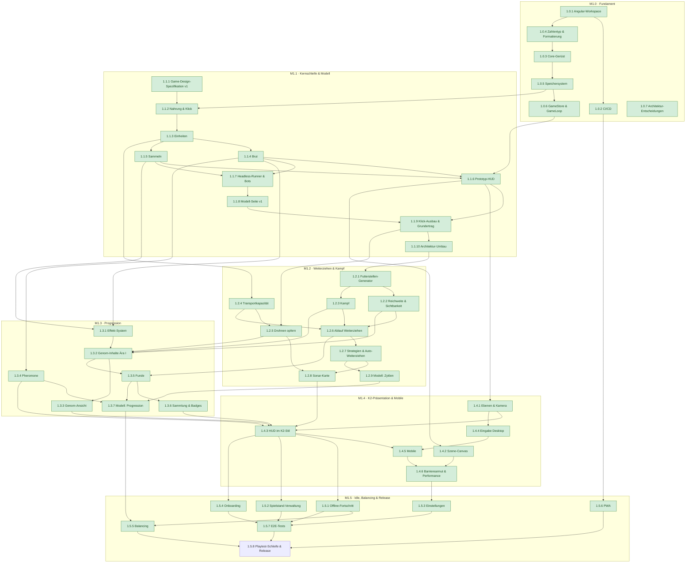

# IdleSwarm · Projektplan

> Stand: 22.11.2026 · Grundlage: [Projektidee (archiviert)](archiv/projektidee.md), [Produktplanung](produktplanung.md), [Technisches Konzept](technisches-konzept.md), UI-Leitbild [Mockup K2-K · Kurzgesagt-Stil](mockups/k2-kurzgesagt.html)

## 1. Ziel und Rahmen

IdleSwarm ist ein Idle-Browserspiel für eine Person, ohne Multiplayer. Der Spieler steuert einen Schwarm, der als Einzeller in der Ursuppe beginnt, von Futterstelle zu Futterstelle zieht und sich über mehrere Ären (Meer, Land, All) zur dominanten Lebensform entwickelt. Fortschritt entsteht durch strategische Käufe und Entscheidungen, nicht durch Klicken.

| Rahmen | Festlegung |
|---|---|
| Plattform | Browser, **Desktop und Mobile von Anfang an** |
| Optik | Mockup **K2-K · Kurzgesagt-Stil** (Bedienung und Ebenen aus K2 · Kamera-Zoom): Sonar-Karte ⊖ · Schwarm-Szene ✺ · Genom ⊕ als eine zusammenhängende Welt, flache Farbflächen statt Glow |
| Technik | Angular (zoneless, Signals), Spiellogik als reines TypeScript, kein Backend (Details: [Technisches Konzept](technisches-konzept.md)) |
| Team | 1 Entwickler + KI-Unterstützung |
| Planung | Aufwand in **Personentagen (PT)**, Meilensteine **ohne Termine** |
| Vorgehen | iterativ: Jeder Meilenstein endet mit einem spielbaren Stand und einem kurzen Spieltest-Review; jede Ausbaustufe beginnt mit UI-Mockups und endet mit einer Playtest-Schleife (§6) |

### Leitprinzip: Das Modell zuerst

Idle-Spiele stehen und fallen mit ihrer Wachstumskurve: Wird die Wartezeit zu lang, langweilt sich der Spieler, wächst alles zu schnell, gibt es keine Entscheidungen mehr. Deshalb entsteht ab Meilenstein 1.1 parallel zum Spiel eine **Modell-Seite**. Sie simuliert das Spiel ohne Oberfläche und zeigt Wachstum, Kosten und Pacing als Diagramme. Jede neue Mechanik wird dort sichtbar gemacht, bevor sie als fertig gilt.

### Leitprinzip: Strategie statt Klicken

Es gibt keine Klick-Mechanik für Ressourcen. Ein fester [Grundertrag](game-design.md#41-grundertrag) trägt den Start, danach zählen Käufe und Entscheidungen. Das Spiel wird mit jeder Ära strategischer: In der Ursuppe wählt man Käufe und Ziele, im Urmeer verteilt man den Schwarm auf 2–3 Standorte, an Land erobert man Gebiete an mehreren Fronten, und im Weltraum steuert man die Ausbreitung über eine globale Übersicht. Das [Mockup K2-K](mockups/k2-kurzgesagt.html) ist die optische Vorlage, sein Klick-Verhalten gilt aber nicht mehr.

## 2. Ausbaustufen im Überblick

| AS | Name | Kern | Detaillierung |
|---|---|---|---|
| **1** | **Basisspiel · Ära I Ursuppe** | vollständige Kernschleife einer Ära, K2-Oberfläche, Desktop und Mobile, Modell-Seite | **detailliert** (Abschnitt 3) |
| 2 | Evolution · große Ascension | Prestige-Schicht (Einzeller → Mehrzeller), Mutationen, Erfolge, aktive Fähigkeiten | grob + Entscheidungspunkte |
| 3 | Ära II · Urmeer | neue Biome, 2–3 gleichzeitige Standorte, Verteidigungsarten, zweiter Rohstoff, Spezialeinheiten | grob + Entscheidungspunkte |
| 4 | Ära III · Land | Gebiete an mehreren Fronten erobern und leerfressen, bis der Planet eingenommen ist; Zivilisation als Gegner | grob + Entscheidungspunkte |
| 5 | Ära IV+ · Weltraum | Ausbreitung über Sonnensystem und Galaxis mit globaler Übersicht; endlose Skalierung | grob + Entscheidungspunkte |

Jede Ausbaustufe endet mit einem veröffentlichten Release; die Versionsnummer folgt [§6 (Versionierung)](#6-vorgehen). Spielstände bleiben über alle Stufen hinweg kompatibel (Migrationen, siehe Technisches Konzept).

## 3. Ausbaustufe 1 · Basisspiel (Ära I Ursuppe)

### 3.1 Ziel

Ein vollständiges, ausbalanciertes Spiel für Ära I: Der Schwarm sammelt Nahrung, brütet Einheiten aus, erobert Futterstellen, entwickelt sein Genom und spielt auch idle und offline sinnvoll weiter. Die große Ascension (Übergang zum Mehrzeller) ist **nicht** enthalten. Ära I hat ein offenes Ende, das Spiel endet nicht.

**Umfang:**
- Grundertrag, Königinnen/Drohnen/Soldaten, Eier/min, Platz
- Pheromone
- Futterstellen, Weiterziehen, Kampf, Transportkapazität, Drohnen opfern, Strategien, Auto-Weiterziehen
- DNA und Genom
- Funde und Sammlung
- Speichern und Offline-Fortschritt
- K2-Oberfläche für Desktop und Mobile
- Modell-Seite

### 3.2 Meilensteine

| MS | Name | Ergebnis (Abnahmekriterium) | Aufwand |
|---|---|---|---|
| M1.0 | Fundament | Leeres Angular-Projekt läuft auf GitHub Pages; CI grün; Spielzustand tickt, wird gespeichert und geladen | 6,5–9,5 PT |
| M1.1 | Kernschleife & Modell | Grundertrag statt Klick, Einheiten kaufen, Drohnen sammeln, Königinnen brüten; Modell-Seite zeigt die Kurven dazu; Code folgt der Zielarchitektur (ADR-009 bis 011) | 12,5–18 PT |
| M1.2 | Weiterziehen & Kampf | Schwarm zieht über die Sonar-Karte von Futterstelle zu Futterstelle, manuell und automatisch; Kampf und Verluste funktionieren | 9,5–13,5 PT |
| M1.3 | Progression | Genom, Pheromone und Funde vollständig; Modell-Seite zeigt Upgrade-Wirkung und Pacing-Zielband | 8,5–12 PT |
| M1.4 | K2-Präsentation & Mobile | Oberfläche entspricht Mockup K2 inkl. Zoom-Übergängen; auf Smartphone voll bedienbar | 9–13,5 PT |
| M1.5 | Idle, Balancing & Release | Offline-Fortschritt, Onboarding, PWA; Balancing innerhalb der Zielbänder; Release veröffentlicht | 9–13,5 PT |
| | **Summe AS1** | | **55–80 PT** (+ ~15 % Puffer) |

Die Meilensteine sind so geschnitten, dass zuerst die Mechanik steht (M1.0–M1.3) und danach die Präsentation (M1.4). Die Sonar-Karte (M1.2) und das Genom (M1.3) werden trotzdem schon im K2-Stil gebaut. M1.4 fügt sie zur Zoom-Welt zusammen und macht sie mobiltauglich.

```
M1.0 ──► M1.1 ──► M1.2 ──► M1.3 ──► M1.4 ──► M1.5
```

Abhängigkeiten: M1.4 baut auf den Ansichten aus M1.2 (Sonar) und M1.3 (Genom) auf. Die Aufgaben 1.4.1 (Ebenen und Kamera) und 1.4.2 (Szene-Canvas) können schon nach M1.1 vorgezogen werden. M1.5 setzt alle Mechaniken voraus.

### 3.3 Arbeitspakete

Die Spalte **Stories** verweist auf die User Stories in der [Produktplanung](produktplanung.md).

#### Abhängigkeiten der Arbeitspakete

Ein Pfeil bedeutet: Das Arbeitspaket am Pfeilanfang muss fertig sein, bevor das am Pfeilende abgeschlossen werden kann. Indirekte Abhängigkeiten sind nicht eingezeichnet. Die Abhängigkeiten sind aus den Inhalten der Arbeitspakete, den User Stories und dem bisherigen Code abgeleitet. AP 1.0.7 hängt mit keinem anderen Arbeitspaket zusammen. Abgeschlossene Arbeitspakete sind grün hinterlegt.



#### M1.0 · Fundament

| AP | Arbeitspaket | Inhalt | PT | Stories |
|---|---|---|---|---|
| 1.0.1 | Angular-Workspace | Projekt anlegen (standalone, zoneless, strict), ESLint/Prettier, Vitest, Ordnerstruktur `core/ game/ ui/ model/` | 1–1,5 | – |
| 1.0.2 | CI/CD | GitHub Actions: Lint, Test, Build; Deployment auf GitHub Pages bei Push auf `main` | 0,5–1 | – |
| 1.0.3 | Core-Gerüst | `GameState`-Typen, Kommando-Mechanik, `step(state, dt)`, seeded RNG | 1,5–2 | – |
| 1.0.4 | Zahlentyp & Formatierung | Decimal-Wrapper um `break_infinity.js`, Formatierung de-DE (Kurzformen, wissenschaftlich) | 1–1,5 | US-09.02 |
| 1.0.5 | Speichersystem | Serialisierung, Versionsfeld, Migrationskette, localStorage-Adapter | 1–1,5 | US-07.02 |
| 1.0.6 | GameStore & GameLoop | Angular-Services: Signal-Store, fester Logik-Takt, Trennung vom Render-Takt | 1–1,5 | – |
| 1.0.7 | Architektur-Entscheidungen | ADRs aus dem technischen Konzept in `docs/adr/` festhalten | 0,5 | – |

#### M1.1 · Kernschleife & Modell

| AP | Arbeitspaket | Inhalt | PT | Stories |
|---|---|---|---|---|
| 1.1.1 | Game-Design-Spezifikation v1 | `docs/game-design.md`: Formeln, Startwerte, Kostenkurven. Klärt das TODO aus der Projektidee: Kosten der Königinnen je Einheitentyp | 1,5–2 | – |
| 1.1.2 | Nahrung & Klick | Futterstelle mit Vorrat, Klickertrag, Anzeige des Vorrats (der Klick entfällt mit AP 1.1.9). Provisorisch bis M1.2: Knopf „Neue Futterstelle“ füllt den leeren Vorrat wieder auf ([Game-Design §4.4](game-design.md#44-leere-futterstelle-provisorium-bis-m12)) | 0,5–1 | US-01.03 |
| 1.1.3 | Einheiten | Königinnen, Drohnen, Soldaten: Kauf, Kostenkurven, Platz | 1,5–2 | US-02.01–02.04 |
| 1.1.4 | Brut | Eier/min aus Königinnen, passive Erzeugung (bis M1.3 mit festem Verhältnis) | 1 | US-02.05 |
| 1.1.5 | Sammeln | Drohnen bauen Nahrung ab, Futterstelle leert sich | 0,5–1 | US-01.04 |
| 1.1.6 | Prototyp-HUD | Ressourcen, Aktionsleiste, Vorratsbalken; funktional, noch ohne K2-Grafik | 1–1,5 | – |
| 1.1.7 | Headless-Runner & Bots | Simulation ohne Oberfläche im Zeitraffer; Bots „Aktiv“ und „Idle“ | 1,5–2 | US-10.01, 10.04 |
| 1.1.8 | Modell-Seite v1 | Route `/modell`: Ressourcen, Einheiten und Raten über die Zeit (log), Zeit bis zum nächsten Kauf, Parameter-Panel | 2–3 | US-10.02, 10.03, 10.05 |
| 1.1.9 | Klick-Ausbau & Grundertrag | Klick aus Core, Bots, HUD, Modell-Seite und Tests entfernen; Grundertrag einführen und anzeigen; Spielstand prüfen; Pacing neu messen, [Game-Design §6](game-design.md#6-messwerte-v1) sowie ADR-003 und ADR-004 aktualisieren | 1–1,5 | US-01.01, 01.02, 10.04 |
| 1.1.10 | Architektur-Umbau | Bestand auf die Zielarchitektur aus [`CLAUDE.md`](../CLAUDE.md) umstellen: Domänen und Schichten ([ADR-009](adr/009-domaenen-schichten-facade.md)), Facades mit Viewmodels, `BuyButton`/`FeedingSite` präsentational; Tailwind v4 mit `--sw-*`-Tokens für HUD und Modell-Seite ([ADR-010](adr/010-tailwind-tokens.md)); `$localize` statt `TEXTS_DE`/`MODEL_TEXTS`/`fillText` ([ADR-011](adr/011-i18n-localize.md)); `ModelForm` auf Signal Forms ([ADR-012](adr/012-signal-forms.md)); ESLint: Schichten je Domäne, Determinismus, `import/order`, Klassensuffixe; Alias `@app/*`; `.npmrc` mit `save-exact` und exakte Versionen; Regeldateien in `.claude/rules/`. Verhalten, Spielstand-Format und Tests bleiben fachlich gleich | 2–3 | – |

#### M1.2 · Weiterziehen & Kampf

| AP | Arbeitspaket | Inhalt | PT | Stories |
|---|---|---|---|---|
| 1.2.1 | Futterstellen-Generator | Typen der Ära I (Schlot, Algenmatte, Bakterienrasen, Walsturz, Methanquelle …) mit Größe, Distanz, Abwehr, DNA, Fundchance; **Garantie: immer eine Futterstelle mit Abwehr 0 in Reichweite** | 1,5–2 | US-04.01, 04.02 |
| 1.2.2 | Reichweite & Sichtbarkeit | Ziele außer Reichweite und unerforschte Ziele | 0,5 | US-04.03 |
| 1.2.3 | Kampf | Angriff gegen Abwehr (binär), Verlustformel, DNA-Belohnung | 1–1,5 | US-04.04, 04.05 |
| 1.2.4 | Transportkapazität | Platz je Königin, Mitnahme-Priorität (Drohnen / Soldaten / ausgewogen) | 1–1,5 | US-04.06 |
| 1.2.5 | Drohnen opfern | Drohnen → Nahrung mit Umwandlungsverlust; Drohnen → Königinnen für den Transport | 0,5–1 | US-04.07, 04.08 |
| 1.2.6 | Ablauf Weiterziehen | Aufbruch, Ankunft, Zustandswechsel, Ereignisse fürs Log | 1 | US-04.09 |
| 1.2.7 | Strategien & Auto-Weiterziehen | Strategien „Geringster Widerstand“, „Ausgewogen“, „Kampfgehärtet“; Auslöser (Vorrat leer / Schwelle) | 1–1,5 | US-04.10, 04.11 |
| 1.2.8 | Sonar-Karte | SVG-Komponente im K2-Stil: Ringe, Ziele, Route, bisherige Route, Detailpanel | 2–3 | US-04.12 |
| 1.2.9 | Modell: Zyklen | Dauer pro Futterstelle, Soldaten-Bilanz, Warnung bei Stillstand (z. B. keine Soldaten mehr) | 1–1,5 | US-10.06 |

#### M1.3 · Progression

| AP | Arbeitspaket | Inhalt | PT | Stories |
|---|---|---|---|---|
| 1.3.1 | Effekt-System | Modifikatoren (additiv, multiplikativ, Freischaltung), Abhängigkeiten zwischen Genom-Knoten | 1,5–2 | – |
| 1.3.2 | Genom-Inhalte Ära I | Äste Sammeln, Brut, Kampf; ca. 15 Knoten plus einzigartige Adaptionen | 1 | US-05.01 |
| 1.3.3 | Genom-Ansicht | Radialer SVG-Baum im Zellkern, Detailpanel, Kauf, Hinweis auf verfügbare Knoten | 2–3 | US-05.02–05.04 |
| 1.3.4 | Pheromone | Punkte (Gesamtzahl = Brutrate), Verteilung (= Verhältnis), Drüse ausbauen | 1–1,5 | US-03.01–03.03 |
| 1.3.5 | Funde | Fundtabelle, Ziehung beim Einnehmen bzw. Abbauen, Sofort-Boni, einzigartige Adaptionen | 1–1,5 | US-06.01, 06.02 |
| 1.3.6 | Sammlung & Badges | Sammelobjekte, Sets, Schublade „Funde“ | 1–1,5 | US-06.03, 06.04 |
| 1.3.7 | Modell: Progression | Upgrade-Wirkung, DNA-Fluss, Pacing-Zielband mit Warnungen | 1–1,5 | US-10.07, 10.08 |

#### M1.4 · K2-Präsentation & Mobile

| AP | Arbeitspaket | Inhalt | PT | Stories |
|---|---|---|---|---|
| 1.4.1 | Ebenen & Kamera | Drei Ebenen (Sonar, Welt, Genom), Moduswechsel mit CSS transform/clip-path wie im Mockup | 1,5–2 | US-08.01 |
| 1.4.2 | Szene-Canvas | Futterstelle, Agenten-Renderer mit Budget (ein Sprite = n Einheiten), Plankton, Ertrags-Effekte, DPR | 2–3 | US-08.02 |
| 1.4.3 | HUD im K2-Stil | Ressourcen, Titel je Modus, Aktionsleiste, Zoom-Leiste, Schubladen, Log, Ära-Anzeige | 2–3 | US-08.03, 08.04 |
| 1.4.4 | Eingabe Desktop | Mausrad, Tastatur (W / G / Esc), Pointer Events | 0,5–1 | US-08.05 |
| 1.4.5 | Mobile | Pinch → Moduswechsel, Breakpoints, Bottom-Sheets, Touch-Ziele ≥ 44 px; aus der M1.2-Durchsicht: Beschriftungen der Sonar-Karte und ihre Darstellung auf Mobilgeräten überarbeiten; aus der M1.3-Durchsicht: Genom-Baum auf dem Smartphone lesbar und treffbar machen (Beschriftungen, Trefferflächen ≥ 44 px ohne Überlappung benachbarter Knoten), Links im HUD-Kopf ≥ 44 px | 2–3 | US-08.06, 08.07 |
| 1.4.6 | Barrierearmut & Performance | `prefers-reduced-motion`, Fokusführung, Pause bei verdecktem Tab, Profiling auf Smartphone | 1–1,5 | US-08.08, 09.03 |

#### M1.5 · Idle, Balancing & Release

| AP | Arbeitspaket | Inhalt | PT | Stories |
|---|---|---|---|---|
| 1.5.1 | Offline-Fortschritt | Nachholen mit Ereignissen (Futterstelle leer, Auto-Weiterziehen), Obergrenze, Rückkehr-Zusammenfassung; neu bewerten, ob das Ereignis-Log in den Spielstand gehört (heute nur Arbeitsspeicher, `GameStore.load` leert es); aus der M1.3-Durchsicht: Toleranz zwischen grobem und feinem Schritt prüfen (Runner-Test seit M1.3 mit 15 % statt 2 %, [TK §10](technisches-konzept.md#10-qualitätssicherung)); aus der M1.4-Durchsicht: Der GameLoop holt einen Rückstand bei verborgenem Tab schon in 1-s-Schritten an `nextSplitMs` nach, mit vorläufiger Obergrenze 24 h (`MAX_CATCH_UP_MS`); Obergrenze festlegen und mit dem Offline-Fortschritt vereinheitlichen ([TK §4](technisches-konzept.md#4-simulation)). **Umgesetzt:** Laden und verborgener Tab holen über dasselbe `catchUp` nach (1-s-Schritte, geteilt an `nextSplitMs`), Obergrenze `T_max` = 24 h als überschreibbare Konstante `maxCatchUpHours` (ersetzt `MAX_CATCH_UP_MS`); Abweichung zum 100-ms-Takt ≤ 0,5 %, mit Kampf ≤ 2 % ([TK §10](technisches-konzept.md#10-qualitätssicherung)); das Ereignis-Log bleibt außerhalb des Spielstands (PO-Entscheidung); Rückkehr-Zusammenfassung ab 5 min nachgeholter Zeit im nativen `<dialog>` ([ADR-014](adr/014-dialog-nativ.md)) mit Dauer, gesammelter Nahrung (davon für Brut verbraucht), DNA, Einheiten, Futterstellen und Funden | 1,5–2 | US-07.01, 07.03 |
| 1.5.2 | Spielstand-Verwaltung | Autosave, Export/Import, Zurücksetzen. **Umgesetzt** im Dialog „Einstellungen“: Export als kopierbarer Text, Import mit Prüfung und Bestätigung, ohne Offline-Nachholen (alte Export-Texte bringen keine Zeit); Zurücksetzen mit zwei Bestätigungen und Angebot zum Export, neuer Seed, Einstellungen bleiben, Onboarding beginnt neu ([ADR-005](adr/005-speicherformat-localstorage.md)) | 0,5–1 | US-07.04, 07.05 |
| 1.5.3 | Einstellungen | Zahlenformat, Animationen, Autosave-Intervall; aus der M1.4-Durchsicht: Schalter „Animationen“ an den `MotionPreferenceService` anschließen ([TK §8.5](technisches-konzept.md#85-barrierearmut)). **Umgesetzt:** Dialog „Einstellungen“ hinter dem Zahnrad in allen Modi mit Zahlenformat (Kurzformen, wissenschaftlich, technisch), Animationen (System, an, reduziert; über das Token `MOTION_OVERRIDE`), Autosave-Intervall (10 s, 30 s, 60 s, 5 min), Hinweise zurücksetzen sowie Version und Build-Datum; Einstellungen und Onboarding-Fortschritt im Spielstand Version 5, die Migration 4→5 behält den Fortschritt (PO-Entscheidung, [Game-Design §5.2](game-design.md#52-spielstand-version-5)) | 0,5–1 | US-09.01 |
| 1.5.4 | Onboarding | Kontextuelle Hinweise, schrittweise Freischaltung der Oberfläche. **Umgesetzt** mit der Folge aus der PO-Entscheidung ([Game-Design §4.18](game-design.md#418-onboarding)): Start mit Nahrung, Eier/min, Königin und Drohne, Titel, Vorrat und Log; Drüse erstmals bezahlbar → Pheromone; Vorrat erstmals ≤ 25 % → Umgebung, Soldaten, Angriff, Drohnen opfern; erster Fund → Funde; erste DNA → Genom; erstes Öffnen der Umgebung → Hinweis Auto-Weiterziehen. Freigeschaltetes bleibt sichtbar, gesperrte Modi überspringen Zoom-Leiste, Tasten, Mausrad und Pinch; Hinweise erscheinen einmal, sind wegklickbar und in den Einstellungen zurücksetzbar | 1–1,5 | US-09.04 |
| 1.5.5 | Balancing | Zielwerte festlegen, Bot-Läufe, Anpassen, Kennzahlen als Regressions-Snapshots; aus der M1.2-Durchsicht: neu bewerten, ob die längste Wartezeit für „Aktiv“ (Ziel ≤ 60 s) das Warten misst oder eher die Kaufkraft am Spielbeginn; aus der M1.3-Durchsicht ([Game-Design §6.5](game-design.md#65-messung-m13)): DNA-Senke (Genom nach rund 3 h komplett), Pacing-Abweichungen der Messung M1.3, kein Kampf bei „Aktiv“ und „Idle“, „Idle“ genau auf der Grenze „< 60 min“ der längsten Strecke ohne Kauf (Band bleibt exklusiv). **Umgesetzt:** Die Wartezeit zählt wie „Kauf“ (Einheit, Drüsenpunkt, Adaption; PO-Entscheidung). Werte v1.5 bei unveränderten Zielbändern ([Game-Design §6.6](game-design.md#66-messung-m15-werte-v15)): Genom bei „Aktiv“ nach rund 12 h komplett, „Aktiv“ und „Idle“ nehmen in 24 h je rund 30-mal mit Kampf ein, die meisten Futterstellen liegen im Band. Balancing-Snapshots für Seeds `modell` und `release`, „Aktiv“ und „Idle“, 24 h, Toleranz ±5 % ([TK §5.6](technisches-konzept.md#56-balancing-als-test)). Verfehlte Bänder siehe „Offen nach M1.5“ | 2–3 | US-10.09 |
| 1.5.6 | PWA | Manifest, Service Worker, Icons; aus der M1.4-Durchsicht: Der Service Worker muss die gebündelten Schriftdateien (`media/*.woff2`, [ADR-013](adr/013-webfont-nunito.md)) vorab cachen. **Umgesetzt** mit `@angular/service-worker` ([ADR-015](adr/015-pwa-service-worker.md)): Vorab-Cache für App, Bundles, Schriften und Icons, Manifest mit eigenen Icons, Hinweis „Neue Version verfügbar“ mit „Neu laden“; Offline-Start im Browser geprüft | 0,5 | US-07.06 |
| 1.5.7 | E2E-Tests | Smoke-Tests für Desktop- und Mobile-Viewport; aus der M1.4-Durchsicht: Moduswechsel über Zoom-Leiste, Zurück-Knopf und Tasten sowie Bottom-Sheets und Log mit Einträgen im Smartphone-Viewport abdecken (Test-IDs `shell.*`). **Umgesetzt:** Playwright-Smoke (devDependency) gegen den Produktions-Build für Desktop und Smartphone, dazu Querformat; neues Spiel mit Onboarding, Kauf, Moduswechsel, Schubladen, Weiterziehen, Einstellungen mit Export und Import, Rückkehr-Zusammenfassung; die CI deployt nur nach grünem E2E-Lauf ([TK §10](technisches-konzept.md#10-qualitätssicherung)) | 1–1,5 | – |
| 1.5.8 | Playtest-Schleife & Release | Schleife aus (1) Playtest mit 3–5 externen Testspielern, (2) Umsetzen des Feedbacks, (1) erneutem Playtest usw., bis der PO abnimmt; danach Release (Version 0.1.0 nach Bestätigung, §6); aus der M1.4-Durchsicht: Profiling und Pinch auf echten Geräten (iOS, Android), Körnung (`mix-blend-mode: overlay`) auf dem Desktop mit echter GPU prüfen ([TK §10](technisches-konzept.md#10-qualitätssicherung)); Querformat auf dem Smartphone; Kartenbeschriftung „(hier)“ weicht Zielen nicht aus, „Reichweite“ liegt auf dem Desktop teils unter dem Titel-Panel. **Umgesetzt (Code-Anteile, PO-Entscheidung):** Querformat auf dem Smartphone (Variante `short:`, [TK §8.4](technisches-konzept.md#84-responsives-layout)); „(hier)“ weicht Zielen aus; Ringnummern und „Reichweite“ stehen unter den Ringen und damit nicht mehr unter dem Titel-Panel; Nachbesserungen aus der Browser-Prüfung (Dialoge mit fester Fußleiste, Hinweiskarte, Kopfzeile bei 360 px); Version 0.0.1 mit Build-Datum in den Einstellungen. **Beim PO:** 3–5 externe Testspieler und Bugfixing daraus, Profiling und Pinch auf echten Geräten (iOS, Android), Körnung auf dem Desktop mit echter GPU, Veröffentlichen des Release (Push auf `main`) | 2–3 | – |

#### Offen nach M1.5

AS1 endet mit M1.5. Die folgenden Punkte aus der M1.5-Durchsicht gehören zu keinem Arbeitspaket; ob und wann sie bearbeitet werden, entscheidet der PO.

- **Balancing** ([Game-Design §6.6](game-design.md#66-messung-m15-werte-v15), [§7](game-design.md#7-ausblick)): „Aktiv“ verfehlt die längste Strecke ohne Kauf über 24 h (21,8 min statt < 10 min) und den Abstand neuer Optionen in der ersten Stunde (25,7 min statt ≤ 15 min), einzelne Futterstellen liegen knapp über 15 min; bei „Idle“ liegt rund ein Drittel der Futterstellen knapp unter 10 min (die Bänder von „Aktiv“ und „Idle“ überlappen nur in 10–15 min); beim Aufbruch ist der Platz noch 10- bis 30-fach überfüllt. Erreichbar nur mit Formel- oder Bot-Änderungen. Seit der neuen Wartezeit-Definition zählen Soldaten auch für Bots als Kauf, die keine kaufen; der Anteil der Wartezeit über 24 h fällt dadurch auf rund 0 %.
- **Zeitbudget Catch-up:** 24 h Nachholen dauern rund 1,1 s (Vitest, WSL) statt < 1 s ([TK §4](technisches-konzept.md#4-simulation), [§10](technisches-konzept.md#10-qualitätssicherung)); auf Smartphones blockiert das Laden nach langer Abwesenheit womöglich mehrere Sekunden. Mögliche Mittel: `step` und `Num` beschleunigen oder das Nachholen stückeln.
- **Kopfzeile bei 360 px:** Mit Werten ab 10 Zeichen ist sie rund 14 px zu breit (Gestaltung).
- **Sonar-Karte:** Ringnummern und „x · Reichweite“ stehen unter statt über den Ringen und weichen damit vom [Mockup K2-K](mockups/k2-kurzgesagt.html) ab.
- **Querformat:** Die Hinweiskarte verdeckt die Log-Zeile und einen Teil der Karte (keine Bedienelemente); der Genom-Baum ist bei 740 × 360 teils verdeckt (verschiebbar).
- **Onboarding:** Soldaten schlüpfen schon vor der Freischaltung der Umgebung, aber unsichtbar (Brut 3 : 1); es gibt keine Markierung neu freigeschalteter Teile; die Hinweistexte sind noch gegenzulesen.
- **PWA** ([ADR-015](adr/015-pwa-service-worker.md)): kein regelmäßiges `checkForUpdate()`, das Ereignis `unrecoverable` wird nicht eigens behandelt, das Chunk der Modell-Seite wird mit vorab geladen; Installation auf dem Smartphone und Lighthouse-Prüfung stehen aus.
- **Dialoge:** Modale Dialoge blenden beim Schließen nicht aus, nur das Öffnen ist animiert.

### 3.4 Game-Design-Entscheidungen für AS1

Diese Punkte aus der Projektidee werden in AP 1.1.1 bzw. im jeweiligen AP entschieden. Ist ein Punkt nicht als **entschieden** markiert, ist er noch offen: Der Vorschlag ist dann der Ausgangspunkt und wird über die Modell-Seite geprüft.

| Frage | Vorschlag bzw. Entscheidung | AP |
|---|---|---|
| Brauchen Königinnen für Drohnen, Soldaten und Königinnen dieselbe Menge Nahrung? | **Entschieden** (siehe [Game-Design](game-design.md#22-einheiten)): Nein, eigene Nahrungskosten je Einheitentyp (Drohne < Soldat < Königin). Eier/min ist nur die Brutrate, keine Ressource. | 1.1.1 |
| Was ersetzt den Klick? | **Entschieden:** Ein fester Grundertrag aus der Futterstelle (Startwert 1,5 Nahrung/s, siehe [Game-Design](game-design.md#41-grundertrag)). Er trägt den Spielstart und verhindert, dass der Schwarm ohne Drohnen und Nahrung feststeckt, solange die Futterstelle Vorrat hat. | 1.1.9 |
| Wie verhindern wir, dass Soldaten ausgehen und der Spieler feststeckt? | **Entschieden** (siehe Game-Design [§4.6](game-design.md#46-futterstellen-generator), [§4.10](game-design.md#410-drohnen-opfern)): Kombination aus Option 1 und 3 der Projektidee: **Drohnen opfern** mit Umwandlungsverlust (Ausbeute 50 %, per Genom verringerbar, Mindestverlust 10 %) **und** garantierte Algenmatte mit Abwehr 0 in Reichweite. Keine pluripotenten Drohnen. | 1.2.1, 1.2.5 |
| Wie hängt die Pheromon-Gesamtzahl mit der Brutrate zusammen? | **Entschieden** (siehe [Game-Design §4.15](game-design.md#415-pheromone)): Brutrate = Königinnen × Basisrate × verteilte Punkte / Startpunkte (`P_v / P_0`, Start 4 Punkte, 3 : 1); das Verhältnis teilt nur auf Drohnen und Soldaten auf, freie Punkte brüten nicht. Die Drüse kostet Nahrung (`100 · 2^k`). Königinnen werden nur gezielt gekauft. | 1.3.4 |
| Was passiert mit zurückgelassenen Einheiten? | **Entschieden** (siehe [Game-Design §4.9](game-design.md#49-transportkapazität)): Sie gehen verloren (ohne Rückerstattung); die Mitnahme-Priorität (Drohnen zuerst, Soldaten zuerst, ausgewogen; Standard ausgewogen) entscheidet, wer bleibt. Königinnen kommen immer mit. | 1.2.4 |
| Wann zieht der Schwarm im Idle-Betrieb weiter? | **Entschieden** (siehe [Game-Design §4.12](game-design.md#412-strategien-und-auto-weiterziehen)): Bei eingeschaltetem Auto-Weiterziehen, sobald der Vorrat die einstellbare Schwelle erreicht (0–90 %, Standard: leer), zum Ziel der Strategie; findet sie keins, zur sicheren Futterstelle. Auto-Weiterziehen ist in einem neuen Spiel ausgeschaltet und wirkt auch im Offline-Fortschritt. | 1.2.7 |
| Wird der Kaufzähler beim Weiterziehen zurückgesetzt? | **Entschieden** (siehe [Game-Design §4.11](game-design.md#411-weiterziehen-und-reise)): Nein, der Kaufzähler `bought` bleibt beim Weiterziehen für alle Einheitentypen erhalten. | 1.2.6 |

### 3.5 Pacing-Ziele (vorläufig)

Diese Zielbänder werden auf der Modell-Seite überwacht und in AP 1.5.5 feinjustiert. Seit AP 1.3.7 stehen sie als Konfiguration in `balance/domain/targets.ts`, die Modell-Seite zeigt sie als Flächen und Warnliste; die aktuelle Messung steht in [Game-Design §6.6](game-design.md#66-messung-m15-werte-v15).

| Kennzahl | Ziel (aktiv) | Ziel (idle) |
|---|---|---|
| Zeit bis zur ersten sinnvollen Entscheidung | < 10 s | – |
| Zeit zwischen zwei sinnvollen Käufen, erste 30 min | 5–60 s | < 5 min |
| Dauer pro Futterstelle | 3–15 min | 10–60 min |
| Längste Durststrecke ohne neue Option | < 10 min | < 60 min |
| Neue Mechanik/Ansicht freigeschaltet | alle 5–15 min in der ersten Stunde | – |

## 4. Spätere Ausbaustufen (grob)

Die späteren Stufen beginnen jeweils mit einem **Konzept-Meilenstein**. Darin werden die unten genannten Entscheidungspunkte getroffen und auf der Modell-Seite durchgerechnet. Das erste Arbeitspaket jedes Konzept-Meilensteins (`AP x.0.0`) ist die **Mockup-Runde** ([§6](#6-vorgehen)): Es entstehen mehrere UI-Mockups für die Stufe, eines davon wird ausgewählt und dient wie [Mockup K2-K](mockups/k2-kurzgesagt.html) für Ära I als UI-Leitbild. Erst danach werden die Arbeitspakete detailliert. Das letzte Arbeitspaket jeder Stufe ist die **Playtest-Schleife** vor dem Release. Viele Mechaniken orientieren sich an [Swarm Simulator](https://github.com/swarmsim/swarm), werden aber an die Schwarm-Biologie von IdleSwarm angepasst.

### AS2 · Evolution: große Ascension und Langzeitmotivation

**Ziel:** Der erste Übergang „Einzeller → Mehrzeller“ wird zur Prestige-Schicht, die einen Neustart mit dauerhaften Vorteilen belohnt.

| MS | Name |
|---|---|
| M2.0 | Konzept, UI-Mockups & Entscheidungen |
| M2.1 | Große Ascension & Prestige-Währung |
| M2.2 | Mutationen & Erfolge |
| M2.3 | Aktive Fähigkeiten |
| M2.4 | Balancing & Release |

| Entscheidungspunkt | Optionen | Vorbild Swarm Simulator |
|---|---|---|
| Prestige-Währung | eigene Währung (z. B. „Erbgut-Fragmente“) vs. DNA weiterverwenden | Mutagen aus der Ascension |
| Was bleibt beim Reset? | Genom, Funde, Sammlung, Badges: jeweils behalten, teilweise behalten, verlieren | Mutationen bleiben, Einheiten verfallen |
| Erzeuger-Ketten | Erzeuger von Erzeugern (z. B. Brutnester → Königinnen → Einheiten) für polynomielles Wachstum: ja/nein, wie viele Stufen | Drone → Queen → Nest → Greater Queen … |
| Energie & Fähigkeiten | zweite Ressource für aktive Fähigkeiten, z. B. Zeitsprung, Brutschub, Spiegelarmee; sie müssen planbare strategische Käufe bleiben und dürfen keine Reflexaktionen werden | Energy/Nexus: Swarmwarp, Clone Larvae, House of Mirrors |
| Erfolge | reine Abzeichen vs. Erfolgspunkte mit Bonus | Achievements mit Punktwert |
| Kaufmodi | ×1 / ×10 / 25 % / Max | Buy 25 % / Max |
| Mehrfach-Upgrades | Upgrades, die pro Kauf mehrere Einheiten ergeben | Twin-Upgrades |
| Zahlen-Skalierung | ab wann wissenschaftliche Notation Standard wird | Notationsoptionen |

### AS3 · Ära II Urmeer

**Ziel:** Fische und andere Meeresbewohner ziehen durch Seetangwälder, Riffe, Gräben und Küstenregionen. Erstmals arbeitet der Schwarm an 2–3 Standorten gleichzeitig, als Übergang zur Gebietseroberung an Land.

| MS | Name |
|---|---|
| M3.0 | Konzept, UI-Mockups & Entscheidungen |
| M3.1 | Biome & Futterstellen der Ära II |
| M3.2 | Mehrere Standorte |
| M3.3 | Verteidigungsarten & Spezialeinheiten |
| M3.4 | Zweiter Rohstoff |
| M3.5 | Visuelle Ära II (Szene, Karte, Genom) |
| M3.6 | Balancing & Release |

| Entscheidungspunkt | Optionen |
|---|---|
| Biome | Biome als Unterebenen der Ära (Meeresgrund, offenes Meer, Küste) mit eigenen Futterstellentypen vs. gemischte Karte |
| Mehrere Standorte | **Entschieden:** 2–3 gleichzeitig. Offen: Aufteilung des Schwarms über feste Anteile vs. Zuweisung beim Kauf; Freischaltung der weiteren Standorte |
| Verteidigungsarten | weiterhin ein Abwehrwert vs. Typen mit Konter-System (z. B. Panzer, Gift, Schwarm) |
| Zweiter Rohstoff | Kalk/Mineralien, die nicht aus Nahrung kommen, für Schalen und Panzer: ja/nein, Quelle |
| Spezialeinheiten | neue Einheitentypen (z. B. Späher für Reichweite, Träger für Transport) vs. Spezialisierung über das Genom |
| Übergang I → II | Ära I bleibt spielbar (Rückkehr) vs. abgeschlossen |

### AS4 · Ära III Land

**Ziel:** Landtiere erobern einen Planeten Gebiet für Gebiet, von Feldern und Wäldern bis zu Dörfern und Städten. Der Schwarm kämpft an mehreren Fronten, frisst eroberte Gebiete leer und nimmt so den ganzen Planeten ein.

| MS | Name |
|---|---|
| M4.0 | Konzept, UI-Mockups & Entscheidungen |
| M4.1 | Land-Biome & Planetenkarte |
| M4.2 | Gebietseroberung & Fronten |
| M4.3 | Zivilisation als Gegner |
| M4.4 | Planeteneinnahme |
| M4.5 | Balancing & Release |

| Entscheidungspunkt | Optionen | Vorbild Swarm Simulator |
|---|---|---|
| Eroberung | **Entschieden:** mehrere Fronten gleichzeitig. Eroberte Gebiete bleiben auf der Planetenkarte und liefern Nahrung, bis sie leergefressen sind | – |
| Zuweisung | Einheiten je Front gezielt kaufen vs. feste Anteile vs. Prioritäten | – |
| Gegner | statische Abwehr vs. Zivilisation mit eigener Dynamik (wächst, schlägt zurück) | – |
| Länder | eigene Ascension-Ebene vs. Gruppierung auf der Karte | – |
| Leergefressene Gebiete | ohne weiteren Nutzen vs. dauerhafter Bonus (z. B. Reichweite, Platz) | Territory → Expansions |
| Planeteneinnahme | Bedingung (alle Gebiete vs. Anteil) und Belohnung beim Übergang | – |
| Strategien | weitere Idle-Strategien für die Frontwahl (z. B. „Plünderer“, „Siedler“) | – |

### AS5 · Ära IV+ Weltraum

**Ziel:** Schwarmflotten breiten sich über das aktuelle Sonnensystem und danach über die ganze Galaxis aus. Eine globale Übersicht zeigt alle Systeme, Fronten und Flotten. Das Spiel skaliert ab hier offen weiter. Stellaris dient nur als Orientierung für das Bedienprinzip der Übersicht; Inhalte, Namen und Optik bleiben eigenständig.

| MS | Name |
|---|---|
| M5.0 | Konzept, UI-Mockups & Entscheidungen |
| M5.1 | Ausbreitung im Sonnensystem |
| M5.2 | FTL & weitere Systeme |
| M5.3 | Galaxis-Gesamtübersicht & Endlos-Skalierung |
| M5.4 | Release |

| Entscheidungspunkt | Optionen |
|---|---|
| Einstieg | Erstes Sonnensystem als Tutorial mit FTL-Freischaltung vs. sofort mehrere Systeme |
| Auswahl-Granularität | Steuerung Planet → System → Galaxis: automatisch ab Schwarmgröße vs. eigene Ascension |
| Globale Übersicht | Eingriffstiefe: einzelne Flotten vs. Prioritäten je Region; Automatisierung im Idle-Betrieb |
| Planetenklassen | Fels, Eis, Erde, Gasriese, Raumstation: jeweils eigene Mechanik vs. nur andere Werte |
| Weitere Ascensions | Galaxis-Ascension als weitere Prestige-Schicht |
| Testplan | vollständigen Testplan ausarbeiten; strengere Regeln (Oracle-Regel, Mutationstests, Seiten-Tests je Akzeptanzkriterium) bewerten |

### Querschnittsthemen (Stufe offen)

- Cloud-Sync des Spielstands (weiterhin kein Multiplayer)
- Englische Übersetzung
- Statistikseite für Spieler
- Weitere Ära-Grafiken und Sound

## 5. Risiken

| Risiko | Auswirkung | Gegenmaßnahme |
|---|---|---|
| Spiel wird langweilig (zu lange Wartezeiten, keine Entscheidungen) | hoch | Modell-Seite ab M1.1, Pacing-Zielbänder, Regressions-Snapshots |
| Spieler steckt fest (keine Soldaten, keine Drohnen, kein erreichbares Ziel) | hoch | Grundertrag, garantierte Futterstelle mit Abwehr 0, Drohnen opfern, Stillstands-Warnung im Modell |
| K2-Übergänge ruckeln auf Smartphones (`clip-path`, `blur`) | mittel | Profiling in AP 1.4.6, vereinfachte Übergänge als Fallback, `prefers-reduced-motion` |
| Mobile-Layout passt nicht zu K2 (Platz für Seitenpanels) | mittel | Bottom-Sheets ab AP 1.4.5, frühe Tests auf echtem Gerät |
| Spielstände späterer Stufen inkompatibel | mittel | Versionierte Saves mit Migrationskette ab M1.0 |
| Umfang wächst | mittel | Strikte Trennung der Ausbaustufen; Ideen landen im Backlog der späteren Stufen |
| Große Strategiekarten sind auf dem Smartphone schwer bedienbar | mittel | Bedienkonzept in M4.0 und M5.0 früh für Mobile entwerfen, Steuerung über Prioritäten statt Einzelbefehle |
| Viele Standorte verlangsamen Simulation und Offline-Fortschritt | mittel | Regionen zusammenfassen, adaptive Schritte, Benchmarks ab AS3 |
| Rechenaufwand bei großen Zahlen | gering | Decimal-Wrapper, Benchmarks im Core |

## 6. Vorgehen

- **Iterativ je Meilenstein:** Am Meilenstein-Ende stehen ein spielbarer Stand auf GitHub Pages, ein kurzer Spieltest und ein Blick auf die Modell-Seite.
- **Definition of Done (AP):** Code folgt den Regeln aus [`CLAUDE.md`](../CLAUDE.md), Tests für die wesentliche Logik (siehe „Tests bis M5.0“), CI grün, Stories abgenommen, Modell-Seite um neue Mechaniken ergänzt (falls betroffen), Umsetzungsstand in ADRs, technischem Konzept und Regeldateien nachgezogen.
- **Planung späterer Stufen:** Vor jeder neuen Ausbaustufe wird dieser Plan um die Detaillierung der Stufe ergänzt, nachdem der Konzept-Meilenstein abgeschlossen ist.
- **UI-Mockups am Anfang jeder Ausbaustufe:** Das erste Arbeitspaket einer Stufe (`AP x.0.0`, im Konzept-Meilenstein) erstellt mehrere UI-Mockups. Der PO wählt eines aus, es wird als UI-Leitbild der Stufe festgehalten. Erst danach werden die Arbeitspakete der Stufe detailliert. AS1 hatte diese Runde vor Beginn des Plans (UI-Leitbild [Mockup K2-K · Kurzgesagt-Stil](mockups/k2-kurzgesagt.html), Ebenen und Bedienung aus [K2](mockups/k2-zoom.html)), daher gibt es kein AP 1.0.0.
- **Playtest-Schleife am Ende jeder Ausbaustufe:** Das letzte Arbeitspaket der Stufe (letztes AP des letzten Meilensteins) ist eine Schleife aus (1) Playtest, (2) Umsetzen des Feedbacks, (1) erneutem Playtest usw., bis der PO die Stufe abnimmt. Danach folgt das Release. In AS1 ist das AP 1.5.8.
- **Versionierung** (`MAJOR.MINOR.PATCH` in `package.json`, angezeigt in den Einstellungen):
  - **MAJOR** wird nur auf ausdrückliche Ansage des PO erhöht.
  - **MINOR** wird erhöht, wenn eine Ausbaustufe abgeschlossen ist und der PO das bestätigt; PATCH beginnt dann wieder bei 0.
  - **PATCH** wird bei jedem normalen Commit erhöht.
  - Stand: 0.0.1, weil AS1 noch nicht abgeschlossen ist. Mit der Abnahme von AS1 wird daraus 0.1.0.
- **Tests bis M5.0:** Bis zum Konzept-Meilenstein M5.0 gibt es keinen vollständigen Testplan. Getestet werden nur die **wesentliche** Logik (z. B. Formeln, `apply`/`step`, Determinismus, Migrationen) und die **wesentlichen** E2E-Abläufe. Hauptziel der Tests ist bis dahin, unbeabsichtigte Regressionen zu vermeiden, nicht Vollständigkeit. Der vollständige Testplan entsteht in M5.0.
